# Activity Diagrams

An **activity diagram** describes the flow of control of a process: the sequence of
actions, the decisions that branch it, the loops that repeat it, and the parallel paths
that run at the same time. It is PlantUML's answer to the classic flowchart and to UML
activity modelling — ideal for documenting business processes, algorithms, request
handling, CI/CD pipelines, onboarding workflows or any "first do this, then that, and if
X then…" narrative.

This page documents the **modern activity syntax** (historically called the *beta*
syntax). It completely supersedes the old activity syntax (the one built from `(*)`,
`-->` and `--> [label]`). The modern syntax is faster to write, needs no explicit node
names, produces far better layouts, and is the only one that supports switches,
swimlanes with colors, connectors, `detach`/`kill`, `goto`, grouping and rich styling.
**Always use the syntax shown here** — do not mix in the legacy form.

Every diagram lives between `@startuml` and `@enduml`. Activities are written as
`:text;` and are linked automatically in the order you declare them, so a bare list of
actions already draws a top-to-bottom flow.

## Start, stop and end

A flow begins with the keyword `start` (a filled circle) and terminates with either
`stop` or `end`:

- `stop` draws the UML **final node** — a filled circle inside a ring. Use it for "the
  process is finished".
- `end` draws the UML **flow-final node** — a circle with a cross. Semantically it ends
  a single flow/branch rather than the whole activity.

A minimal diagram is just a start marker, one action and a stop marker:

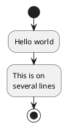

You are not forced to include `start`/`stop`; a diagram can begin or end on a plain
activity. But for readable, well-formed flows you normally want both. Here is the
difference between `stop` and `end`:

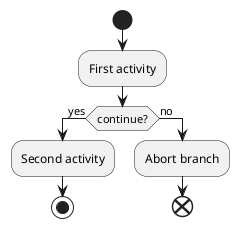

## Activities

An **activity** is the basic action node, written `:label;`. The trailing semicolon is
mandatory — it is what tells PlantUML the action is complete. Labels may span several
lines (just press return inside the `:` … `;`) and may use PlantUML's Creole markup for
**bold** (`**…**`), *italic* (`//…//`), monospace (`""…""`), underline (`__…__`) and
strikethrough (`--…--`), plus inline color tags.

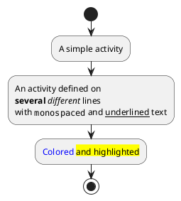

### Activity shapes (SDL / stereotypes)

You can change a node's shape by attaching a UML/SDL **stereotype** after the activity —
this is the modern, portable way to draw the classic Specification and Description
Language (SDL) shapes. Common stereotypes include `<<input>>`, `<<output>>`,
`<<procedure>>`, `<<load>>`, `<<save>>`, `<<continuous>>`, `<<task>>`, `<<object>>`,
`<<sendSignal>>`, `<<acceptEvent>>`, `<<timeEvent>>` and `<<trigger>>`:

```plantuml
@startuml
start
:Read request; <<input>>
:Process; <<procedure>>
:Load cache; <<load>>
:Persist result; <<save>>
:Emit response; <<output>>
stop
@enduml
```

## Conditionals: if / then / else / endif

A decision is written with `if (...) then (...)` … `endif`. The text in the first
parentheses is the **condition** shown in the diamond; the text in `then (...)` and
`else (...)` labels the outgoing branches. `else` is optional.

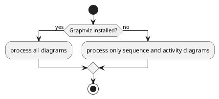

There are three equivalent ways to phrase a condition. `then` is one; `is` and `equals`
let you put the label on the branch differently:

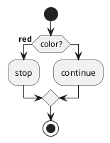

### Multiple branches with elseif

Chain conditions with `elseif (...) then (...)`. By default branches are laid out
side-by-side (horizontal). Add `!pragma useVerticalIf on` at the top to stack them
vertically, which is easier to read when there are many.

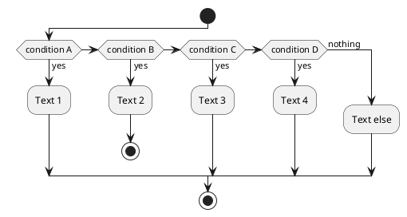

Vertical layout for the same idea:

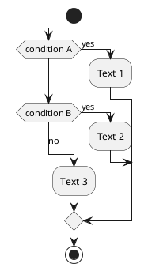

## Switch and case

When a single value fans out into many mutually exclusive outcomes, `switch (test?)`
with a series of `case (...)` clauses is clearer than a long `elseif` chain. Close it
with `endswitch`.

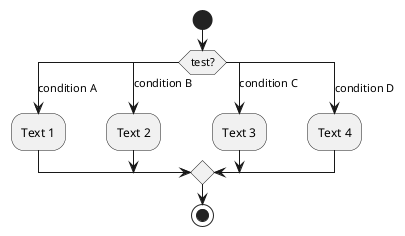

## Repeat loops

A `repeat` loop runs the body at least once, then tests a condition to decide whether to
loop again. The test lives on the `repeat while (...)` line. You can label the exit and
the loop-back branches with `is (...)` and `not (...)`.

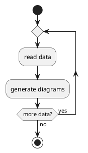

The loop-back arrow can carry an activity too. Put it after a `backward:` keyword so it
renders on the return path, and you may give the `repeat` a starting label:

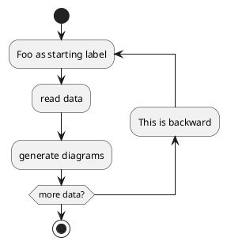

## While loops

A `while (...)` loop tests **before** running the body, so it may execute zero times.
Close it with `endwhile`. You can label the exit condition with `endwhile (label)` or the
loop entry with `is (label)`.

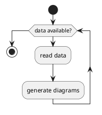

With an exit label and a backward action on the return path:

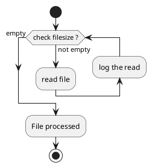

### break

Use `break` to jump out of a loop early from inside a branch:

```plantuml
@startuml
start
repeat
  :Test something;
  if (Something went wrong?) then (yes)
    :Error!; <<#pink>>
    break
  endif
  :Test ok;
repeat while (Something left?) is (yes) not (no)
:Done;
stop
@enduml
```

## Parallel flows: fork / fork again / end fork

A `fork` splits control into concurrent paths that all run in parallel; `fork again`
starts each additional path; `end fork` joins them back together.

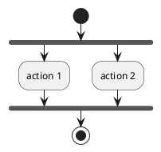

Instead of joining, `end merge` merges the branches without a synchronization bar. You
can also annotate the join bar with a UML *joinspec* such as `{or}` or `{and}`:

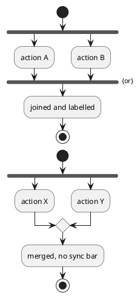

## Split processing

`split` is similar to `fork` but models a branching of the *token* rather than true
concurrency; it is the tool for multi-start and multi-end flows. Use `split again` for
each additional path and `end split` to rejoin.

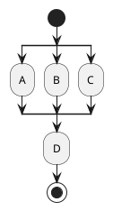

A **multi-end** flow: let some branches terminate independently with `detach` or `kill`
so they do not rejoin the main path:

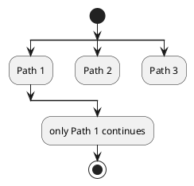

## detach and kill

`detach` removes the outgoing arrow from an action, leaving a dangling flow (useful for
"and this branch just ends here"). `kill` does the same but terminates the flow with a
final marker. Both are written on their own line right after the action they apply to.

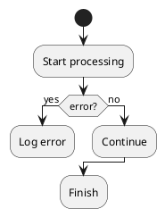

## Connectors (circle connectors)

A **connector** is a small labelled circle, written `(text)`, used to break a long flow
into pieces or to visually re-enter it elsewhere without drawing a long arrow. Connectors
can be colored by prefixing a color: `#blue:(B);`.

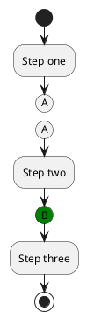

## goto and label (experimental)

The `label` / `goto` pair lets you jump to a named point in the flow — handy for cleanly
expressing "go back and retry". It is marked experimental in PlantUML, so treat it as a
convenience for special cases rather than a default building block. Declare a target with
`label name` and jump to it with `goto name`.

```plantuml
@startuml
title Point two queues/routes to the same activity
start
label sharedTarget
label lab1
:activity 1;
if (test) then
  goto lab1
else
endif
:activity 2;
stop
@enduml
```

## Swimlanes

**Swimlanes** partition the diagram into vertical columns, one per actor or system, so
you can see who does what. Switch lane simply by writing its name between pipes,
`|Lane|`; every activity after that line belongs to that lane. Change lanes as often as
you like; the columns are drawn automatically.

```plantuml
@startuml
|Customer|
start
:place order;
|Warehouse|
:pick items;
:pack box;
|Courier|
:ship parcel;
|Customer|
:receive parcel;
stop
@enduml
```

### Colored swimlanes and aliases

Give a lane a background color by prefixing it: `|#AntiqueWhite|Name|`. You can also
assign a short **alias** so later references are terse — `|#palegreen|f| Fisherman`
defines lane `f` titled "Fisherman"; afterwards `|f|` switches back to it.

```plantuml
@startuml
|#AntiqueWhite|Customer|
start
:submit request;
|#LightBlue|api| API Server
:validate request;
:enqueue job;
|#palegreen|w| Worker
:run job;
:store result;
|api|
:return response;
|Customer|
:read response;
stop
@enduml
```

## Notes

Attach a note to the previous activity with `note left` / `note right` … `end note` for
multi-line notes, or the one-liner `note left:` / `note right:`. A **floating** note is
detached from the flow: `floating note left: ...`.

```plantuml
@startuml
start
:Prepare data;
note right
  This note spans
  several //lines//
  and uses **markup**.
end note
:Process data;
note left: A single-line note
:Emit result;
floating note right: A floating note
stop
@enduml
```

## Arrows, labels and line styles

Because activities auto-connect, you rarely draw arrows by hand — but you can, to add a
label or restyle a link. A bare `->` on its own line adds text to the *next* connection.
Arrow style is set inside brackets: color `-[#blue]->`, plus `dashed`, `dotted`, `bold`
or `hidden` (an invisible spacer link). Combine them with a comma: `-[#green,dashed]->`.

```plantuml
@startuml
start
:foo1;
-> You can put text on arrows;
:foo2;
-[#blue]->
:foo3;
-[#green,dashed]-> dashed and green;
:foo4;
-[#red,bold]->
:foo5;
stop
@enduml
```

## Colors

Prefix an activity with `#color:` (or append the `<<#color>>` stereotype form) to fill
it. Named colors, hex colors and gradients (`#color1|color2` or `#color1/color2`) all
work. Inside a condition branch, `#pink:Error!;` colors just that node. (Note: when a
single colored `#color:label;` node would be the very last statement before a `stop`,
`end` or `break`, follow it with a plain activity or use the `:label; <<#color>>` form —
some PlantUML builds reject a lone colored node in terminal position.)

```plantuml
@startuml
start
:normal;
#HotPink:hot pink activity;
#lightgreen:pale green;
#red/yellow:diagonal gradient;
#blue|green:horizontal gradient;
stop
@enduml
```

## Grouping: partition, group, package, rectangle, card

You can visually box a set of activities. `partition` and `group` draw a titled frame;
`package`, `rectangle` and `card` are alternative frame styles. A partition can be
colored (`partition #lightGreen "Title" { ... }`) and made clickable with a link.

```plantuml
@startuml
start
partition Initialization {
  :read config file;
  :init internal variable;
}
partition #LightSkyBlue "Running the process" {
  :wait for event;
  :handle event;
}
group Cleanup {
  :flush buffers;
  :close files;
}
stop
@enduml
```

Alternative frame keywords — `package`, `rectangle`, `card`:

```plantuml
@startuml
start
package "A package" {
  :packaged activity;
}
rectangle "A rectangle" {
  :boxed activity;
}
card "A card" {
  :carded activity;
}
stop
@enduml
```

## Styling with the &lt;style&gt; block

Beyond per-node colors you can theme the whole diagram with a `<style>` block, targeting
`activityDiagram`, `activity`, `diamond`, `arrow`, `partition` and `note`.

```plantuml
@startuml
<style>
activityDiagram {
  BackgroundColor #33668E
  FontColor #FFFFFF
  FontSize 16
  BorderColor #33668E
  diamond {
    BackgroundColor #ccf
    LineColor #33668E
    FontColor green
  }
  arrow {
    FontColor gold
  }
}
</style>
start
:styled activity;
if (ok?) then (yes)
  :continue;
else (no)
  :abort;
endif
stop
@enduml
```

## Complete example: order fulfilment

Putting many features together — swimlanes, colors, a decision, a loop, a parallel
fork, notes and grouping:

```plantuml
@startuml
title Order fulfilment
|#AntiqueWhite|Customer|
start
:submit order;
|#LightBlue|Shop|
partition "Validation" {
  :check stock;
  if (in stock?) then (yes)
    #lightgreen:reserve items;
  else (no)
    #pink:notify out of stock;
    stop
  endif
}
:charge payment;
note right: idempotent, retried on failure
fork
  |#LightYellow|Warehouse|
  :pick & pack;
fork again
  |Shop|
  :send confirmation email;
end fork
|#LightYellow|Warehouse|
repeat
  :attempt shipment;
repeat while (carrier accepted?) is (no) not (yes)
|#AntiqueWhite|Customer|
:receive parcel;
stop
@enduml
```

## Render it via the API

Any of the examples above can be rendered through the API. Send the PlantUML source as
JSON to `POST /api/v1/render` and choose a `format` (`svg`, `png`, `txt`, `pdf`, …):

```bash
curl -s -X POST http://localhost:8080/api/v1/render \
  -H 'content-type: application/json' \
  -d '{"source":"@startuml\nstart\n:Hello world;\nif (continue?) then (yes)\n:Second activity;\nstop\nelse (no)\n:Abort;\nend\nendif\n@enduml","format":"svg"}' \
  -o activity.svg
```

The response streams the native media type (`image/svg+xml` here), so you can write it
straight to a file. Swap `"format":"svg"` for `"png"` or `"pdf"` to get other outputs.
