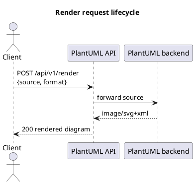
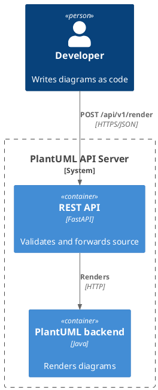

# REST API Reference

This page is the complete reference for the **PlantUML API Server** — a modern REST
wrapper around the official PlantUML Server (running **PlantUML v1.2026.8**). It does not
reinvent PlantUML; it exposes it elegantly: render diagrams to PNG/SVG/TXT/PDF, encode and
decode PlantUML URL tokens, and discover the bundled icon/architecture **libraries**,
**themes** and a curated **examples** gallery.

Everything below is generated from the live OpenAPI schema at
[`/openapi.json`](https://plantuml.joor.net/openapi.json), and every request/response shown
was captured against the live service. The interactive Swagger UI lives at
[`/docs`](https://plantuml.joor.net/docs).

- **Base URL:** `https://plantuml.joor.net`
- **API prefix:** `/api/v1`
- **Auth:** none required for the public endpoints documented here.
- **Content type:** all request bodies are `application/json`.

## Conventions

### Base URL and versioning

Every functional endpoint is namespaced under `/api/v1`. The un-prefixed operational
endpoints — [`/health`](#health-get-health) and [`/metrics`](#metrics-get-metrics) — sit at
the root so that simple uptime probes and Prometheus scrapers do not have to know the API
version. The current `api_version` is `1.0.0`; you can read it live from
[`/api/v1`](#api-discovery-get-api-v1) or `/health`.

### Media types

Most endpoints return `application/json`. The one exception is
[`/api/v1/render`](#render-a-diagram-post-api-v1-render), which returns the **native media
type** of the diagram you asked for — `image/png`, `image/svg+xml`, `text/plain` or
`application/pdf`. Binary responses are streamed as raw bytes, **never base64-encoded**, so
you save the response body directly to a file.

### Error model

All application-level errors follow an **RFC 7807-style problem detail** object
(`ErrorResponse`):

```json
{
  "type": "about:blank",
  "title": "Not Found",
  "status": 404,
  "detail": "Unknown library 'nope'"
}
```

| Field    | Type              | Meaning                                                        |
| -------- | ----------------- | -------------------------------------------------------------- |
| `type`   | string            | Problem type URI. Defaults to `about:blank`.                   |
| `title`  | string            | Short, human-readable summary of the problem type.            |
| `status` | integer           | The HTTP status code, repeated in the body.                    |
| `detail` | string \| null    | Human-readable explanation specific to this occurrence.        |

Request-shape errors (a missing or empty field, a wrong type) are caught **before** they
reach the renderer and come back as FastAPI's validation envelope (`HTTPValidationError`),
which is a different shape — a `detail` **array**:

```json
{
  "detail": [
    {
      "type": "string_too_short",
      "loc": ["body", "source"],
      "msg": "String should have at least 1 character",
      "input": "",
      "ctx": { "min_length": 1 }
    }
  ]
}
```

Both use HTTP **422**, so branch on the shape of `detail` (object vs. array) if you need to
tell "you sent malformed JSON" apart from "PlantUML could not parse your diagram".

### Common status codes

| Code | When it happens                                                                                   |
| ---- | ------------------------------------------------------------------------------------------------- |
| 200  | Success. For `/render`, the body is the diagram in the requested media type.                      |
| 404  | A path parameter (`{library}`, `{theme_id}`, `{example_id}`) did not match a known resource.       |
| 413  | The request body (your PlantUML source) exceeds the server's maximum accepted size.               |
| 422  | Either the JSON body failed validation, or the PlantUML source has a syntax error.                |
| 503  | The PlantUML backend is unreachable (down or restarting).                                          |
| 504  | The PlantUML backend accepted the job but did not finish rendering before the timeout.            |

## Endpoint index

| Method | Path                                   | Purpose                                    |
| ------ | -------------------------------------- | ------------------------------------------ |
| POST   | `/api/v1/render`                       | Render source to PNG/SVG/TXT/PDF/…         |
| POST   | `/api/v1/encode`                       | Encode source into a PlantUML URL token    |
| POST   | `/api/v1/decode`                       | Decode a PlantUML URL token back to source |
| GET    | `/api/v1/libraries`                    | List icon / architecture libraries         |
| GET    | `/api/v1/libraries/{library}`          | Get one library                            |
| GET    | `/api/v1/libraries/{library}/examples` | Examples that use a library                |
| GET    | `/api/v1/libraries/{library}/icons`    | A library's icon categories                |
| GET    | `/api/v1/themes`                       | List PlantUML themes                       |
| GET    | `/api/v1/themes/{theme_id}`            | Get one theme                              |
| GET    | `/api/v1/examples`                     | List curated examples                      |
| GET    | `/api/v1/examples/{example_id}`        | Get one example with render URLs           |
| GET    | `/api/v1`                              | API discovery / service metadata           |
| GET    | `/health`                              | Service + backend health                   |
| GET    | `/metrics`                             | Prometheus metrics                          |

---

## Rendering

### Render a diagram — `POST /api/v1/render`

Renders PlantUML source to the requested format and returns the **native media type**.
Submit ordinary PlantUML — the `theme` and `libraries` fields are conveniences that inject
lines into your source for you; they are never a replacement for PlantUML syntax.

#### Request body — `RenderRequest`

| Field       | Type              | Required | Default | Description                                                                                                   |
| ----------- | ----------------- | -------- | ------- | ------------------------------------------------------------------------------------------------------------- |
| `source`    | string            | **yes**  | —       | PlantUML source. Submit normal PlantUML, `@startuml … @enduml`. Minimum length 1.                              |
| `format`    | enum              | no       | `svg`   | Output format. One of `png`, `svg`, `txt`, `utxt`, `pdf`, `eps` (`RenderFormat`).                              |
| `theme`     | string \| null    | no       | `null`  | A PlantUML theme name, injected as `!theme <name>`. See [`/api/v1/themes`](#list-themes-get-api-v1-themes).    |
| `libraries` | string[] \| null  | no       | `null`  | Known library ids whose `!include` lines are injected for you. See [`/api/v1/libraries`](#list-libraries-get-api-v1-libraries). |
| `index`     | integer ≥ 0 \| null | no     | `null`  | Which diagram to render when the source contains multiple `@startuml` blocks (0 = the first).                 |

**About `format`.** `png`, `svg` and `pdf` produce their obvious media types. `txt`
produces ASCII art (`text/plain`); `utxt` is the Unicode-box-drawing variant; `eps` is
Encapsulated PostScript.

**About `theme` / `libraries`.** These exist so a caller can keep source minimal and pick a
skin or icon set out of band. Passing `libraries: ["awslib"]` prepends
`!include <awslib/AWSCommon>` to your source; passing `theme: "cerulean"` prepends
`!theme cerulean`. You can always write those lines yourself instead — the result is
identical.

**About `index`.** The first diagram is index `0`. Use it to pull one diagram out of a file
that concatenates several `@startuml`/`@enduml` blocks.

#### Responses

| Code | Media type(s)                                              | Body                          |
| ---- | ---------------------------------------------------------- | ----------------------------- |
| 200  | `image/png`, `image/svg+xml`, `text/plain`, `application/pdf` | The rendered diagram.       |
| 413  | `application/json`                                         | `ErrorResponse` — source too large. |
| 422  | `application/json`                                         | `ErrorResponse` — invalid PlantUML source (or `HTTPValidationError` for a bad body). |
| 503  | `application/json`                                         | `ErrorResponse` — PlantUML backend unavailable. |
| 504  | `application/json`                                         | `ErrorResponse` — render timed out. |

#### Example — render to SVG

```bash
curl -sS -X POST https://plantuml.joor.net/api/v1/render \
  -H 'content-type: application/json' \
  -d '{"source":"@startuml\nAlice -> Bob: Hello\n@enduml","format":"svg"}' \
  -o diagram.svg -D -
```

```
HTTP/2 200
content-type: image/svg+xml

<svg xmlns="http://www.w3.org/2000/svg" ... data-diagram-type="SEQUENCE" ...>
  ...
</svg>
```

#### Example — render to PNG with a theme

```bash
curl -sS -X POST https://plantuml.joor.net/api/v1/render \
  -H 'content-type: application/json' \
  -d '{"source":"@startuml\nAlice -> Bob: Hi\n@enduml","format":"png","theme":"cerulean"}' \
  -o diagram.png
# -> HTTP 200, content-type: image/png (binary bytes written to diagram.png)
```

#### Example — pick one diagram from a multi-block source

```bash
curl -sS -X POST https://plantuml.joor.net/api/v1/render \
  -H 'content-type: application/json' \
  -d '{"source":"@startuml\nA->B\n@enduml\n@startuml\nX->Y\n@enduml","format":"png","index":0}' \
  -o first.png
# -> HTTP 200, renders the first @startuml block
```

#### Error examples

Invalid source (**422**, `ErrorResponse`):

```bash
curl -sS -X POST https://plantuml.joor.net/api/v1/render \
  -H 'content-type: application/json' \
  -d '{"source":"this is not plantuml }{","format":"png"}'
```

```json
{
  "type": "about:blank",
  "title": "Unprocessable Entity",
  "status": 422,
  "detail": "Syntax Error? (Assumed diagram type: sequence)"
}
```

Empty `source` (**422**, `HTTPValidationError` — caught before the renderer):

```json
{
  "detail": [
    {
      "type": "string_too_short",
      "loc": ["body", "source"],
      "msg": "String should have at least 1 character",
      "input": "",
      "ctx": { "min_length": 1 }
    }
  ]
}
```

Other render-time failures return the same `ErrorResponse` shape with the matching status:
**413** (`"title": "Request Entity Too Large"` when the source exceeds the size limit),
**503** (`"title": "Service Unavailable"`, `"detail": "PlantUML backend unavailable"`) and
**504** (`"title": "Gateway Timeout"`, `"detail": "PlantUML render timed out"`).

#### A complete, renderable diagram

The lifecycle a `/render` call goes through, as a diagram this very docs page renders live:



---

## Encoding

PlantUML servers accept diagrams as a compact, URL-safe token (deflate-compressed then
mapped onto a PlantUML-specific alphabet). These two endpoints convert between raw source
and that token so you can build shareable image URLs, or recover source from a link.

### Encode source — `POST /api/v1/encode`

Encodes PlantUML source into the URL token and returns ready-to-use editor / PNG / SVG /
TXT URLs built from it.

#### Request body — `EncodeRequest`

| Field    | Type   | Required | Description                            |
| -------- | ------ | -------- | -------------------------------------- |
| `source` | string | **yes**  | PlantUML source to encode (min length 1). |

#### Response — `200`, `EncodeResponse`

| Field        | Type   | Description                                     |
| ------------ | ------ | ----------------------------------------------- |
| `encoded`    | string | The URL-safe encoded token.                     |
| `editor_url` | string | Link that opens the diagram in the live editor. |
| `png_url`    | string | Direct PNG render URL.                          |
| `svg_url`    | string | Direct SVG render URL.                          |
| `txt_url`    | string | Direct ASCII-art render URL.                    |

Errors: **422** (`HTTPValidationError`) if `source` is missing/empty.

```bash
curl -sS -X POST https://plantuml.joor.net/api/v1/encode \
  -H 'content-type: application/json' \
  -d '{"source":"@startuml\nAlice -> Bob: Hello\n@enduml"}'
```

```json
{
  "encoded": "SoWkIImgAStDuNBCoKnELT2rKt3AJx9Iy4ZDoSddSaZDIm7A0G00",
  "editor_url": "https://plantuml.joor.net/editor/uml/SoWkIImgAStDuNBCoKnELT2rKt3AJx9Iy4ZDoSddSaZDIm7A0G00",
  "png_url": "https://plantuml.joor.net/editor/png/SoWkIImgAStDuNBCoKnELT2rKt3AJx9Iy4ZDoSddSaZDIm7A0G00",
  "svg_url": "https://plantuml.joor.net/editor/svg/SoWkIImgAStDuNBCoKnELT2rKt3AJx9Iy4ZDoSddSaZDIm7A0G00",
  "txt_url": "https://plantuml.joor.net/editor/txt/SoWkIImgAStDuNBCoKnELT2rKt3AJx9Iy4ZDoSddSaZDIm7A0G00"
}
```

### Decode a token — `POST /api/v1/decode`

Decodes a PlantUML URL token back into diagram source. It understands the standard deflate
form as well as the `~1` (plain deflate) and `~h` (hex) prefixed forms.

#### Request body — `DecodeRequest`

| Field     | Type   | Required | Description                     |
| --------- | ------ | -------- | ------------------------------- |
| `encoded` | string | **yes**  | The token to decode (min length 1). |

#### Response — `200`, `DecodeResponse`

| Field    | Type   | Description               |
| -------- | ------ | ------------------------- |
| `source` | string | The decoded PlantUML source. |

Errors: **422** (`ErrorResponse`) if the token is malformed.

```bash
curl -sS -X POST https://plantuml.joor.net/api/v1/decode \
  -H 'content-type: application/json' \
  -d '{"encoded":"SyfFKj2rKt3CoKnELR1Io4ZDoSa70000"}'
```

```json
{ "source": "Bob -> Alice : hello" }
```

Malformed token (**422**):

```json
{
  "type": "about:blank",
  "title": "Unprocessable Entity",
  "status": 422,
  "detail": "Could not decode token: Error -3 while decompressing data: invalid stored block lengths"
}
```

---

## Libraries

The service bundles PlantUML's standard-library icon and architecture sets. Under
`SECURITY_PROFILE=INTERNET` only these **bundled, angle-bracket** includes are allowed —
`!include <awslib/AWSCommon>` and friends. Remote `!includeurl` to arbitrary hosts is
blocked, so discover what is available through these endpoints rather than pulling includes
off the internet. At the time of writing there are **13** libraries: `uml`, `c4`, `awslib`,
`azure`, `kubernetes`, `osa`, `material`, `office`, `logos`, `archimate`, `elastic`,
`tupadr3`, `gcp`.

### List libraries — `GET /api/v1/libraries`

Returns an array of `Library` objects.

#### `Library` object

| Field         | Type            | Description                                             |
| ------------- | --------------- | ------------------------------------------------------- |
| `id`          | string          | Stable identifier used in the `libraries` render field and in path params. |
| `name`        | string          | Human-readable name.                                    |
| `builtin`     | boolean         | Whether the library ships with the PlantUML stdlib.     |
| `description` | string          | What the library covers.                                |
| `include`     | string          | The exact `!include` line(s) that load it.              |
| `docs_url`    | string \| null  | Upstream documentation link.                            |
| `categories`  | string[]        | Top-level icon/element groupings.                       |

```bash
curl -sS https://plantuml.joor.net/api/v1/libraries
```

```json
[
  {
    "id": "uml",
    "name": "Core UML",
    "builtin": true,
    "description": "Classic UML — sequence, class, component, deployment, activity, state, use-case, object and timing diagrams. No include required.",
    "include": "",
    "docs_url": "https://plantuml.com/",
    "categories": ["sequence", "class", "component", "deployment", "activity", "state"]
  },
  {
    "id": "c4",
    "name": "C4 model",
    "builtin": true,
    "description": "C4 architecture-as-code (Context, Container, Component, Deployment, Dynamic) via the bundled C4-PlantUML macros.",
    "include": "!include <C4/C4_Container>",
    "docs_url": "https://github.com/plantuml-stdlib/C4-PlantUML",
    "categories": ["C4_Context", "C4_Container", "C4_Component", "C4_Deployment", "C4_Dynamic"]
  }
]
```

### Get one library — `GET /api/v1/libraries/{library}`

Returns a single `Library` object. Responds **404** for an unknown id, **422** for a
malformed path value.

```bash
curl -sS https://plantuml.joor.net/api/v1/libraries/awslib
```

```json
{
  "id": "awslib",
  "name": "AWS Architecture Icons",
  "builtin": true,
  "description": "Official AWS Architecture icons (modern awslib) — Compute, Storage, Database, Networking, groups and more.",
  "include": "!include <awslib/AWSCommon>",
  "docs_url": "https://github.com/awslabs/aws-icons-for-plantuml",
  "categories": ["Compute", "Storage", "Database", "Networking", "Groups", "Analytics"]
}
```

Unknown library (**404**):

```json
{ "type": "about:blank", "title": "Not Found", "status": 404, "detail": "Unknown library 'nope'" }
```

### Examples that use a library — `GET /api/v1/libraries/{library}/examples`

Returns the curated `Example` objects (full `source` included) that exercise the given
library. Responds **404** for an unknown id.

#### `Example` object

| Field         | Type      | Description                                    |
| ------------- | --------- | ---------------------------------------------- |
| `id`          | string    | Example identifier.                            |
| `title`       | string    | Short title.                                   |
| `description` | string    | What the example shows.                        |
| `category`    | string    | Gallery category (e.g. `C4`, `AWS`).           |
| `libraries`   | string[]  | Library ids the example depends on.            |
| `source`      | string    | Complete, renderable PlantUML source.          |

```bash
curl -sS https://plantuml.joor.net/api/v1/libraries/c4/examples
```

```json
[
  {
    "id": "c4-context",
    "title": "C4 — System Context",
    "description": "Level-1 C4 context diagram using the bundled C4-PlantUML macros.",
    "category": "C4",
    "libraries": ["c4"],
    "source": "@startuml\n!include <C4/C4_Context>\nPerson(user, \"Developer\", \"Creates diagrams as code\")\nSystem(puml, \"PlantUML API\", \"Renders UML & architecture diagrams\")\nSystem_Ext(ci, \"CI/CD\", \"Generates diagrams in pipelines\")\nRel(user, puml, \"Uses\", \"HTTPS/REST\")\nRel(ci, puml, \"Calls\", \"HTTPS/REST\")\n@enduml"
  }
]
```

### A library's icon categories — `GET /api/v1/libraries/{library}/icons`

Returns the top-level icon categories for a library. Full per-icon sprite enumeration is
best done through the editor's autocomplete; this endpoint gives you the groupings and a
hint about how to compose an include path. Responds **404** for an unknown id.

```bash
curl -sS https://plantuml.joor.net/api/v1/libraries/awslib/icons
```

```json
{
  "library": "awslib",
  "name": "AWS Architecture Icons",
  "include": "!include <awslib/AWSCommon>",
  "categories": ["Compute", "Storage", "Database", "Networking", "Groups", "Analytics"],
  "docs_url": "https://github.com/awslabs/aws-icons-for-plantuml",
  "note": "Use the categories with the library include path, e.g. `!include <awslib/<Category>/<Icon>>`. Explore full icon names in the editor."
}
```

---

## Themes

Themes restyle a diagram without touching its structure. Apply one with `!theme <name>` in
your source, or via the `theme` field of `/api/v1/render`. There are **39** bundled themes
(e.g. `amiga`, `aws-orange`, `black-knight`, `bluegray`, `cerulean`, `cerulean-outline`,
`crt-amber`, …).

### List themes — `GET /api/v1/themes`

Returns an array of `Theme` objects.

#### `Theme` object

| Field            | Type   | Description                                        |
| ---------------- | ------ | -------------------------------------------------- |
| `id`             | string | Theme identifier, used with `!theme` and in path params. |
| `name`           | string | Display name.                                      |
| `preview_source` | string | A tiny PlantUML source demonstrating the theme.    |

```bash
curl -sS https://plantuml.joor.net/api/v1/themes
```

```json
[
  {
    "id": "cerulean",
    "name": "cerulean",
    "preview_source": "@startuml\n!theme cerulean\nAlice -> Bob: Hello\nBob --> Alice: Hi!\n@enduml"
  }
]
```

### Get one theme — `GET /api/v1/themes/{theme_id}`

Returns a single `Theme`. Responds **404** for an unknown id, **422** for a malformed path
value.

```bash
curl -sS https://plantuml.joor.net/api/v1/themes/cerulean
```

```json
{
  "id": "cerulean",
  "name": "cerulean",
  "preview_source": "@startuml\n!theme cerulean\nAlice -> Bob: Hello\nBob --> Alice: Hi!\n@enduml"
}
```

Feed a theme's `preview_source` straight into `/api/v1/render` to see it, or apply it to
your own diagram by adding `!theme cerulean` right after `@startuml`.

---

## Examples

A curated gallery covering UML, AWS, Azure, Kubernetes, C4, GCP, network/security, icon
libraries, themes and PlantUML's non-UML diagram types. There are **20** examples across
categories including `UML`, `C4`, `AWS`, `Azure`, `Kubernetes`, `GCP`, `Network & Security`,
`Icons & Libraries`, `Themes` and `Diagrams as Code`.

### List examples — `GET /api/v1/examples`

Returns an array of lightweight `ExampleSummary` objects (no `source` — fetch a single
example to get the source and render URLs).

#### `ExampleSummary` object

| Field         | Type      | Description                       |
| ------------- | --------- | --------------------------------- |
| `id`          | string    | Example identifier.               |
| `title`       | string    | Short title.                      |
| `description` | string    | What it shows.                    |
| `category`    | string    | Gallery category.                 |
| `libraries`   | string[]  | Library ids it depends on.        |

```bash
curl -sS https://plantuml.joor.net/api/v1/examples
```

```json
[
  {
    "id": "sequence-basic",
    "title": "Basic sequence diagram",
    "description": "A minimal request/response sequence — the classic PlantUML hello world.",
    "category": "UML",
    "libraries": ["uml"]
  }
]
```

### Get one example — `GET /api/v1/examples/{example_id}`

Returns an `ExampleDetail`: the full source plus a pre-computed token, direct render/editor
URLs, and a ready-to-POST sample request. Responds **404** for an unknown id.

#### `ExampleDetail` object

| Field         | Type      | Description                                                        |
| ------------- | --------- | ------------------------------------------------------------------ |
| `id`          | string    | Example identifier.                                                |
| `title`       | string    | Short title.                                                       |
| `description` | string    | What it shows.                                                     |
| `category`    | string    | Gallery category.                                                  |
| `libraries`   | string[]  | Library ids it depends on.                                         |
| `source`      | string    | Complete, renderable PlantUML source.                              |
| `encoded`     | string    | The pre-computed URL token for `source`.                           |
| `svg_url`     | string    | Direct SVG render URL.                                             |
| `png_url`     | string    | Direct PNG render URL.                                             |
| `editor_url`  | string    | Opens the example in the live editor.                             |
| `api_request` | object    | A ready-to-use `RenderRequest` body you can POST to `/api/v1/render`. |

```bash
curl -sS https://plantuml.joor.net/api/v1/examples/c4-context
```

```json
{
  "id": "c4-context",
  "title": "C4 — System Context",
  "description": "Level-1 C4 context diagram using the bundled C4-PlantUML macros.",
  "category": "C4",
  "libraries": ["c4"],
  "source": "@startuml\n!include <C4/C4_Context>\nPerson(user, \"Developer\", ...)\n@enduml",
  "encoded": "POv1Yy8m48Nl_HMpFKWNX5uyog94KK6XjFKi8Nti1jAqJAQ...",
  "svg_url": "https://plantuml.joor.net/editor/svg/POv1Yy8m48Nl_HMpFKWNX5uyog94KK6X...",
  "png_url": "https://plantuml.joor.net/editor/png/POv1Yy8m48Nl_HMpFKWNX5uyog94KK6X...",
  "editor_url": "https://plantuml.joor.net/editor/uml/POv1Yy8m48Nl_HMpFKWNX5uyog94KK6X...",
  "api_request": { "source": "@startuml\n!include <C4/C4_Context>\n...\n@enduml", "format": "svg" }
}
```

Unknown example (**404**):

```json
{ "type": "about:blank", "title": "Not Found", "status": 404, "detail": "Unknown example 'nope'" }
```

A C4 container diagram in the spirit of the gallery, rendered live on this page:



---

## System

### API discovery — `GET /api/v1`

Service metadata plus links to the API's main entry points. Handy for a client to bootstrap
without hard-coding paths. Returns an `ApiInfo` object.

#### `ApiInfo` object

| Field              | Type           | Description                              |
| ------------------ | -------------- | ---------------------------------------- |
| `service`          | string         | Service name.                            |
| `api_version`      | string         | REST API version.                        |
| `plantuml_version` | string \| null | Version of the PlantUML backend.         |
| `openapi`          | string         | Path to the OpenAPI schema.              |
| `docs`             | string         | Path to the Swagger UI.                  |
| `editor`           | string         | Path to the live editor.                 |
| `health`           | string         | Path to the health endpoint.             |
| `metrics`          | string         | Path to the Prometheus metrics endpoint. |
| `libraries`        | string         | Path to the libraries listing.           |
| `themes`           | string         | Path to the themes listing.              |
| `examples`         | string         | Path to the examples listing.            |

```bash
curl -sS https://plantuml.joor.net/api/v1
```

```json
{
  "service": "PlantUML API Server",
  "api_version": "1.0.0",
  "plantuml_version": "1.2026.8",
  "openapi": "/openapi.json",
  "docs": "/docs",
  "editor": "/editor",
  "health": "/health",
  "metrics": "/metrics",
  "libraries": "/api/v1/libraries",
  "themes": "/api/v1/themes",
  "examples": "/api/v1/examples"
}
```

### Health check — `GET /health`

Reports overall service health plus the PlantUML backend's status and version. It
**always returns HTTP 200** so trivial probes can simply read the JSON body rather than
branch on the status code. Returns a `HealthResponse`.

#### `HealthResponse` object

| Field         | Type          | Description                                           |
| ------------- | ------------- | ----------------------------------------------------- |
| `status`      | string        | Overall service status: `healthy` or `degraded`.     |
| `api_version` | string        | REST API version.                                     |
| `plantuml`    | `BackendHealth` | Nested backend status.                              |

`BackendHealth`: `status` (`healthy` | `unhealthy`) and `version` (string | null, the
running PlantUML version).

```bash
curl -sS https://plantuml.joor.net/health
```

```json
{
  "status": "healthy",
  "api_version": "1.0.0",
  "plantuml": { "status": "healthy", "version": "1.2026.8" }
}
```

When the backend is down the top-level `status` flips to `degraded` and `plantuml.status`
to `unhealthy` — but the HTTP code stays **200**, so alert on the body, not the code.

### Metrics — `GET /metrics`

Exposes Prometheus metrics in the standard text exposition format (`text/plain`). Alongside
the default Python/process collectors you get service-specific series:

| Metric                                     | Type      | Meaning                                              |
| ------------------------------------------ | --------- | ---------------------------------------------------- |
| `http_requests_total`                      | counter   | Total HTTP requests.                                 |
| `http_request_duration_seconds`            | histogram | HTTP request duration.                               |
| `plantuml_render_requests_total`           | counter   | Total diagram render requests.                       |
| `plantuml_render_duration_seconds`         | histogram | Diagram render duration.                             |
| `plantuml_render_errors_total`             | counter   | Total diagram render errors.                         |
| `plantuml_backend_up`                      | gauge     | `1` if the PlantUML backend is reachable, else `0`.  |
| `plantuml_backend_request_duration_seconds`| histogram | Duration of requests made to the PlantUML backend.   |
| `plantuml_api_info`                        | gauge     | Build/version info (labels carry the version).       |

```bash
curl -sS https://plantuml.joor.net/metrics
```

```
# HELP plantuml_render_requests_total Total diagram render requests.
# TYPE plantuml_render_requests_total counter
plantuml_render_requests_total 42.0
# HELP plantuml_backend_up 1 if the PlantUML backend is reachable, else 0.
# TYPE plantuml_backend_up gauge
plantuml_backend_up 1.0
```

Point a Prometheus scrape job at `/metrics` to track render throughput, latency, error rate
and backend availability.

---

## Quick recipes

**Render and open an SVG in one shot:**

```bash
curl -sS -X POST https://plantuml.joor.net/api/v1/render \
  -H 'content-type: application/json' \
  -d '{"source":"@startuml\nAlice -> Bob: Hello\n@enduml","format":"svg"}' \
  -o out.svg && xdg-open out.svg
```

**Build a shareable image link from source (Python):**

```python
import requests

BASE = "https://plantuml.joor.net"
src = "@startuml\nAlice -> Bob: Hello\n@enduml"

# Encode once, reuse the URLs anywhere.
r = requests.post(f"{BASE}/api/v1/encode", json={"source": src}, timeout=40)
r.raise_for_status()
print(r.json()["png_url"])
```

**Render straight to bytes (Python):**

```python
import requests

BASE = "https://plantuml.joor.net"
body = {"source": "@startuml\nAlice -> Bob: Hi\n@enduml", "format": "png"}
r = requests.post(f"{BASE}/api/v1/render", json=body, timeout=40)
r.raise_for_status()
open("diagram.png", "wb").write(r.content)  # native bytes, not base64
```
