# Architecture Icon Libraries

PlantUML can do far more than boxes and arrows. Bundled with every release is the
**PlantUML Standard Library (stdlib)** — a large collection of ready-made icon sets and
modeling macros for AWS, Azure, Kubernetes, C4, GCP, ArchiMate and more. With a single
`!include` line you get vendor-accurate icons, colours and helper macros, so your
"architecture as code" diagrams look like the reference diagrams the cloud vendors
publish, without hand-drawing a single shape.

This page explains how the standard library works, then walks through every architecture
library the API server exposes — with the exact include paths, the macro/sprite
convention for each, the pitfalls that trip people up, and validated examples you can copy
straight into a `plantuml` fence.

> Every `plantuml` example on this page was rendered against the live API and returns
> HTTP 200 under `SECURITY_PROFILE=INTERNET`. You can paste any of them as-is.

## How the standard library works

The stdlib follows the "C standard library" idea: a set of files shipped **inside**
`plantuml.jar` that you pull in with an angle-bracket include. The syntax mirrors C's
`#include <stdio.h>`:

```text
!include <library/path/File>
```

Because the files are bundled, no network request leaves the server — which is exactly why
they work under the locked-down `INTERNET` security profile while remote includes do not.

### Angle brackets vs. quotes vs. URLs

There are three include forms in PlantUML, and only one of them is safe here:

- `!include <awslib/AWSCommon>` — **angle brackets**: resolves against the bundled stdlib.
  This is the form you want. The trailing `.puml` extension is optional.
- `!include "myfile.puml"` — **quotes**: a local file on the server's filesystem. Not
  useful through the API (you have no filesystem to put files on).
- `!includeurl https://.../file.puml` — **remote URL**: fetches from an arbitrary host.
  **Blocked** under `SECURITY_PROFILE=INTERNET`. Many upstream READMEs (notably the C4
  project) show this form — ignore it and use the bundled `<...>` equivalent instead.

> Rule of thumb for this API: if an include does not start with `<`, it will not work.

### Sprites vs. macros — the two flavours of icon library

Every architecture library gives you icons in one of two styles. Knowing which style a
library uses tells you how to place an icon.

- **Sprites** are raw monochrome (or coloured) images embedded in the include. You place
  them with the `<$spriteName>` syntax **inside a label**, e.g. inside a `rectangle`:

  ```text
  rectangle "<$react>\nFrontend" as fe
  ```

  Libraries like `logos` and `material` are sprite-only: there is no helper function, you
  just drop `<$name>` wherever text is allowed.

- **Macros** are helper functions defined in a `common`/`Common` file that draw a fully
  styled element — icon plus label plus colour plus a PlantUML alias you can connect. For
  example the AWS library gives you `EC2(alias, "label", "tech")`. Macros are the richer,
  more convenient option and are what the AWS, Azure, C4, GCP, ArchiMate, k8s and tupadr3
  libraries are built around.

Most macro libraries are built on top of sprites, so even in a macro library you can often
still reference `<$icon>` directly if you want just the picture.

### Discovering what is available

The API server exposes a discovery endpoint that lists every architecture library it
supports, with the canonical include statement for each:

```bash
curl -s https://plantuml.joor.net/api/v1/libraries | jq .
```

Each entry has fields like `id`, `name`, `builtin`, `description`, `include`, `docs_url`
and `categories`. Every architecture library on this page corresponds to one of those
entries, and the curated `GET /api/v1/examples` endpoint has a matching runnable example
for each.

To explore from *inside* PlantUML itself (for example locally with the jar), these
built-in helpers list the shipped content:

```bash
# print the full stdlib manifest (all libraries + versions)
java -jar plantuml.jar -stdlib

# extract every stdlib source file to disk for browsing
java -jar plantuml.jar -extractstdlib
```

And inside a diagram, `@startuml … listsprites … @enduml` prints all sprites available
after your includes — handy when you are hunting for the exact sprite name in a library.
The upstream catalogue lives at <https://plantuml.com/stdlib>.

---

## AWS (`awslib` — modern icons)

`awslib` is the current, maintained AWS icon set (the older `aws` namespace still exists
but `awslib` matches today's AWS Architecture Icons). You always start with
`<awslib/AWSCommon>`, then include one file per service you need. Service files are grouped
into folders that mirror the AWS console categories (`Compute`, `Database`, `Storage`,
`Networking`, `ApplicationIntegration`, …).

**Convention.** The macro name equals the icon file name, and takes an alias, a label and a
"technology" string: `EC2(alias, "label", "tech")`. The tech string may be empty (`""`).
Container/grouping boxes come from the `Groups` folder — `<awslib/Groups/AWSCloud>` defines
`AWSCloudGroup(alias){ ... }`, which you wrap around the enclosed elements.

**Pitfalls.**
- Include `<awslib/AWSCommon>` before any service file — it defines the macros the service
  files rely on.
- Add `!include <awslib/AWSSimplified>` for the clean, monochrome "simplified" look that
  drops the busy service colours.

A minimal example — one compute node writing to storage:

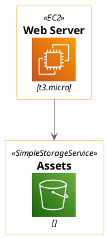

A richer example using a **group** container to represent the AWS Cloud boundary:

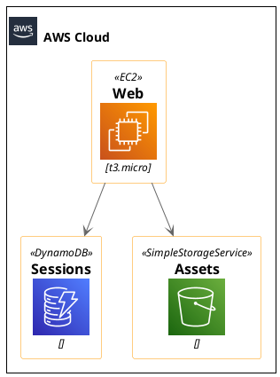

A serverless request path, this time with the simplified look:

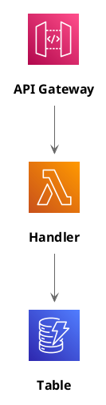

---

## Azure (`azure`)

The Azure library covers Microsoft's cloud services, organised into folders that follow the
Azure portal (`Compute`, `Databases`, `Containers`, `Networking`, `Storage`, …). As with
AWS you begin with a common file, `<azure/AzureCommon>`.

**Convention.** Macros take `Macro(alias, "label", "tech")`, e.g.
`AzureVirtualMachine(vm, "VM", "Linux")`.

**Pitfalls.** Azure's file layout and macro casing are inconsistent, so watch two things:
- `AzureAppService` lives under `azure/Compute/`, **not** `azure/Web/` where you might
  expect it.
- The file is `AzureSQLDatabase` (upper-case `SQL`) but the **macro** is `AzureSqlDatabase`
  (camelCase). Include the upper-case file, call the camelCase macro.

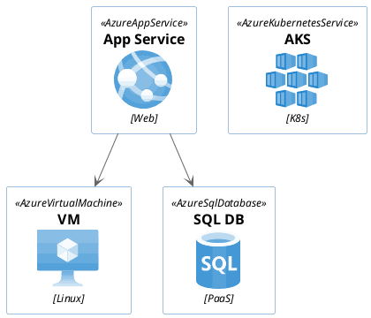

---

## Kubernetes (`k8s` — macros)

Kubernetes ships in two namespaces and this trips almost everyone up. Use **`k8s`** — the
macro library — for anything you want to label and connect.

**Convention.** Start with `<k8s/Common>`, then include resource files from `<k8s/OSS/...>`
(open-source Kubernetes) or the coloured `<k8s/Blue/...>` / `<k8s/Green/...>` variants.
Macros take `Macro(alias, "name", "detail")`, e.g. `KubernetesPod(pod, "web-pod", "")`.

**Pitfall.** Do **not** reach for `<kubernetes/...>` — that namespace contains only raw
sprite sheets with no macros. If you did want the sprite sheet approach it looks like
`!include <kubernetes/k8s-sprites-unlabeled-25pct>` followed by `<$pod>`, `<$master>`, etc.
For labelled, connectable icons, `<k8s/...>` is the one you want.

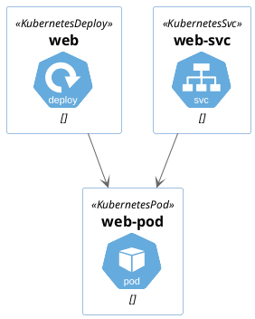

---

## C4 model (`C4`)

C4 is not an icon set — it is a modeling notation (Context, Container, Component, Code) for
describing software architecture at four zoom levels. The stdlib bundles Simon Brown's
official C4-PlantUML macros.

**Files.** Pick the file for the level you are drawing:
`<C4/C4_Context>`, `<C4/C4_Container>`, `<C4/C4_Component>`, `<C4/C4_Deployment>`,
`<C4/C4_Dynamic>`, `<C4/C4_Sequence>`. Each file includes the ones below it, so
`C4_Container` gives you the Context macros too.

**Macros.** The building blocks are `Person`, `System`, `System_Ext`, `Container`,
`ContainerDb`, `Component`, boundary wrappers `System_Boundary` / `Container_Boundary`, and
relationships `Rel` plus the directional hints `Rel_U`, `Rel_D`, `Rel_L`, `Rel_R` (up /
down / left / right) to steer layout. `LAYOUT_WITH_LEGEND()` adds an auto-generated legend;
`LAYOUT_TOP_DOWN()` / `LAYOUT_LEFT_RIGHT()` change flow direction.

**Pitfall.** The upstream C4 README shows `!include https://raw.githubusercontent.com/.../C4_Context.puml`.
That remote form is **blocked** under the INTERNET profile — always use the bundled
`<C4/...>` include instead.

A container diagram with a system boundary and a legend:

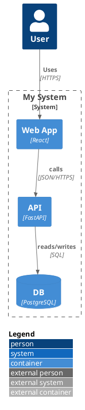

A higher-level system context diagram, using `System_Ext` for a third-party system:

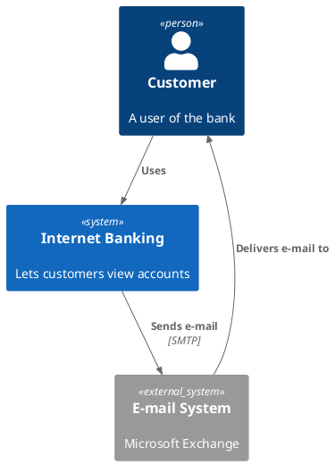

---

## Google Cloud Platform (`gcp` — bundled, snake_case)

The GCP library provides Google Cloud's product icons. Start with `<gcp/GCPCommon>`, then
include one service file per product.

**Convention.** Macros take `Macro(alias, "label", "tech")`, e.g.
`Compute_Engine(vm, "Compute Engine", "VM")`.

**Pitfall — mixed casing.** The **folders** are CamelCase (`Compute`, `Storage`,
`Networking`, `Databases`) but the **service files and macros** are snake_case
(`Compute_Engine`, `Cloud_Storage`, `Cloud_SQL`, `Kubernetes_Engine`). So the include path
mixes both: `<gcp/Compute/Compute_Engine>`.

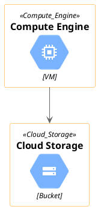

---

## Open Security Architecture / network (`osa`)

`osa` is the Open Security Architecture icon set — desktops, servers, firewalls, network
gear and other security/infrastructure symbols. Icons are grouped by category folder
(`desktop`, `firewall`, `database`, `network`, …).

**Convention.** The macro is the UPPERCASE of the icon name: including
`<osa/firewall/firewall>` gives you `FIREWALL(alias, "label")`.

**Pitfall.** OSA depends on a helper (`PUML_ENTITY`) that lives in the AWS common file, so
you must `!include <aws/common>` **first**, before any `osa/...` include. Note this is the
older lowercase `aws/common`, not `awslib/AWSCommon`.

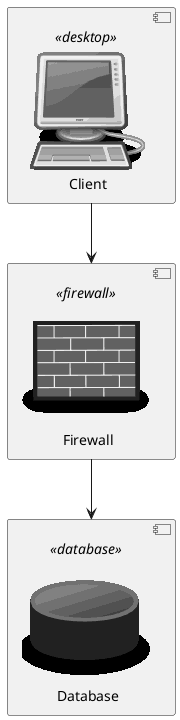

---

## Material icons (`material2.1.19` — sprites)

Google's Material Design icon set — a big general-purpose collection of UI/system glyphs.
This is a **sprite** library: there is one file per icon plus a `common` file.

**Convention.** Include `<material2.1.19/common>` first, then one file per icon
(`<material2.1.19/folder>`). Reference the sprite in a label as `<$folder>`. For a fully
styled entity there is also `SPRITE_ENT_L(alias, stereo, "label", icon, "#color")`.

**Pitfall — use the versioned namespace.** In this build you must use the versioned
`material2.1.19` path. The unversioned `<material/...>` namespace and its `MA_*` macros are
broken here, so stick to `material2.1.19` and the `<$icon>` sprite form.

```plantuml
@startuml
!include <material2.1.19/common>
!include <material2.1.19/folder>
rectangle "Documents\n<$folder>" as docs
@enduml
```

---

## Office icons (`office`, needs tupadr3)

Microsoft Office / infrastructure style icons — servers, devices, users, clouds — grouped
by folder (`Servers`, `Devices`, `Users`, `Concepts`, …).

**Convention.** The macro is `OFF_<NAME>`, e.g. `OFF_DATABASE_SERVER(db, "Primary DB")`.

**Pitfall.** The Office icons are built on the tupadr3 helpers, so you must
`!include <tupadr3/common>` **first**.

```plantuml
@startuml
!include <tupadr3/common>
!include <office/Servers/database_server>
OFF_DATABASE_SERVER(db, "Primary DB")
@enduml
```

---

## Technology logos (`logos` — sprites, no macros)

The `logos` library is a flat collection of 300+ brand and technology logos — languages,
frameworks, databases, cloud vendors, tools. Great for lightweight "tech stack" diagrams.

**Convention.** This is the simplest library of all: no common file, no macros, flat
folder. Include one file per logo (`<logos/react>`) and reference it as `<$react>` inside
any label.

**Pitfall.** Because there are no macros there is nothing to connect to directly — wrap the
sprite in a `rectangle "..." as alias` and connect the aliases, as below.

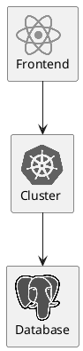

---

## Devicons & Font Awesome (`tupadr3`)

`tupadr3` is a bundle of several popular icon fonts wrapped as PlantUML macros: Font
Awesome (v4 and v5), Devicons (v1 and v2), and Material. It is the go-to for developer-tool
and general-purpose icons, and — as seen above — several other libraries (Office) build on
its common file.

**Convention.** Always `!include <tupadr3/common>` first, then one file per icon from the
relevant sub-folder. Each icon-font uses its own macro prefix:

- `FA5_*` — Font Awesome 5 (`<tupadr3/font-awesome-5/server>` → `FA5_SERVER(...)`)
- `FA_*` — Font Awesome 4
- `DEV_*` — Devicons (`<tupadr3/devicons/mysql>` → `DEV_MYSQL(...)`)
- `DEV2_*` — Devicons 2
- `MD_*` — Material

Macros take `Macro(alias, "label")` (some accept a colour/scale argument too).

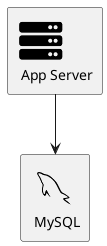

---

## ArchiMate (`archimate`)

ArchiMate is the Open Group's enterprise-architecture modeling language, covering the
Business, Application and Technology layers. The stdlib bundles the whole notation in a
single file.

**Convention.** One include — `<archimate/Archimate>` — brings in everything. Elements are
named `<Layer>_<Type>(alias, "label")`, e.g. `Business_Actor`, `Application_Component`,
`Technology_Node`, `Business_Service`, `Application_Service`. Relationships use `Rel_<Type>`
macros that map to ArchiMate's relationship set: `Rel_Serving`, `Rel_Assignment`,
`Rel_Access`, `Rel_Realization`, `Rel_Triggering`, `Rel_Composition`, and so on.

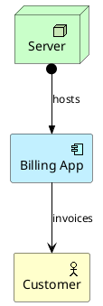

---

## Quick reference

| Library | Include first | Icon style | Macro / sprite form | Key pitfall |
|---|---|---|---|---|
| AWS | `<awslib/AWSCommon>` | macros | `EC2(a,"l","t")`; groups `AWSCloudGroup(a){}` | add `<awslib/AWSSimplified>` for clean look |
| Azure | `<azure/AzureCommon>` | macros | `AzureVirtualMachine(a,"l","t")` | `AppService` is under `Compute/`; macro `AzureSqlDatabase` |
| Kubernetes | `<k8s/Common>` | macros | `KubernetesPod(a,"n","d")` | use `<k8s/...>`, not `<kubernetes/...>` |
| C4 | `<C4/C4_Container>` (etc.) | macros | `Container`, `Rel`, `LAYOUT_WITH_LEGEND()` | remote `!include https://...` is blocked |
| GCP | `<gcp/GCPCommon>` | macros | `Compute_Engine(a,"l","t")` | CamelCase folders, snake_case files/macros |
| OSA | `<aws/common>` then `<osa/...>` | macros | `FIREWALL(a,"l")` | needs `<aws/common>` first |
| Material | `<material2.1.19/common>` | sprites | `<$folder>` | use versioned `material2.1.19` |
| Office | `<tupadr3/common>` then `<office/...>` | macros | `OFF_DATABASE_SERVER(a,"l")` | needs `<tupadr3/common>` first |
| Logos | `<logos/name>` | sprites | `<$name>` in a label | no macros; wrap in `rectangle` |
| Devicons/FontAwesome | `<tupadr3/common>` | macros | `FA5_SERVER`, `DEV_MYSQL`, … | prefix per font family |
| ArchiMate | `<archimate/Archimate>` | macros | `Business_Actor`, `Rel_Serving` | one include for everything |

**Discover more.** `GET /api/v1/libraries` lists every supported library with its canonical
include statement, and `GET /api/v1/examples` has a runnable example for each. The upstream
catalogue is at <https://plantuml.com/stdlib>.
