# The C4 Model

The **C4 model** is a simple, developer-friendly way to describe and communicate
software architecture. Created by Simon Brown, it treats a system the way maps treat
geography: you start zoomed out and progressively zoom in, so each diagram answers a
different question for a different audience without drowning anyone in detail. C4 stands
for its four levels of abstraction — **Context**, **Container**, **Component**, and
**Code** — and the acronym doubles as the name of the whole approach.

**C4-PlantUML** is the community library (maintained under `plantuml-stdlib`) that turns
these abstractions into a compact set of PlantUML macros: `Person(...)`, `System(...)`,
`Container(...)`, `Rel(...)`, and so on. Instead of hand-drawing boxes and remembering a
notation, you *declare* the elements and their relationships and the library renders a
consistent, legend-backed C4 diagram for you. Because it is bundled in the PlantUML
standard library, you get it with a single angle-bracket include — no network access
required.

This page teaches the whole C4-PlantUML vocabulary and gives a complete, validated
example for every level.

---

## Why C4, and how the levels fit together

The central idea of C4 is a **hierarchy of maps**. Each level is a zoom-in on a single
box from the level above:

| Level | Diagram | Answers | Primary audience |
|-------|---------|---------|------------------|
| 1 | **System Context** | How does the system fit into the world? Who uses it, what does it talk to? | Everyone, including non-technical stakeholders |
| 2 | **Container** | What are the deployable/runnable pieces (apps, services, data stores) and how do they communicate? | Architects, developers, ops |
| 3 | **Component** | What are the major building blocks *inside* one container, and how do they collaborate? | Developers working in that container |
| 4 | **Code** | How is a component implemented? (classes, functions) | Usually generated on demand from the IDE, rarely hand-drawn |

Three **supplementary** diagrams round out the model:

- **System Landscape** — several software systems and how they relate, at enterprise scope.
- **Dynamic** — how elements collaborate *at runtime* to satisfy a particular scenario (numbered steps).
- **Deployment** — how containers map onto infrastructure (nodes, servers, cloud, devices).

The four core abstractions you will name in diagrams are:

- **Person** — a human user or role (customer, admin, operator).
- **Software System** — the highest-level thing that delivers value; the box you are describing, plus the external systems it depends on.
- **Container** — *not* a Docker container specifically, but any separately deployable/runnable unit: a web app, an API, a mobile app, a database, a message broker, a serverless function.
- **Component** — a grouping of related functionality inside a container, behind a well-defined interface.

Keep the golden rule in mind: **a diagram should have a single level of abstraction.**
Don't mix components and infrastructure on a Context diagram. C4-PlantUML nudges you
toward this by giving you a different include file per level.

---

## Getting started: the bundled include files

PlantUML ships C4-PlantUML inside its standard library, so you include it with the
**angle-bracket stdlib syntax** — this is the only form that works under
`SECURITY_PROFILE=INTERNET`, because it resolves from files bundled with the server, not
from the network:

```text
!include <C4/C4_Context>
!include <C4/C4_Container>
!include <C4/C4_Component>
!include <C4/C4_Deployment>
!include <C4/C4_Dynamic>
```

Each file is **cumulative**: `C4_Container` re-includes `C4_Context`, `C4_Component`
re-includes `C4_Container`, and so on. So you only need the include for the *deepest*
level you use — including `C4_Component` gives you `Person`, `System`, `Container`, and
`Component` macros all at once.

> **Security note.** The classic C4-PlantUML README shows remote includes such as
> `!include https://raw.githubusercontent.com/plantuml-stdlib/C4-PlantUML/master/C4_Context.puml`.
> Those `!includeurl`/HTTPS forms reach out to arbitrary hosts and are **blocked** on this
> server. Always use `!include <C4/...>`. The macro set is identical; only the include
> mechanism differs.

Here is the smallest possible C4 diagram — three declarations:

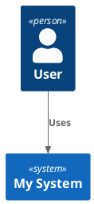

Every element macro follows the same shape: an **alias** (an identifier you reference in
relationships), a **label** (the display name), and then optional arguments — a
description, technology, sprite, tags, link, and so on.

---

## Level 1 — System Context

The Context diagram is the highest zoom level. It shows your system as a single box in
the middle, surrounded by the people who use it and the other systems it interacts with.
No internal structure, no technology choices — just "what is this, who cares, what does
it touch."

### Context macros

**People:**

- `Person(alias, label, ?descr, ?sprite, ?tags, ?link, ?type)` — a user inside your organization/scope.
- `Person_Ext(alias, label, ?descr, ?sprite, ?tags, ?link, ?type)` — an external person; drawn in a muted "external" colour.

**Software systems:**

- `System(alias, label, ?descr, ?sprite, ?tags, ?link, ?type, ?baseShape)` — a system in scope.
- `System_Ext(alias, label, ...)` — an external system you don't own.
- `SystemDb(alias, label, ...)` / `SystemDb_Ext(...)` — a system rendered as a database (cylinder).
- `SystemQueue(alias, label, ...)` / `SystemQueue_Ext(...)` — a system rendered as a queue.

**Boundaries** (visual grouping; see the dedicated section below):

- `Enterprise_Boundary(alias, label, ?tags, ?link, ?descr)`
- `System_Boundary(alias, label, ?tags, ?link, ?descr)`
- `Boundary(alias, label, ?type, ?tags, ?link, ?descr)` — a generic boundary; `?type` sets the stereotype text.

The `?descr` argument is the short sentence under the name; use it liberally, because a
good C4 diagram is self-explanatory without a separate key.

### A complete Context diagram

This is the canonical "Internet Banking System" context. Note how `Rel_Neighbor` and
`Rel_Back` are used to steer layout, and how `SHOW_LEGEND()` appends the auto-generated
key.

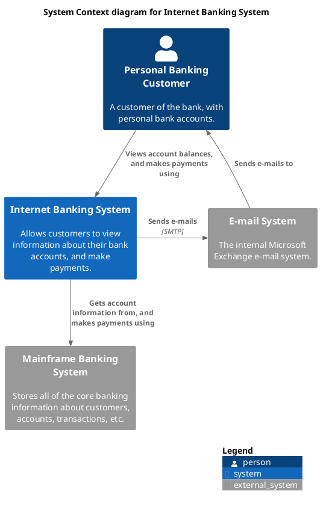

### Database and queue system shapes

When an external dependency *is* a data store or a broker, `SystemDb` and `SystemQueue`
(and their `_Ext` variants) render it with the appropriate shape so readers immediately
grasp its nature:

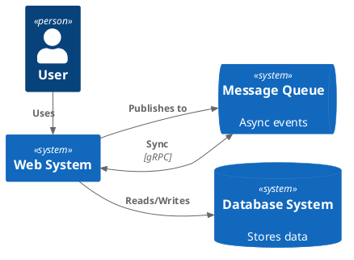

---

## Level 2 — Container

Zooming into the system box reveals its **containers**: the separately deployable or
runnable things and the data stores between them. This is where technology choices first
appear (`"Java, Spring MVC"`, `"PostgreSQL"`, `"Kafka"`). The optional `?techn` argument
is dedicated to that technology string.

### Container macros

Include `<C4/C4_Container>` (which pulls in everything from Context) to get:

- `Container(alias, label, ?techn, ?descr, ?sprite, ?tags, ?link, ?baseShape)` — an application/service.
- `ContainerDb(alias, label, ?techn, ?descr, ...)` — a data store (cylinder).
- `ContainerQueue(alias, label, ?techn, ?descr, ...)` — a message queue/broker.
- `Container_Ext`, `ContainerDb_Ext`, `ContainerQueue_Ext` — external variants in muted colours.
- `Container_Boundary(alias, label, ?tags, ?link, ?descr)` — groups components inside a container (used at the Component level).

Note the argument order shift from Context: containers put **`?techn` before `?descr`**,
because technology is a first-class property of a container.

### A complete Container diagram

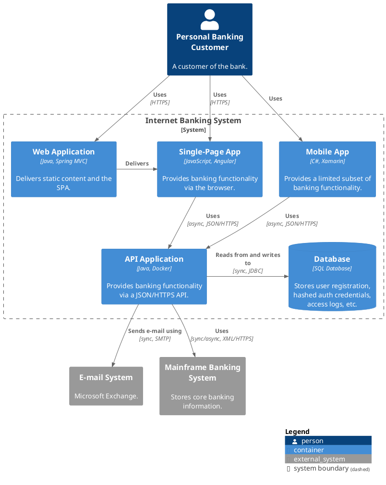

The `System_Boundary(...) { ... }` block draws a dashed rectangle around everything you
own, visually separating it from the two external systems.

---

## Level 3 — Component

The Component diagram zooms into a **single container** and shows the major structural
building blocks inside it. Wrap them in a `Container_Boundary` and keep the surrounding
containers/systems (the things this container talks to) on the diagram as plain
`Container`/`System_Ext` boxes for context.

### Component macros

Include `<C4/C4_Component>`:

- `Component(alias, label, ?techn, ?descr, ?sprite, ?tags, ?link, ?baseShape)`
- `ComponentDb(alias, label, ?techn, ?descr, ...)`
- `ComponentQueue(alias, label, ?techn, ?descr, ...)`
- `Component_Ext`, `ComponentDb_Ext`, `ComponentQueue_Ext`

### A complete Component diagram

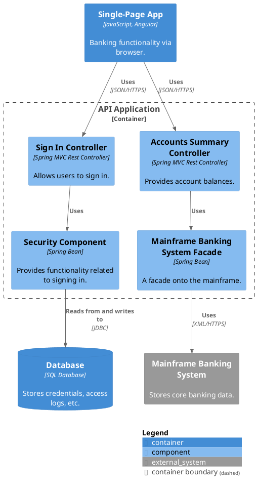

---

## Relationships

Relationships are the arrows between elements. They are declared by referencing the two
element **aliases**, plus a label describing the interaction and (optionally) the
technology/protocol.

### Relationship macros

- `Rel(from, to, label, ?techn, ?descr, ?sprite, ?tags, ?link)` — the workhorse; direction chosen by the layout engine.
- **Directional** hints, which *both* add the relationship *and* pin the direction:
  - `Rel_U` / `Rel_Up`, `Rel_D` / `Rel_Down`, `Rel_L` / `Rel_Left`, `Rel_R` / `Rel_Right`.
- `Rel_Neighbor(from, to, ...)` — keeps the two elements adjacent (short arrow, no rank change).
- `Rel_Back(from, to, ...)` — a reverse arrow (the arrowhead points at `from`); great for "returns to" flows.
- `BiRel(from, to, label, ...)` — a bidirectional arrow (arrowheads on both ends).

Direction is expressed **from the caller's point of view**: `Rel_D(web, db, ...)` places
`db` below `web`. Use directional variants sparingly — a handful of well-chosen hints
untangles a layout, but over-constraining fights the engine.

### Layout helpers without arrows

Sometimes you want to influence position without implying a relationship. Use the
`Lay_*` procedures — `Lay_U(a, b)`, `Lay_D(a, b)`, `Lay_L(a, b)`, `Lay_R(a, b)` — to
nudge relative placement, and `Lay_Distance(a, b, ?distance)` to space elements out.

---

## Boundaries

Boundaries are dashed containers that group elements. They carry no runtime meaning; they
exist purely to organize the reader's eye.

- `Enterprise_Boundary(alias, label, ...)` — the outermost "our company" box, typically on a Landscape/Context diagram spanning multiple systems.
- `System_Boundary(alias, label, ...)` — "the system I am describing", used on Container diagrams to fence off owned containers.
- `Container_Boundary(alias, label, ...)` — "the container I am describing", used on Component diagrams.
- `Boundary(alias, label, ?type, ...)` — a generic boundary; set `?type` to relabel the stereotype (e.g. a region, a team, a security zone).

Boundaries nest. Open with `{` and close with `}`:

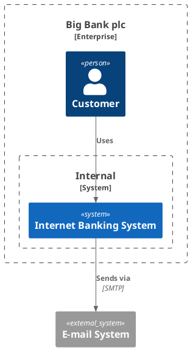

---

## Level 4 (supplementary) — Deployment

The Deployment diagram maps containers onto the infrastructure that runs them: physical
servers, virtual machines, cloud services, Kubernetes clusters, mobile devices. The
building block is the **node**, which can nest arbitrarily.

### Deployment macros

Include `<C4/C4_Deployment>`:

- `Deployment_Node(alias, label, ?type, ?descr, ?sprite, ?tags, ?link)` — an infrastructure node. `?type` is the stereotype (e.g. `"Ubuntu 22.04"`, `"Amazon EC2"`).
- `Node(alias, label, ?type, ?descr, ...)` — a shorter alias for `Deployment_Node`.
- `Node_L(...)` / `Node_R(...)` — a node that is laid out to the left / right of its siblings.

Nodes contain other nodes and, at the leaves, the `Container`/`ContainerDb` instances
being deployed. Deployment nodes give the "where"; the containers inside give the "what."

### A complete Deployment diagram

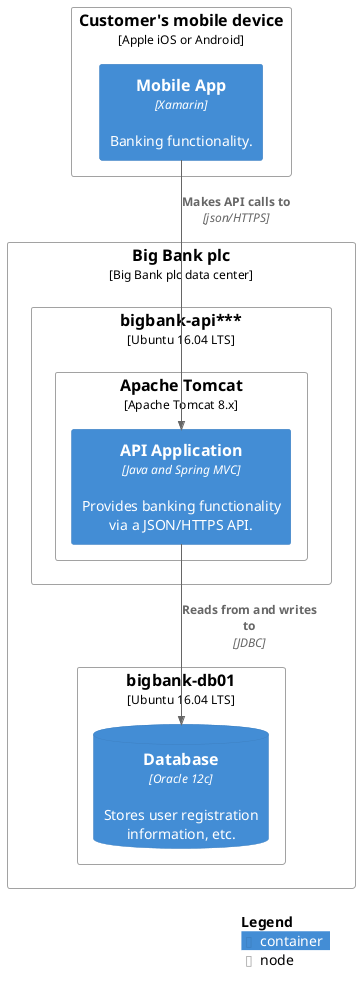

### A cloud-style deployment with `Node`/`Node_R`

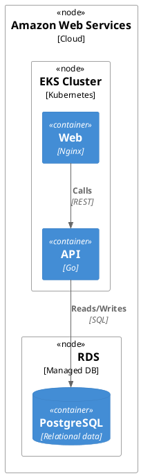

---

## Level 4 (supplementary) — Dynamic

A Dynamic diagram tells a *story*: it shows the elements collaborating to satisfy one
scenario, with **numbered steps** that give reading order. Include `<C4/C4_Dynamic>` and
call `Index()` on each relationship to auto-number the steps.

The `Index()` family:

- `Index()` — returns the current step number and advances the counter (use `$index=Index()`).
- `SetIndex(n)` / `setIndex(n)` — reset the counter to `n`.
- `increment(offset)` — bump the counter without emitting a number.
- `LastIndex()` — the most recently used number.

### Dynamic diagram with explicit step labels

You can also number steps manually inside the label text (`"1. ..."`), which needs no
`Index()`:

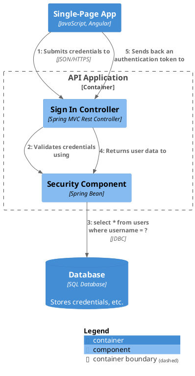

### Auto-numbered steps with `Index()`

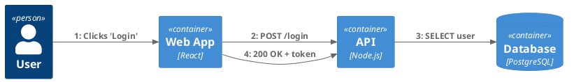

---

## Layout and the legend

C4-PlantUML gives you macros to control global layout and to render the key that explains
element colours and shapes.

- `LAYOUT_TOP_DOWN()` — default flow, top to bottom.
- `LAYOUT_LEFT_RIGHT()` — flow left to right; good for pipelines and wide-but-shallow systems.
- `LAYOUT_LANDSCAPE()` — an alias biased toward horizontal spreading.
- `LAYOUT_WITH_LEGEND()` — arrange with the legend inline (older-style combined layout+legend call).
- `SHOW_LEGEND(?hideStereotype, ?details)` — render the auto-generated legend as a separate box (the modern, preferred call).
- `SHOW_FLOATING_LEGEND(?alias, ?hideStereotype, ?details)` — a legend you can position with `Lay_*` relative to other elements.

`LAYOUT_WITH_LEGEND()` versus `SHOW_LEGEND()`: the former both sets a layout and shows the
legend in one call and predates the split; the latter only shows the legend and composes
with whichever `LAYOUT_*` you chose. New diagrams should prefer a `LAYOUT_*` +
`SHOW_LEGEND()` pairing.

### Landscape layout across systems

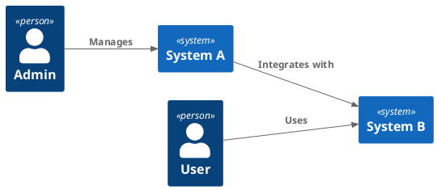

### A floating legend

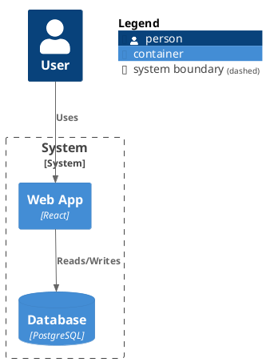

---

## Styling: tags, colours, and default overrides

Two mechanisms let you customize appearance: **tags** (define a named style once, apply it
to many elements) and **default-style overrides** (change how a whole element category
looks).

### Defining and applying tags

- `AddElementTag(name, ?bgColor, ?fontColor, ?borderColor, ?shadowing, ?shape, ?sprite, ?techn, ?legendText, ?legendSprite, ?borderStyle, ?borderThickness)`
- `AddRelTag(name, ?textColor, ?lineColor, ?lineStyle, ?sprite, ?techn, ?legendText, ?legendSprite, ?lineThickness)`
- `AddBoundaryTag(name, ...)`

Apply a tag with the `$tags="..."` argument on any element or relationship. Combine
multiple tags with `+` (`$tags="v1+external"`).

Line-style helpers you can pass to `$lineStyle`/`?lineStyle`: `SolidLine()`,
`DashedLine()`, `DottedLine()`, `BoldLine()`. Shape helpers include `RoundedBoxShape()`,
`SharpCornerShape()`, and `EightSidedShape()`.

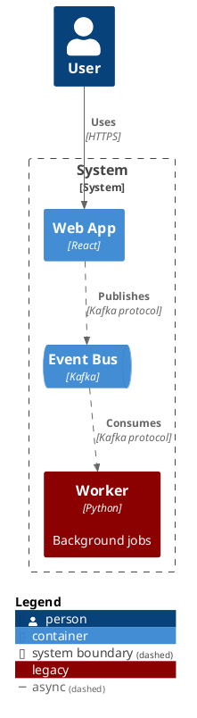

The tag also appears in the legend, so the reader knows what "legacy" and the dashed
"async" line mean.

### Overriding default styles and adding links

- `UpdateElementStyle(elementName, ?bgColor, ?fontColor, ?borderColor, ...)` — restyle a whole category by its internal name (`"person"`, `"system"`, `"container"`, `"component"`, `"external_person"`, etc.).
- `UpdateRelStyle(textColor, lineColor)` — change the default relationship colours.
- `UpdateBoundaryStyle(...)`, `UpdateSystemBoundaryStyle()`, `UpdateContainerBoundaryStyle()`, `UpdateEnterpriseBoundaryStyle()`.
- `UpdateLegendTitle(newTitle)` — rename the legend header.

The `$link="..."` argument makes an element or relationship clickable in SVG output —
handy for wiring a diagram to your docs or repo:

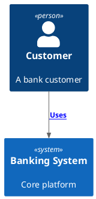

---

## Sprites, person shapes, and sketch mode

**Person rendering** can be tuned globally:

- `SHOW_PERSON_PORTRAIT()` — draw people as a head-and-shoulders portrait.
- `SHOW_PERSON_OUTLINE()` — a lighter outline style (needs PlantUML ≥ v1.2021.4).
- `SHOW_PERSON_SPRITE(?sprite)` — use a sprite (built-ins: `person`, `person2`, `robot`, `robot2`).
- `HIDE_PERSON_SPRITE()` — revert to the plain box.

**Sprites** attach an icon to any element via `$sprite="name"`. You can scale and colour
them (`$sprite="name,scale=0.5"`, `$sprite="&icon,color=gray"`), and reference sprites
from bundled sprite libraries you `!include <...>`.

**Sketch mode** renders the whole diagram in a hand-drawn style — perfect for signalling
"this is a draft / proposal, not the final architecture":

- `LAYOUT_AS_SKETCH()` — enable the sketch look.
- `SET_SKETCH_STYLE(?bgColor, ?fontColor, ?warningColor, ?fontName, ?footerWarning, ?footerText)` — tweak the sketch appearance and footer.

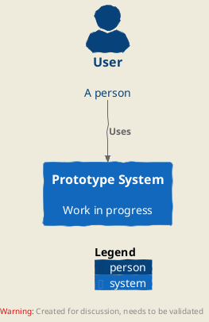

---

## Properties tables

For richer element descriptions you can attach a small property table to the *next*
element declaration:

- `SetPropertyHeader(col1, ?col2, ?col3, ?col4)` — define column headers (up to four columns).
- `AddProperty(col1, ?col2, ?col3, ?col4)` — add a row.
- `WithoutPropertyHeader()` — emit rows without a header.

These are declared immediately before the element they annotate and are consumed by it.

---

## Quick macro reference

**Include (deepest level you need):** `!include <C4/C4_Context|C4_Container|C4_Component|C4_Deployment|C4_Dynamic>`

| Category | Macros |
|----------|--------|
| People | `Person`, `Person_Ext` |
| Systems | `System`, `System_Ext`, `SystemDb`, `SystemDb_Ext`, `SystemQueue`, `SystemQueue_Ext` |
| Containers | `Container`, `Container_Ext`, `ContainerDb`, `ContainerDb_Ext`, `ContainerQueue`, `ContainerQueue_Ext` |
| Components | `Component`, `Component_Ext`, `ComponentDb`, `ComponentDb_Ext`, `ComponentQueue`, `ComponentQueue_Ext` |
| Boundaries | `Enterprise_Boundary`, `System_Boundary`, `Container_Boundary`, `Boundary` |
| Deployment | `Deployment_Node`, `Node`, `Node_L`, `Node_R` |
| Relationships | `Rel`, `Rel_U/D/L/R`, `Rel_Up/Down/Left/Right`, `Rel_Neighbor`, `Rel_Back`, `BiRel` |
| Layout | `Lay_U/D/L/R`, `Lay_Distance` |
| Layout/legend | `LAYOUT_TOP_DOWN`, `LAYOUT_LEFT_RIGHT`, `LAYOUT_LANDSCAPE`, `LAYOUT_WITH_LEGEND`, `SHOW_LEGEND`, `SHOW_FLOATING_LEGEND` |
| Dynamic | `Index`, `SetIndex`, `setIndex`, `increment`, `LastIndex` |
| Styling | `AddElementTag`, `AddRelTag`, `AddBoundaryTag`, `UpdateElementStyle`, `UpdateRelStyle`, `UpdateBoundaryStyle`, `UpdateLegendTitle` |
| Person/sketch | `SHOW_PERSON_PORTRAIT`, `SHOW_PERSON_OUTLINE`, `SHOW_PERSON_SPRITE`, `HIDE_PERSON_SPRITE`, `LAYOUT_AS_SKETCH`, `SET_SKETCH_STYLE` |
| Line/shape | `SolidLine`, `DashedLine`, `DottedLine`, `BoldLine`, `RoundedBoxShape`, `SharpCornerShape`, `EightSidedShape` |
| Properties | `SetPropertyHeader`, `AddProperty`, `WithoutPropertyHeader` |

**Argument order reminders:** `Person`/`System` use `(alias, label, ?descr, ...)`;
`Container`/`Component` insert technology first — `(alias, label, ?techn, ?descr, ...)`;
`Rel` uses `(from, to, label, ?techn, ?descr, ...)`.

---

## Tips for effective C4 diagrams

- **One level per diagram.** Don't sneak infrastructure onto a Container diagram or classes onto a Component diagram.
- **Write full descriptions.** The `?descr` sentence turns a box into something a newcomer can understand unaided.
- **Always show a legend** (`SHOW_LEGEND()`), and use **tags** to explain any non-default colour or line style.
- **Let the engine lay out first.** Add `Rel_*`/`Lay_*` direction hints only where the default layout is genuinely confusing.
- **Keep Container names technology-agnostic** in the label and put the tech in `?techn` — it keeps diagrams readable and future-proof.
- **Use sketch mode for proposals** so viewers know a design is provisional.
