# Class Diagrams

A **class diagram** is the workhorse of UML structural modelling. It describes the *static* shape of a system: the types that exist (classes, interfaces, enumerations, abstract classes, annotations, records, structs…), the data and behaviour each type holds (fields and methods, with visibility, static and abstract modifiers), and the *relationships* that tie those types together (inheritance, realization, composition, aggregation, dependency and plain association, complete with multiplicities and labels). Use a class diagram whenever you want to communicate the design of an object model, a domain model, an API surface, a database schema, or the type hierarchy of a library — anything where the emphasis is on "what things are and how they connect" rather than "what happens over time".

In PlantUML a class diagram lives between `@startuml` and `@enduml`. PlantUML auto-detects that you want a class diagram as soon as it sees a `class`, `interface`, `enum` (etc.) keyword or a class-style relation such as `<|--`. Everything below is compatible with the pinned **PlantUML v1.2026.8** build running under `SECURITY_PROFILE=INTERNET`; every example is a complete, self-contained diagram that has been validated against the live rendering API.

> **Security note.** Under the `INTERNET` profile you may only pull in bundled standard-library files with the angle-bracket form `!include <folder/file>`. Never use `!includeurl` to fetch from arbitrary remote hosts — those requests are blocked.

## Declaring types

The most minimal diagram is a single bare class. No body is required.

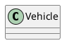

PlantUML understands a rich vocabulary of type keywords. Besides the everyday `class`, `interface`, `enum`, `abstract`/`abstract class` and `annotation`, the parser also accepts `exception`, `record`, `dataclass`, `struct`, `protocol`, `metaclass`, `circle` (or `()`) and `diamond` (or `<>`). Each keyword renders with an appropriate icon/spot letter so readers can tell an interface from an enum at a glance.

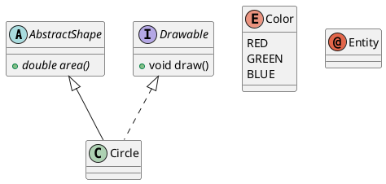

`struct` and `record` are handy for value-object / data-carrier types:

```plantuml
@startuml
struct Point {
  +double x
  +double y
}
record Money {
  +long amount
  +String currency
}
@enduml
```

### Names with spaces or special characters

If a type name contains spaces or characters the parser would otherwise choke on, wrap it in quotes and give it an alias with `as`:

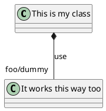

Names that begin with `$` must be quoted when aliased (e.g. `class "$C2" as dollarC2`), because `$` introduces a *tag* (see [Tagging, hiding and removing](#tagging-hiding-and-removing)).

## Fields and methods

Add a body in `{ ... }`. PlantUML decides whether a line is a **method** or a **field** by looking for parentheses: a member containing `()` is treated as a method, everything else as a field. You can put the type before or after the name — PlantUML does not enforce a language, it just reproduces the text you write.

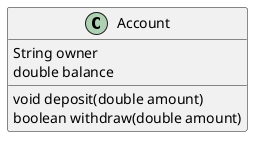

When the automatic detection guesses wrong (for example a field whose name happens to contain parentheses, or a method you want listed among the attributes), force the classification with the `{field}` and `{method}` modifiers:

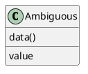

### Visibility modifiers

Prefix a member with a visibility character and PlantUML draws a coloured icon for it:

| Prefix | Visibility        |
|--------|-------------------|
| `+`    | public            |
| `-`    | private           |
| `#`    | protected         |
| `~`    | package private   |

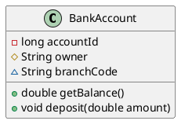

If you prefer the classic textual `+/-/#/~` characters instead of the coloured icons, switch the icons off with `skinparam classAttributeIconSize 0`:

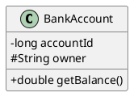

### Static and abstract members

Mark a member `{static}` or `{abstract}` (either at the start or the end of the line). Static members are rendered underlined, abstract members in italics. `{classifier}` is an accepted synonym for `{static}`.

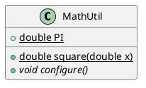

### Grouping members with separators

Inside a class body you can insert horizontal separators to group related members. Four styles are available and each accepts an optional title: `--` (line), `..` (dotted), `==` (double line) and `__` (underline).

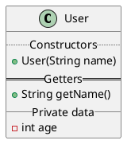

## Relationships

Relationships are drawn by connecting two type names with a *relation operator*. The operator encodes both the semantics (which UML relationship) and the line style. As a rule of thumb, replace the dashes `--` with dots `..` to turn any solid line into a dotted one.

| Relationship                | Operator | Meaning                                            |
|-----------------------------|----------|----------------------------------------------------|
| Extension / generalization  | `<|--`   | subclass specializes a superclass                  |
| Realization / implementation| `<|..`   | class implements an interface                      |
| Composition                 | `*--`    | strong ownership; part cannot live without whole   |
| Aggregation                 | `o--`    | weak ownership; part can exist independently        |
| Dependency                  | `-->`    | one type uses another                              |
| Weak dependency             | `..>`    | dotted "uses", e.g. a transient reference          |
| Association                 | `--`     | a structural link with no ownership                |

The head can also be flipped (`--|>`, `..|>`, `--*`, `--o`, `<--`, `<..`) so the arrow points the other way, and you can read any of the arrowheads on either end.

### Extension (inheritance)

`<|--` puts the hollow-triangle generalization arrowhead next to the parent, so write `Parent <|-- Child`.

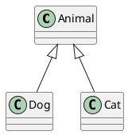

### Realization (implements)

Same triangle, dotted line: `Interface <|.. Class`.

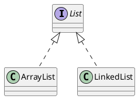

### Composition and aggregation

A filled diamond (`*--`) is composition — the whole owns the parts and controls their lifetime. A hollow diamond (`o--`) is aggregation — the parts can outlive the whole.

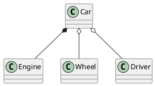

### Dependency and association

A dashed open arrow (`..>`) is the classic "depends on / uses" relationship; a plain solid line (`--`) is a structural association.

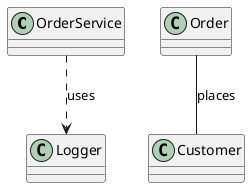

### Multiplicity and labels

Attach a **multiplicity** to either end by placing a quoted string next to the class name, and give the relation itself a **label** after a colon.

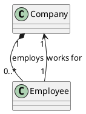

Add a `<` or `>` at the end of a label to draw a little solid triangle showing the **reading direction** of the association — i.e. which side is the subject of the verb.

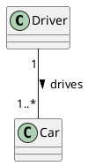

### Role labels

You can label the *roles* played at each end (and even keep a multiplicity too) by attaching a quoted role name — optionally with a `/multiplicity` suffix — directly to each participant:

```plantuml
@startuml
class User
class Item
User "owner which is very long"/1 -- "0..n"/items Item
@enduml
```

## Controlling direction and layout

By default PlantUML lays classes out top-to-bottom. Two global switches change the flow: `left to right direction` and `top to bottom direction` (the default). You can also steer an individual relation with the `-up-`, `-down-`, `-left-`, `-right-` keywords (abbreviated `-u-`, `-d-`, `-l-`, `-r-`).

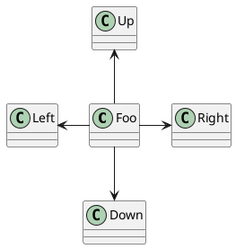

Use `together { ... }` to hint that a set of classes should be kept side by side, and add invisible `-[hidden]-` links to nudge the layout without drawing anything.

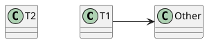

## Generics and templates

Angle brackets after a type name declare a generic/template parameter. Bounds such as `extends` are reproduced verbatim.

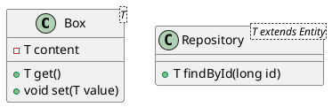

(If you prefer the old-style template box in the top-right corner, set `skinparam genericDisplay old`.)

## Packages and namespaces

### Packages

Group classes inside `package "Name" { ... }`. You may give the package a background colour with `#RRGGBB`/`#colorname` and a visual style via a `<<Style>>` stereotype.

```plantuml
@startuml
package "Domain" #DDDDDD {
  class Order
  class Customer
}
package "Infrastructure" <<Database>> {
  class OrderRepository
}
Order --> Customer
OrderRepository ..> Order
@enduml
```

The available package styles are `Node`, `Rectangle`, `Folder`, `Frame`, `Cloud` and `Database`, each drawing a different container shape:

```plantuml
@startuml
package Node <<Node>> {
  class A
}
package Rect <<Rectangle>> {
  class B
}
package Folder <<Folder>> {
  class C
}
package Frame <<Frame>> {
  class D
}
package Cloud <<Cloud>> {
  class E
}
package DB <<Database>> {
  class F
}
@enduml
```

### Namespaces

`namespace` behaves like a package but participates in name resolution: a fully-qualified name uses the dot as separator, and classes in one namespace can reference classes in another with their qualified name.

```plantuml
@startuml
namespace com.example.model {
  class User
  class Role
  User --> Role
}
namespace com.example.web {
  class Controller
  Controller ..> com.example.model.User
}
@enduml
```

### Choosing the namespace separator

`set separator ::` lets you write fully-qualified names with a custom separator and PlantUML will build the enclosing packages automatically. `set separator none` disables automatic package creation entirely.

```plantuml
@startuml
set separator ::
class com::example::app::Main
class com::example::app::Config
Main --> Config
@enduml
```

## Notes

Notes annotate a diagram with free text. Attach one to a specific element with `note left|right|top|bottom of <Element>`, either on a single line after a colon or as a block terminated by `end note`. Notes support Creole/HTML-style markup such as `<b>`, `<i>`, `<u>`, `<s>`, `<font>`, `<color>` and `<size>`. A note can also be attached to the most recently drawn relation with `note on link` (and `note left on link` / `note right on link`).

```plantuml
@startuml
class Server
class Client
note top of Server : Handles requests
note bottom of Client : Sends requests
note left of Server
  Multi-line note
  with <b>bold</b> text
end note
Client --> Server
note on link : HTTP
@enduml
```

### Floating notes

Declare a note with `note as N1 ... end note` to create a standalone note you can then link to anything with a dotted line.

```plantuml
@startuml
class A
class B
note as N1
  A floating note
  not attached to anything
end note
A --> B
N1 .. A
@enduml
```

### Notes on individual members

You can even attach a note to a single field or method by qualifying it with the class name and `::member`. For overloaded methods, quote the full signature (e.g. `note right of A::"method(Type)"`).

```plantuml
@startuml
class Counter {
  +int counter
  +void increment()
}
note right of Counter::counter
  Current value
end note
note right of Counter::increment
  Adds one
end note
@enduml
```

## Stereotypes and spots

A `<<Stereotype>>` after a type name tags it with a role. By default PlantUML also draws a coloured "spot" (the little circle with a letter). You can override that spot with the `<< (Character, Color) Stereotype >>` form — the character and colour go in parentheses.

```plantuml
@startuml
class System << (S,#FF7700) Singleton >>
class Date << (D,orchid) >>
class Service << general >>
@enduml
```

## Colours and line styling

### Colouring a class

Attach a colour spec to a class with `#...`. You can set the background (`back:`), border (`line:`), header, use a gradient with `|` or `/`, and change the border style with `line.dashed` / `line.bold`.

```plantuml
@startuml
class Bar #line:green;back:lightblue
class Foo #back:red;line:00FFFF
class Baz #back:lightgreen|yellow;header:blue/red
abstract Special #pink ##[bold]red
@enduml
```

### Styling relations

Relations accept a bracketed style list `-[...]-` for colour, thickness and line pattern (`bold`, `dashed`, `dotted`, `hidden`, `plain`). You can also append an inline `#...` colour spec after the target class (before any label).

```plantuml
@startuml
class A
class B
class C
class D
A -[bold]-> B
A -[dashed]-> C
A -[#red,thickness=2]-> D
B --> C #line:green;text:green : styled
@enduml
```

## Advanced relationships

### Lollipop (ball-and-socket) interfaces

The `()-` / `-()` notation draws an interface as a lollipop (a small circle) attached to the class that provides or requires it, instead of a full box.

```plantuml
@startuml
class Consumer
class Provider
Consumer -() "Serializable"
Provider ()-- Consumer
@enduml
```

### Association classes

Model an association that itself carries attributes by first drawing the association between two classes, then linking a third class to that association with the `(A, B) .. AssocClass` syntax.

```plantuml
@startuml
class Student
class Course
Student "0..*" - "1..*" Course
(Student, Course) .. Enrollment
class Enrollment {
  +Date enrolledOn
  +void drop()
}
@enduml
```

### Qualified associations

Put a `[qualifier]` in square brackets next to a class to model a qualified association (e.g. a lookup key).

```plantuml
@startuml
class Shop
class Customer
Shop [customerId: long] --> "1" Customer
@enduml
```

### `extends` / `implements` keywords

As an alternative to the arrow operators you can spell out inheritance with the `extends` and `implements` keywords right in the declaration — clearer when it mirrors the source language. Multiple parents are comma-separated.

```plantuml
@startuml
class AbstractList
interface List
interface Collection
class ArrayList extends AbstractList implements List
Collection <|-- List
@enduml
```

### Arrows to individual members

Relations can start or end at a specific field/method using the `Class::member` qualifier — useful for showing that one attribute references another.

```plantuml
@startuml
class User {
  +long id
}
class Email {
  +long userId
}
User::id *-- Email::userId
@enduml
```

## Tagging, hiding and removing

The `hide` and `show` commands trim the diagram after it is parsed. `hide empty members` collapses the (otherwise blank) attribute/method compartments of classes that have none; you can also target `fields`, `methods`, `members`, `circle`, `stereotype`, a specific class, or a visibility level (`hide private members`).

```plantuml
@startuml
class Full {
  +int a
  +void m()
}
class Empty
class NoMethods {
  +int x
  +void hidden()
}
hide empty members
hide NoMethods methods
hide circle
@enduml
```

Related commands worth knowing (not shown above to keep the example minimal):

- **Tags.** Attach a `$tag` to elements (`class C1 $tag13`) and then `hide $tag13`, `remove $tag13`, or `restore $tag13`. `remove * restore $tag1` removes everything and brings back only the tagged elements.
- **Unlinked classes.** `hide @unlinked` / `remove @unlinked` drop classes that have no relations.

## ER / IE-style ("database table") notation

Class diagrams double nicely as lightweight entity-relationship diagrams. Give each entity a `Table` stereotype and spot, use a member separator to split the primary key from the columns, mark keys with `<<PK>>` / `<<FK>>` stereotypes on the fields, and use crow's-foot-flavoured multiplicities (`||--o{`) to express one-to-many cardinality.

```plantuml
@startuml
class Customer << (T,#ADD1B2) Table >> {
  + id : INT <<PK>>
  --
  name : VARCHAR
  email : VARCHAR
}
class Order << (T,#ADD1B2) Table >> {
  + id : INT <<PK>>
  --
  # customer_id : INT <<FK>>
  total : DECIMAL
}
Customer "1" ||--o{ Order : places
@enduml
```

> For true crow's-foot ER diagrams PlantUML also offers a dedicated `entity`/`@startuml` IE mode and the Information-Engineering relation set; the class-based approach above is the most portable when you just want a schema sketch alongside the rest of your class model.

## Render it via the API

Every `@startuml … @enduml` block on this page is a valid document you can POST to the render endpoint. Send the diagram source as JSON and pick a `format` (`svg`, `png`, …):

```bash
curl -sS -X POST https://plantuml.joor.net/api/v1/render \
  -H 'content-type: application/json' \
  -d '{
    "source": "@startuml\nclass Company\nclass Employee\nCompany \"1\" *-- \"0..*\" Employee : employs\nEmployee \"1\" --> \"1\" Company : works for\n@enduml",
    "format": "svg"
  }' \
  -o class-diagram.svg
```

A successful call returns HTTP `200` with the rendered image in the response body (here saved to `class-diagram.svg`). A malformed diagram returns `422 Unprocessable Entity` with a JSON body describing the syntax error, which is exactly how each example above was validated.
