# Component Diagrams

A **component diagram** describes how a software system is split into physical, deployable
pieces — components, the interfaces they provide or require, and the wiring between them.
In UML it belongs to the family of structural diagrams, sitting one level below deployment
diagrams and one level above classes. Reach for it whenever you want to communicate
*architecture*: services and their APIs, layered applications, message flows between
subsystems, or the boundary of a system and its external dependencies.

PlantUML's component syntax is deliberately terse — you draw a box by wrapping a name in
`[square brackets]` and draw a wire with `-->`. From that minimal core you can add
interfaces (the "lollipop" circles), ports, richly nested containers (packages, nodes,
folders, frames, clouds, databases), notes, colors, stereotypes, and tag-based
show/hide rules. This page walks through every one of those features, from the smallest
possible diagram to production-grade architecture drawings, with a complete, renderable
example for each.

Every example below is a full `@startuml … @enduml` document and has been validated
against the live rendering API, so you can copy any block verbatim.

## Declaring components

A component is the fundamental building block. There are two equivalent ways to create one:

- **Bracket form** — wrap the display name in square brackets: `[First component]`.
- **Keyword form** — write `component` followed by the name: `component Comp3`.

The bracket form is convenient for names that contain spaces; the keyword form is handy
for single-word names. In both cases you can attach an **alias** with `as`. The alias is a
short, space-free handle you use in relations so you don't have to repeat a long bracketed
name every time. You can also embed a line break in a name with `\n`.

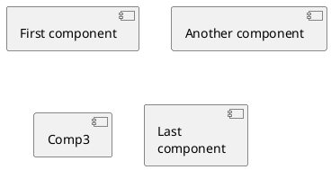

Once an alias is defined, refer to the component either by its alias (`Comp2`) or by its
original bracketed name (`[Another component]`) — both resolve to the same box.

> **Gotcha:** a component whose name starts with `$` is treated specially by the
> `hide`/`remove`/`restore` commands (it is interpreted as a *tag*, see below). If you
> genuinely need a `$` in a name, give the element a plain alias and hide it by alias.

## Interfaces (the lollipop notation)

An **interface** models a contract that a component provides or requires. It is drawn as a
small circle — the classic UML "lollipop". Declare one with the `()` symbol or with the
`interface` keyword; as with components, `as` gives it an alias and `\n` inserts a line
break.

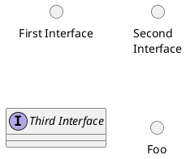

Interfaces come into their own when you link them to components: a plain line
(`Interface - [Component]`) reads as "this component *provides* this interface", while an
arrow from a component to an interface (`[Component] ..> Interface`) reads as "this
component *requires/uses* it". The next section covers relations in full.

## Relations and links

Relations are drawn by combining three ingredients:

| Piece | Meaning |
|-------|---------|
| `--` | solid line |
| `..` | dotted line |
| `>` / `<` | an arrowhead on that end |

So `--` is a solid association, `-->` is a solid directed arrow, `..>` is a dotted
(dependency) arrow, and `<-->` is bidirectional. Add a label after a colon: `: use`.

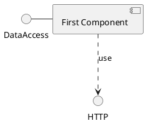

Note that `DataAccess` and `HTTP` above were never explicitly declared — referencing an
undeclared name in a relation implicitly creates it. This keeps small diagrams compact,
though on larger diagrams explicit declarations make intent clearer.

Here is a fuller set of relation styles side by side:

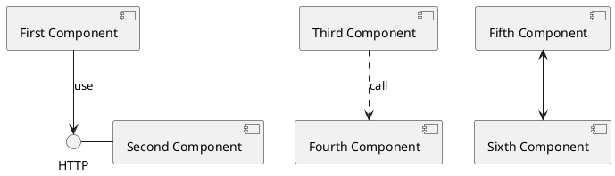

### Controlling arrow direction

By default PlantUML lays elements out top-to-bottom and tries to make relations flow
downward. You can force the direction of an individual link by writing a compass word
*inside* the arrow: `-left->`, `-right->`, `-up->`, `-down->`. These may be abbreviated to
one letter (`-l->`, `-r->`, `-u->`, `-d->`) or two (`-le->`, `-ri->`, `-up->`, `-do->`).

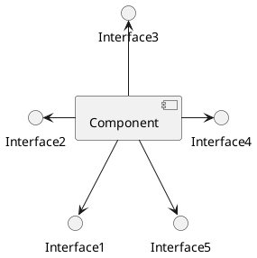

To change the layout of the *whole* diagram instead of a single link, put
`left to right direction` near the top. This often produces a more natural, flatter
diagram for pipelines and layered systems:

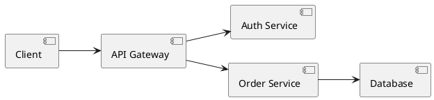

## Grouping: packages, nodes, folders, frames, clouds and databases

Real architectures have boundaries — subsystems, deployment nodes, layers, external
clouds. PlantUML offers several visually distinct **container** keywords. They are
functionally interchangeable (each opens a `{ … }` block that can hold components,
interfaces, and other containers) but each draws a different shape, which lets you convey
meaning through the box style:

- `package "Name" { }` — a UML package (tabbed folder outline).
- `node "Name" { }` — a 3-D box, traditionally a physical/deployment node.
- `folder "Name" { }` — a folder-tab shape.
- `frame "Name" { }` — a titled frame.
- `cloud { }` — a cloud outline, for external/network boundaries.
- `database "Name" { }` — a cylinder, for data stores.

Containers nest arbitrarily, and relations can cross container boundaries.

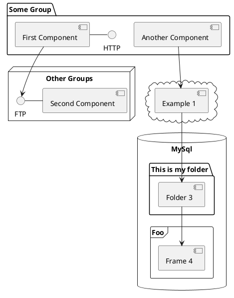

A classic use is expressing a layered application, one package per layer:

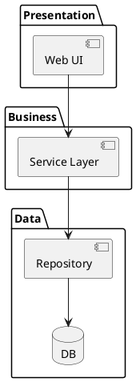

`rectangle` is another useful container — a plain box with no UML decoration, ideal for a
"system boundary". It also accepts a `<<stereotype>>` you can target with a skinparam
(see styling below):

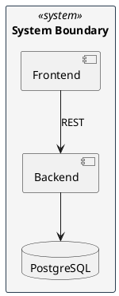

## Ports

A **port** is an explicit connection point on the boundary of a component, letting arrows
attach to a named spot rather than the box as a whole. This is useful for modelling
components that expose several distinct entry/exit points. Three keywords are available,
all declared *inside* the component's `{ }` block:

- `port` — a generic bidirectional port.
- `portin` — an input port (drawn on the entry side).
- `portout` — an output port (drawn on the exit side).

You then draw arrows to the port name, and arrows from the port to the inner elements.

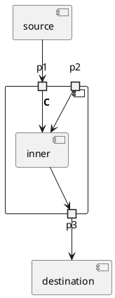

## Notes

Notes annotate a diagram with free text. Attach one to an element with
`note <position> of <element>`, where position is `top`, `bottom`, `left` or `right`.
A single-line note uses a colon; a multi-line note opens with the position and closes with
`end note`.

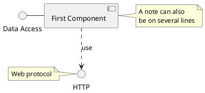

A **floating note** is declared with `note as <alias>` and is not anchored to any element
until you connect it with a dotted line:

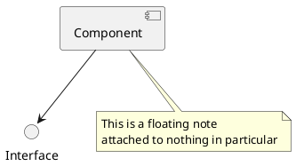

You can also place a note on a container's contents, as here where a note documents a
cache's eviction policy:

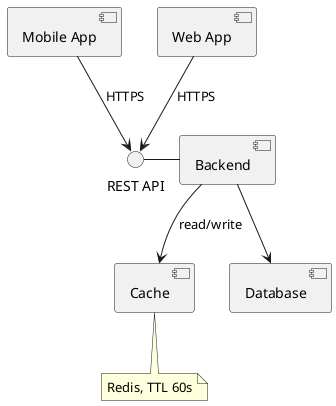

## Long descriptions

Sometimes a component needs more than a name — a short description of its
responsibilities. Follow the `component` declaration with a `[ … ]` block containing
multi-line free text:

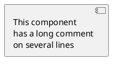

## Colors and styling

### Individual element colors

Append a color to any component to override its fill. Colors can be named
(`#Red`, `#palegreen`) or given as hex (`#99FF99`). This works with both the bracket and
keyword forms.

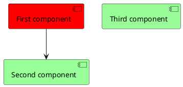

### Global styling with skinparam

`skinparam` sets defaults for whole categories of elements. For components the key knobs
are fonts, background/border colors, and the arrow appearance. You can also target a
specific `<<stereotype>>` so that, say, every `<<Apache>>` component gets the same look.

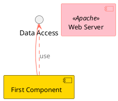

### Component rendering style

`skinparam componentStyle` controls how component boxes are drawn:

- `uml2` — the default; a rectangle with the small UML component icon in the corner.
- `uml1` — the older UML 1 notation with two protruding tabs.
- `rectangle` — a plain rectangle with no UML decoration (a popular, cleaner look).

A clean, decoration-free diagram:

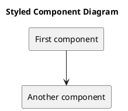

The legacy UML 1 style:

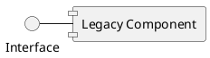

For a strictly black-and-white rendering (useful for print), set
`skinparam monochrome true`:

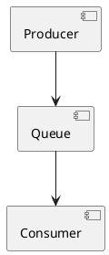

## Showing and hiding elements

On large diagrams you often want to filter what is drawn without deleting the source.
PlantUML provides `hide`, `remove` and `restore`:

- `hide @unlinked` / `remove @unlinked` — suppress components that have no relations. `hide`
  keeps them in the model but not the picture; `remove` drops them entirely.
- **Tags** let you group elements for bulk visibility control. Attach a tag by writing
  `$tagname` after a declaration, then `hide $tagname`, `remove $tagname`, or bring them
  back with `restore $tagname`. Wildcards work too, e.g. `remove * restore $keep`.

Hiding a tagged component:

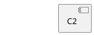

Suppressing everything with no connections via `@unlinked`:

```plantuml
@startuml
[Used component]
[Unused component]
[Client] --> [Used component]
hide @unlinked
@enduml
```

## Mixing in other diagram types

With the `allowmixing` directive on the `@startuml` line, a component diagram can embed
elements from other PlantUML diagram families — for example a `json` block describing a
payload that flows through the system:

```plantuml
@startuml allowmixing
component Component
() Interface
Interface - Component
json JSON {
  "fruit":"Apple",
  "size":"Large",
  "color": ["Red", "Green"]
}
@enduml
```

## Using bundled stdlib sprites

The pinned build ships the PlantUML standard library, so you can pull in icon sets with
the angle-bracket `!include <…>` form (no network access required — remote
`!includeurl` to arbitrary hosts is disabled under the INTERNET security profile). The
AWS library, for instance, gives you cloud-service shapes you can wire together like any
other component:

```plantuml
@startuml
!include <awslib/AWSCommon>
!include <awslib/Compute/EC2>
!include <awslib/Database/RDS>

EC2(web, "Web Server", "")
RDS(db, "Database", "")
web --> db
@enduml
```

## Worked example: a microservices architecture

Bringing many of the features together — interfaces, labelled links, a `queue`, and a
note — here is a small event-driven system:

```plantuml
@startuml
[Order Service] as order
[Payment Service] as payment
[Inventory Service] as inventory
queue "Event Bus" as bus

order --> bus : publish OrderCreated
bus --> payment : consume
bus --> inventory : consume
@enduml
```

## Render it via the API

Any of the examples above can be rendered by POSTing its source to the `/api/v1/render`
endpoint. Send a JSON body with a `source` string and a `format` (`svg`, `png`, …):

```bash
curl -sS -X POST https://plantuml.joor.net/api/v1/render \
  -H 'content-type: application/json' \
  -d '{
    "format": "svg",
    "source": "@startuml\nDataAccess - [First Component]\n[First Component] ..> HTTP : use\n@enduml"
  }'
```

The response is the rendered diagram in the requested format, ready to embed or save.
