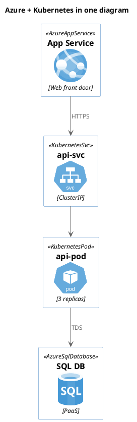
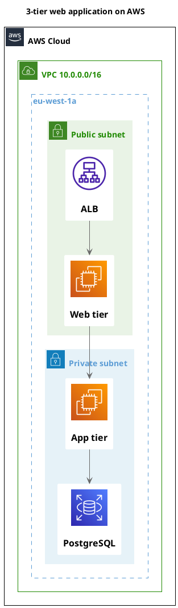
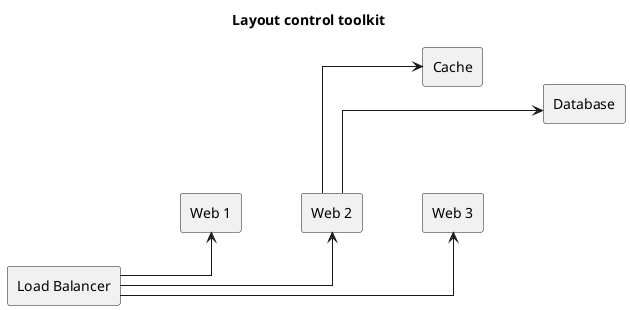
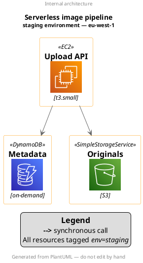
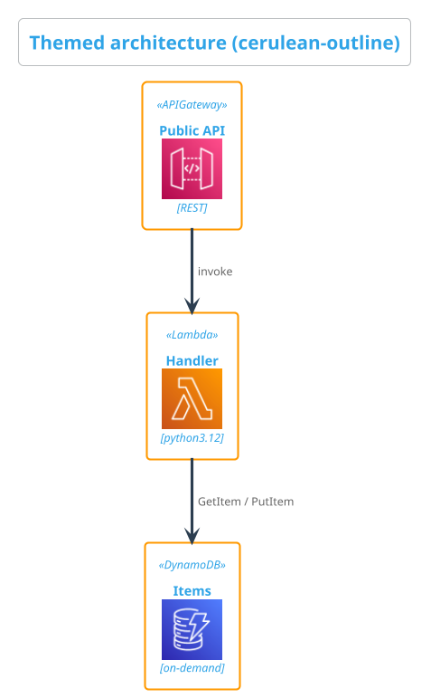
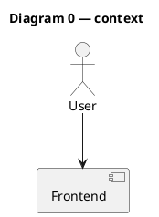
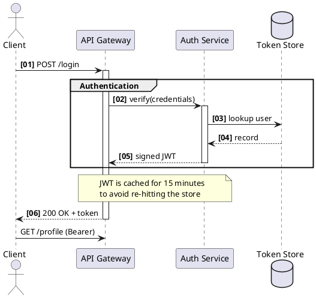
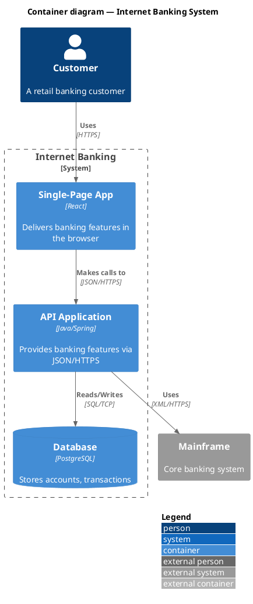
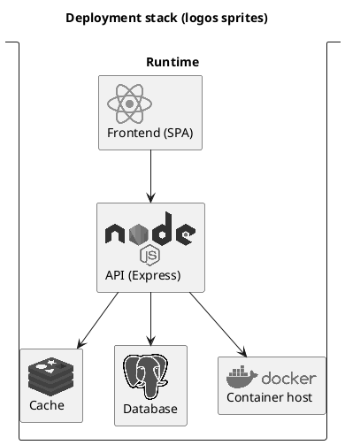
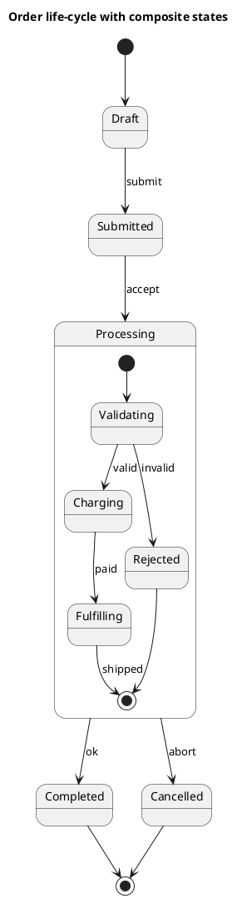

# Cookbook — Advanced Recipes

This page is a **recipe collection**: ten self-contained, battle-tested diagrams that go
beyond the single-feature pages and show how the pieces fit together in real work. Each
recipe is a short problem statement followed by exactly one complete `@startuml … @enduml`
block you can copy, render, and adapt. Every block was validated against the live API and
renders cleanly, so nothing here is aspirational — paste it and you get a picture back.

> All examples target the pinned build **PlantUML v1.2026.8** running under
> `SECURITY_PROFILE=INTERNET`. Icon libraries are pulled only from the **bundled
> standard library** with angle-bracket includes (`!include <...>`); remote
> `!includeurl` to arbitrary hosts is disabled. The exact include paths used below are the
> verified ones documented on the *Architecture Libraries* page — copy them character for
> character, because folder casing and macro casing frequently differ from the file name.

If you are new to a specific technique, the deep-dive pages (*Sequence Diagrams*, *State
Diagrams*, *Architecture Libraries*, …) explain each feature in isolation. This page assumes
you have read those and want to see them **combined**.

---

## 1. Mixing two icon libraries in one diagram

There is no rule that a diagram may include only one library. Because every stdlib library
registers its macros into the same namespace, you can `!include` several of them and freely
mix their elements. Here an **Azure** front door hands off to a service running inside a
**Kubernetes** cluster, which in turn talks to an Azure-managed database — a very common
hybrid topology.

The only discipline required is to include each library's `Common`/`AWSCommon` header once
(it defines colours and the sprite loader) and then include the individual icon files you
need. Aliases from different libraries connect with ordinary arrows.



Watch the casing traps that bite everyone: the file is `Databases/AzureSQLDatabase` but the
macro is `AzureSqlDatabase` (camelCase), and Kubernetes macros come from the `<k8s/...>`
library, **not** `<kubernetes/...>` (that namespace ships raw sprite sheets only).

---

## 2. A full three-tier AWS architecture with groups

Real cloud diagrams are mostly about **containment**: which resource lives in which subnet,
which subnet in which availability zone, which AZ in which VPC. The `awslib/Groups/*`
includes give you exactly those nesting boxes. Each group macro opens a `{ … }` scope; nest
them to mirror your real network. This recipe draws the canonical public-web / private-app /
private-db layout, wrapped in a VPC inside the AWS cloud.



`!include <awslib/AWSSimplified>` switches every icon to the flat, monochrome "simplified"
style that reads better at architecture scale. Drop that line for full-colour service icons.

---

## 3. Layout control — direction, `together {}`, and hidden links

PlantUML's auto-layout is usually good, but when it is not you have four levers, all shown
together here:

- **`left to right direction`** rotates the whole flow 90° — often the single biggest
  readability win for wide pipelines.
- **`skinparam linetype ortho`** forces right-angled (Manhattan) connectors instead of
  diagonal lines.
- **`together { … }`** asks the engine to keep a set of nodes physically grouped.
- **`-[hidden]-`** (and `-[hidden]->`) draws an *invisible* edge whose only job is to impose
  an ordering/alignment constraint — the layout engine respects it, but nothing is rendered.



Reach for hidden links sparingly and only after the real edges are in place — over-constrain
the graph and you get worse layouts, not better ones.

---

## 4. Legends and titles on an architecture diagram

Titles, headers, footers, and legends are ordinary UML commands and work on top of any icon
library. Titles accept **Creole/HTML** markup, so you can size and bold parts of them, and a
`legend` block gives you a free-form key anchored to a corner.



Multi-line `title … end title` (and `legend … end legend`) let you span several lines;
the one-line forms `title X`, `header X`, `footer X`, `caption X` are fine for short text.
`legend` takes an optional position (`left`, `right`, `top`, `bottom`, `center`).

---

## 5. Theming an architecture diagram

A single `!theme <name>` line — placed right after `@startuml` — restyles fonts, colours and
borders across the entire diagram. Themes compose with icon libraries and with your own
`skinparam` overrides (which win, because they come later). Browse the catalogue at
`GET /api/v1/themes`; here we use `cerulean-outline` and then fine-tune the arrow and border
colours by hand.



If you prefer not to edit the source, the render API accepts a `theme` field that is injected
as `!theme <name>` for you — handy for applying a house style to diagrams you do not control:

```json
{ "source": "@startuml\n...\n@enduml", "format": "svg", "theme": "cerulean-outline" }
```

---

## 6. A multi-`@startuml` source rendered by index

One source file may hold **several** diagrams, each in its own `@startuml … @enduml` block.
This is convenient when a single logical document (a design doc, an ADR) needs a context
picture and a detail picture that live and version together.



By default the renderer returns the **first** block (index `0`) — which is what the live
preview above shows. To select a different block, pass the `index` field on the render
request:

```json
{ "source": "@startuml\n...first...\n@enduml\n@startuml\n...second...\n@enduml",
  "format": "svg", "index": 0 }
```

Note two things about this build. First, a syntax error in *any* block fails the whole
render — the source is parsed as a unit — so keep every block valid. Second, index selection
for the single-image SVG/PNG endpoint is reliable for index `0`; if you need each sub-diagram
as its own deterministic image, the most robust approach is to split them into separate
source strings and render each independently.

---

## 7. A sequence diagram with autonumber, groups, and notes

Sequence diagrams shine when you layer three features: **`autonumber`** (with a format
string) to number the messages, **`group`/`alt`/`opt`** frames to bracket related exchanges,
and **notes** to annotate the why. This login flow uses a custom number format, a named group,
a spanning note, and `autonumber stop` to exclude a trailing message from the count.



`autonumber "<b>[00]"` says "start at 1, print two digits, wrap in `[ ]`, bold". Other useful
forms: `autonumber 10 10` (start at 10, step 10) and `autonumber 1.1.1` for hierarchical
numbering inside groups.

---

## 8. A C4 container diagram with a legend

The C4 model ships as a bundled library. Include the level you want (`C4_Context`,
`C4_Container`, `C4_Component`, …), then use the semantic macros: `Person`, `System_Ext`,
`Container`, `ContainerDb`, `System_Boundary`, and the `Rel*` family for relationships.
`LAYOUT_WITH_LEGEND()` appends the standard C4 key so readers know what each shape means.



Use the directional variants (`Rel_U`, `Rel_D`, `Rel_L`, `Rel_R`) to hint layout, and swap
`LAYOUT_WITH_LEGEND()` for `LAYOUT_TOP_DOWN()` or `LAYOUT_LEFT_RIGHT()` to change flow.
Note that the upstream C4 README's remote `!include https://.../C4_Container.puml` is blocked
under `INTERNET` — always use the bundled `<C4/...>` path shown here.

---

## 9. Using logos / devicons sprites in a stack diagram

Not every library provides macros. The `logos` library is a flat folder of **sprites** with
no macros and no common header: include the sprite file, then reference it inline as
`<$name>` anywhere text is accepted — including inside a node label. Combined with the `stack`
element keyword this produces a compact, recognisable technology stack.



The same `<$sprite>` trick works for `material2.1.19` and for the `tupadr3` devicon / Font
Awesome sprites (which, unlike `logos`, *also* expose macros such as `DEV_MYSQL(...)` and
`FA5_SERVER(...)` once you `!include <tupadr3/common>` first).

---

## 10. A state machine with composite states

Composite (nested) states let you hide a sub-workflow inside a single outer state, then
expand it in place. Declare the outer state with `state Name { … }` and give it its own
`[*]` start/end pseudostates. Here an order's overall life-cycle stays readable while the
`Processing` phase carries its own validate → charge → fulfil sub-machine, including an early
exit for rejected orders.



The inner `[*]` symbols are scoped to their composite state, so `Fulfilling --> [*]` ends the
sub-machine (bubbling control back to the outer transitions) rather than terminating the whole
diagram. Nest states as deeply as the domain requires, and add concurrent regions with a `--`
separator inside the composite block when a state has independent parallel behaviour.

---

## Where to go next

- **Architecture Libraries** — the full catalogue of bundled icon sets with verified include
  paths and every casing gotcha called out.
- `GET /api/v1/libraries` — machine-readable list of every library id you can include.
- `GET /api/v1/themes` — every theme name accepted by `!theme` and the render `theme` field.
- `GET /api/v1/examples` — curated, ready-to-render sources, one per technique above.
