# Deployment Diagrams

A **deployment diagram** describes the physical and logical topology of a system: how software (components, artifacts, files) is deployed onto hardware and infrastructure (nodes, servers, devices, cloud environments) and how everything is connected. In PlantUML, the "deployment diagram" is really a flexible superset that unifies the classic UML *deployment*, *component*, and *use-case* element vocabularies into a single free-form canvas. You get 24+ ready-made element shapes (nodes, databases, clouds, queues, folders, actors, and more), arbitrary nesting, and a rich arrow/link language for wiring them together.

Use a deployment diagram whenever you want to show **where things run and how they talk**: 3-tier web architectures, cloud/VPC topologies, container and Kubernetes layouts, network segmentation, message-broker flows, or high-level system context diagrams. Because the same element keywords also power component and use-case diagrams, you can freely mix components, interfaces, and use cases into the same picture.

Every diagram below is complete and self-contained. Each opens with `@startuml` and closes with `@enduml`.

## The element vocabulary

PlantUML deployment diagrams support a large set of predefined element types, each with its own icon/shape. The full list of keywords is:

`actor`, `agent`, `artifact`, `boundary`, `card`, `circle`, `cloud`, `collections`, `component`, `control`, `database`, `entity`, `file`, `folder`, `frame`, `hexagon`, `interface`, `label`, `node`, `package`, `person`, `queue`, `rectangle`, `stack`, `storage`, `usecase` (plus `action` and `process` aliases).

Any of these can be declared, nested, aliased, styled, and linked using exactly the same rules.

### Long-form declaration

The long form is simply the keyword followed by an identifier (and optionally a quoted display label). This is the most common and most readable style, and it works for every element type.

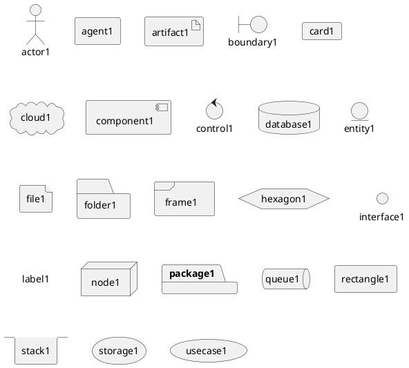

This single diagram is the visual "cheat sheet": it renders every shape so you can pick the one whose icon best matches your intent (a `database` looks like a cylinder, a `cloud` like a cloud, a `queue` like a pipe, a `folder`/`file` like filesystem icons, and so on).

### Short-form declaration

Four of the most-used elements have a punctuation-based shorthand borrowed from component and use-case diagrams:

| Element | Short form | Example |
|---------|------------|---------|
| actor | `:name:` | `:actor2:` |
| component | `[name]` | `[component2]` |
| interface | `() "name"` | `() "interface2"` |
| usecase | `(name)` | `(usecase2)` |

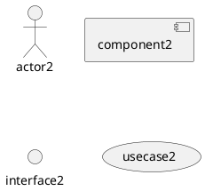

The bracket form `[component2]` is especially handy when wiring components inline in an arrow (for example `[web] --> [db]`) without declaring them first.

### Aliases with `as`

When an element's display name contains spaces or you simply want a short handle to reference in links, use the `as` keyword. You can put the quoted label first and the alias second, or the identifier first and the label second — both directions are accepted.

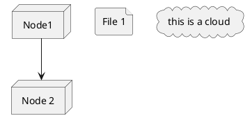

The alias (`n1`, `n2`, …) is what you use on the left/right of arrows; the quoted string is what the reader sees.

## Descriptions and multi-line labels

You can attach a rich, multi-line description to an element by following it with a `[ ... ]` block. Inside the block, special separator lines create visual dividers of different styles: `----` (a line), `====` (a double line), `....` (a dotted line), and `____` (an underline-style line).

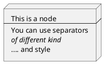

This is the idiomatic way to document what a node contains or does directly on the shape, rather than resorting to a separate note.

## Nesting elements

Most container-style elements can hold other elements inside braces `{ ... }`. This is the heart of deployment modeling — it is how you show that a component runs *inside* a node, which runs *inside* a VPC, which runs *inside* a cloud. The nestable types include: `artifact`, `card`, `cloud`, `component`, `database`, `file`, `folder`, `frame`, `hexagon`, `node`, `package`, `queue`, `rectangle`, `stack`, `storage` (and `action`/`process`).

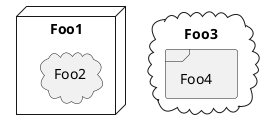

Nesting can go arbitrarily deep. The following extreme example nests ten container types inside one another — useful as a reference for how each shape looks when it wraps another:

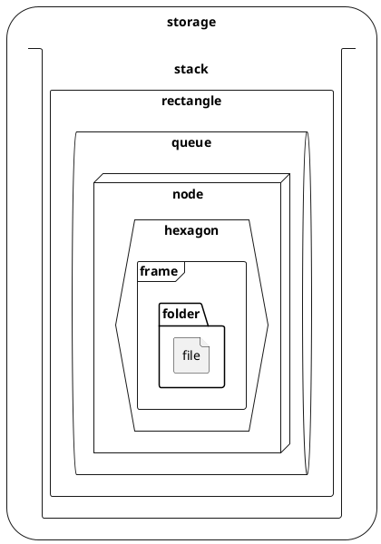

> **Layout tip.** With the default Graphviz engine, PlantUML lays out *nested elements first, then simple elements*. The Smetana engine reverses this (*simple first, then nested*). If a diagram's arrangement surprises you, the nesting order is often the reason — see the layout section below.

## Links and arrows

Elements are connected with links. The link operator's characters determine the line style, its length hints at layout, and an optional `: label` adds text.

### Basic link operators

The line-drawing characters are:

- `--` a solid line
- `..` a dotted line
- `~~` a wavy line
- `==` a bold line

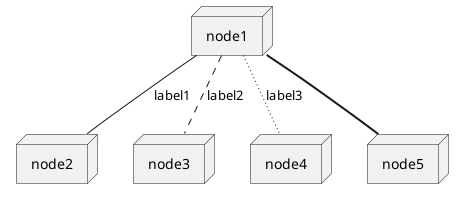

### Arrow heads

Adding a head turns a plain link into a directed arrow. Beyond the ordinary `>`, PlantUML supports a family of decorative heads:

- `-->` standard open arrow
- `--*` filled diamond/circle terminator
- `--o` hollow circle terminator
- `--+` plus terminator
- `-->>` double head

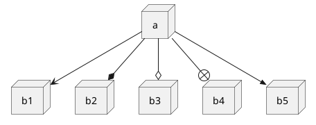

Other head glyphs documented for these diagrams include `#`, `^`, `\\`, `|>`, `||>`, `:|>`, `0`, `@`, and circle-port variants such as `0)--(0`, `-(0)-`, and `--(0`.

### Directional arrows and layout control

The **length and direction** of an arrow influence how Graphviz places the two elements. A short one-hyphen arrow (`->`) keeps things close; a longer arrow (`-->`) pushes them apart. You can also force a direction by embedding `up`, `down`, `left`, or `right` inside the arrow, which is one of the most important layout levers you have.

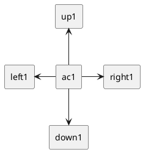

The two-letter abbreviations `-le->`, `-ri->`, `-up->`, and `-do->` work identically.

### Line styles inside brackets

Put a style keyword in square brackets inside the arrow to change how the line is drawn: `[bold]`, `[dashed]`, `[dotted]`, `[plain]`, and `[hidden]`. A **hidden** link draws nothing but still creates a layout constraint — the classic trick for nudging elements into alignment without a visible connector.

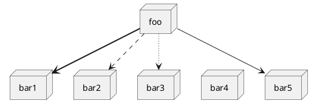

### Arrow color and thickness

Inside the same bracket you can set a color with `#name` or `#RRGGBB`, a `thickness=N`, or combine several attributes separated by commas. You can even specify multiple colors separated by semicolons to produce a **gradient** line.

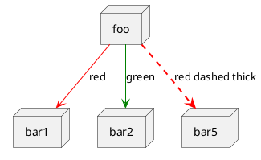

Gradient and heavy-thickness variants:

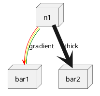

### Inline arrow styling (CSS-like)

An alternative syntax places a style string *after* the target element, using CSS-like properties such as `line:COLOR`, `line.bold`, `line.dashed`, `line.dotted`, and `text:COLOR`:

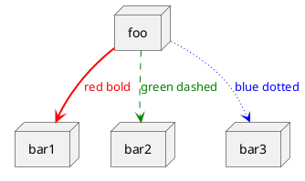

## Notes

Notes annotate a diagram with free-standing commentary. Anchor a note to a specific element with `note left of`, `note right of`, `note top of`, or `note bottom of`. A **floating** note is declared with `note "text" as N` and can then be linked to any element like a normal node.

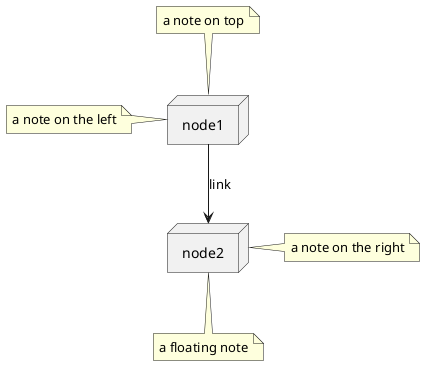

You can also attach a note directly **to the most recent link** with `note on link`:

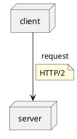

## Grouping and containment

Grouping is expressed purely through nesting — there is no separate "group" keyword needed. Wrap a set of elements in a container shape (`cloud`, `node`, `frame`, `folder`, `package`, `rectangle`, …) to express that they belong together and share a boundary. This is how you draw a VPC, a subnet, a data center, or a Kubernetes pod.

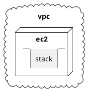

## Ports

A `node` (or other container) can expose explicit connection points called **ports**. `port` is a bidirectional connector, `portin` is an input, and `portout` is an output. Ports sit on the container's border and let arrows dock at a precise spot rather than at the container edge in general.

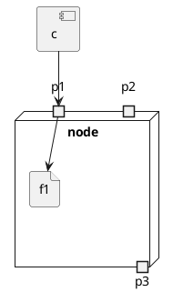

## Styling

### Inline element styling

Just as arrows can carry a style string, elements can too. Append `#` followed by CSS-like properties right after the declaration: fill color (`#palegreen`, `#pink`, or a hex value), `line:COLOR`, `line.bold`/`line.dashed`, and `text:COLOR`. Styling composes cleanly with descriptions, aliases, and nesting.

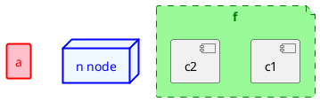

### Stereotypes and the `<style>` block

Stereotypes (`<< ... >>`) both label an element and act as a selector for styling. Define matching rules in a `<style>` block. You can also give a component a classic UML stereotype icon, e.g. `<< (C,#ADD1B2) >>`.

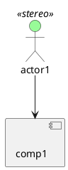

The `<style>` block can also target a whole diagram type or element class. Here every component gets a pale-green background, a red border, and a thin line:

```plantuml
@startuml
<style>
componentDiagram {
  BackGroundColor palegreen
  LineThickness 1
  LineColor red
}
</style>
component c1
component c2
c1 --> c2
@enduml
```

### Rounded corners with `skinparam`

The legacy `skinparam` mechanism still works and is convenient for one-off tweaks such as rounding the corners of rectangles. You can round every rectangle globally with `skinparam roundCorner 15`, or scope the rounding to a stereotype:

```plantuml
@startuml
skinparam rectangle {
  roundCorner<<Concept>> 25
}
rectangle "Concept Model" <<Concept>> {
  rectangle "Example 1" <<Concept>> as ex1
  rectangle "Example 2" <<Concept>> as ex2
}
ex1 --> ex2
@enduml
```

## Layout: direction and engines

By default a deployment diagram flows **top to bottom**. Switch to a horizontal flow with `left to right direction` — this often produces a much cleaner picture for pipeline- or tier-style architectures. (`top to bottom direction` restores the default.)

```plantuml
@startuml
left to right direction
node A
node B
node C
A --> B
B --> C
@enduml
```

For the layout engine itself, PlantUML defaults to **Graphviz**. The pure-Java **Smetana** engine (no Graphviz install required) is selected with `!pragma layout smetana`. Remember the ordering difference: Graphviz places nested elements first, Smetana places simple elements first.

## Mixing with other diagram types

The `allowmixing` directive lets you drop class-diagram and object-diagram elements (like `class`) into a deployment diagram, so you can show, for example, a class deployed on a node next to a use case.

```plantuml
@startuml
allowmixing
class MyClass
node MyNode
usecase MyUsecase
MyClass --> MyNode
@enduml
```

## Worked examples

### Classic three-tier web architecture

A load balancer fanning out to app servers backed by a primary/replica database — the canonical deployment picture.

```plantuml
@startuml
actor "User" as user
node "Load Balancer" as lb
node "App Server 1" as app1
node "App Server 2" as app2
database "Primary DB" as db
database "Replica DB" as replica

user --> lb : HTTPS
lb --> app1
lb --> app2
app1 --> db : read/write
app2 --> db : read/write
db --> replica : replication
@enduml
```

### Cloud / VPC topology with subnets

Nesting frames inside a VPC inside a cloud is the standard way to represent public/private subnet segmentation.

```plantuml
@startuml
cloud "AWS Cloud" {
  node "VPC" {
    frame "Public Subnet" {
      node "EC2 Web" as web
    }
    frame "Private Subnet" {
      node "EC2 App" as app
      database "RDS" as rds
    }
  }
}
actor Client
Client --> web : HTTPS
web --> app
app --> rds
@enduml
```

## Render it via the API

Any of the examples above can be rendered through the PlantUML API server. POST the source to `/api/v1/render` and choose a `format` (`svg`, `png`, or `txt`):

```bash
curl -sS -X POST https://plantuml.joor.net/api/v1/render \
  -H 'content-type: application/json' \
  -d '{
    "source": "@startuml\nnode \"Web Server\" as web\ndatabase \"PostgreSQL\" as db\nweb --> db : SQL\n@enduml",
    "format": "svg"
  }' \
  -o deployment.svg
```

The response body is the rendered diagram in the requested format. Swap the `source` for any complete `@startuml … @enduml` document from this page.
