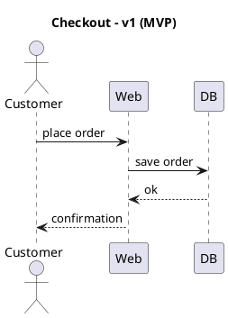
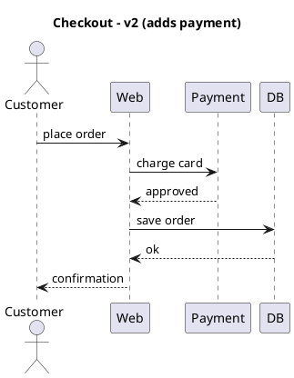
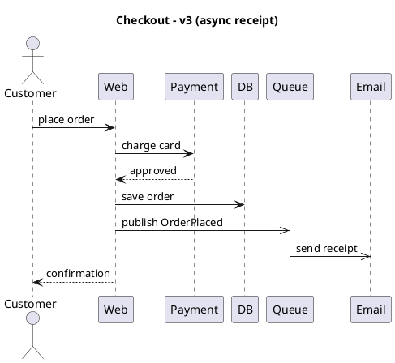
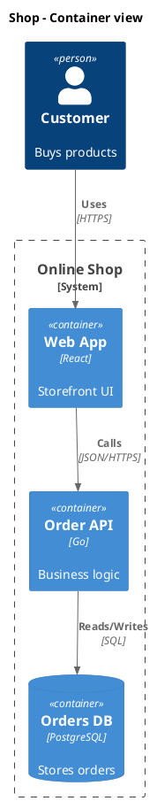
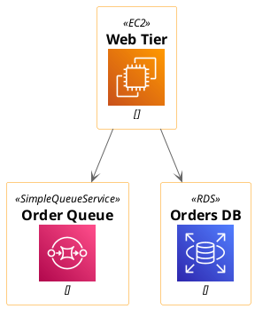
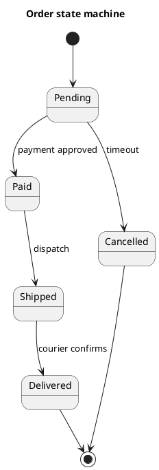

# Diagrams as Code

**Diagrams as Code** is the practice of describing a diagram in plain text and letting a
renderer turn that text into a picture — instead of dragging boxes around in a GUI and
saving an opaque binary file. With PlantUML the *source of truth* is a short, human-readable
`.puml` file; the PNG or SVG is a disposable *build artifact* regenerated on demand.

This one shift — treating the diagram as source code rather than as a document — is what
lets diagrams join every good habit you already apply to code: they live in Git next to the
code they describe, they are reviewed in pull requests, they are regenerated by CI, and any
version of the diagram can be reproduced byte-for-byte from any version of the repository.

This page explains the philosophy behind the approach (drawn from Chris Madden's
*Hitchhiker's Guide to PlantUML* and its "Journey to Documentation as Code" chapter) and
then walks through concrete, copy-pasteable workflows for rendering diagrams in CI with this
API, embedding the results in Markdown, and reviewing diagram diffs in pull requests.

## The philosophy

### A diagram is text

Compare the two worlds. In the GUI world a diagram is a `.vsdx` / `.drawio` / `.png` blob:
you open a heavyweight editor, nudge shapes by hand, and export an image. In the
Diagrams-as-Code world the diagram is this:



Five lines of text describe the whole interaction. Layout is the renderer's job, not yours —
you spend your effort on *what the system does*, not on pixel alignment. Because the artifact
is text, every tool built for text now works on your diagram: `grep`, `sed`, `diff`, code
review, templating, and search.

### Documentation should live next to the code

The core principle from the *Journey to Documentation as Code* chapter is blunt and worth
quoting: **"the documentation of software should live as close as possible to the software it
is describing (e.g. same source code repository). It can then be published to multiple formats
or platforms from there for consumption."**

Practically, that means the `.puml` files sit in the same repository as the code — often in
the same directory as the module they describe. When a developer changes the code, the
diagram is right there to change too, in the same commit, reviewed by the same people. The
diagram cannot silently drift out of date on some wiki nobody edits, because it is part of
the change set. As the guide puts it, the description stays **"current, and in sync"** with the
system through development and maintenance.

This is the antidote to the classic failure mode: a beautiful architecture diagram drawn once
at project kickoff, exported to a PNG, pasted into a wiki, and never touched again — wrong
within a month, actively misleading within a year.

### Why text beats a GUI tool

The *Hitchhiker's Guide* contrasts text-based diagramming with binary/GUI approaches on four
axes:

1. **Version control** — you "maintain that text version in a source code repository beside
   the code for the system it is describing." Every change is a commit with an author, a
   date, and a message.
2. **Collaboration and review** — a team can "share a model or diagram between all members …
   they can all understand and contribute to and edit." No proprietary editor, no license, no
   merge nightmares over a binary file.
3. **Continuous synchronization** — the diagram stays in sync with the running system because
   it changes in lockstep with the code.
4. **Developer comfort** — it "fits with a developer workflow." You edit diagrams in your IDE,
   commit them with `git`, and never leave the terminal.

The trade-off is honest: you give up direct manual control of layout. For architecture,
sequence, and state diagrams that is a *feature* — auto-layout keeps things consistent and
frees you to iterate. For pixel-perfect marketing art, reach for a GUI tool. The guide frames
this as "lightweight, just-enough Agile modeling": model enough to communicate, no more.

### The five properties you get for free

Putting it together, a diagram-as-code is:

- **Textual** — authored and read as plain text.
- **Version-controlled** — one commit history for code and diagrams together.
- **PR-reviewed** — changes land through the same review gate as code.
- **CI/CD-generated** — images are built by a pipeline, never committed by hand.
- **Reproducible** — the same source always renders the same diagram; regenerate any
  historical version on demand.

The rest of this page turns each of these into a concrete workflow.

## Keeping diagrams beside the code

The simplest and most durable convention is to store `.puml` files right next to what they
describe:

```bash
myservice/
├── cmd/
│   └── main.go
├── internal/
│   └── orders/
│       ├── service.go
│       └── service.puml        # diagram lives with the module it documents
├── docs/
│   └── architecture/
│       ├── containers.puml      # system-level views
│       └── order-states.puml
└── README.md
```

A good rule of thumb: **local diagrams next to the local code, system-wide diagrams in
`docs/`.** The `orders` sequence diagram belongs with `orders/`; the whole-system container
view belongs in `docs/architecture/`. Either way it is in the same repo, so a single `git
clone` gives you the code *and* its living documentation.

## A diagram evolving with the code

Because the diagram is text in Git, it evolves through commits exactly like code. The three
diagrams below are three successive versions of the same checkout flow — the kind of change
that would appear across three pull requests as the feature grows. Reviewers see each step as
a small, readable diff.

**Version 1 — the minimal MVP.** Customer, a web app, a database.


**Version 2 — a payment step is added.** A new participant and two messages appear; the diff
is tiny and self-explanatory in review.



**Version 3 — receipts go asynchronous.** The order is now published to a queue and the
receipt email is sent off the critical path (note the async `->>` arrows).



Each version is a complete, self-contained diagram. In a real repo they would be the *same*
file at three points in history — `git log -p internal/orders/checkout.puml` would show
exactly this evolution, with an author and a rationale attached to every change.

## Rendering diagrams in CI with this API

The whole point of Diagrams as Code is that **you never commit the rendered image** — CI
renders it. This API exposes a single render endpoint that takes PlantUML source and returns
the image bytes directly, which makes it trivial to wire into any pipeline.

### The one command everything is built on

`POST /api/v1/render` accepts a JSON body `{"source": "...", "format": "svg"}` and responds
with the raw image bytes (the SVG or PNG itself — not a JSON wrapper). So a single `curl` with
`-o` writes a finished diagram to disk:

```bash
# Render one .puml file to an .svg using the API.
# jq -Rs slurps the whole file into a JSON string, safely escaping newlines/quotes.
jq -Rs '{source: ., format: "svg"}' internal/orders/checkout.puml \
  | curl -sS --fail -m 40 \
      -X POST https://plantuml.joor.net/api/v1/render \
      -H 'content-type: application/json' \
      -d @- \
      -o internal/orders/checkout.svg
```

A few details that matter in CI:

- `--fail` makes `curl` exit non-zero on an HTTP error, so a broken diagram *fails the build*
  instead of silently writing an error page.
- `-m 40` caps the request at 40 seconds so a hung render cannot stall the pipeline.
- Swap `"format": "svg"` for `"png"` if you need raster output; SVG is preferred for docs
  because it is itself text, scales cleanly, and diffs sensibly.

### Render every diagram in the repo

A tiny loop turns the single command into a full-repo build step:

```bash
#!/usr/bin/env bash
set -euo pipefail

API="https://plantuml.joor.net/api/v1/render"

# Find every .puml file and render it to a sibling .svg.
find . -name '*.puml' -print0 | while IFS= read -r -d '' src; do
  out="${src%.puml}.svg"
  echo "Rendering $src -> $out"
  jq -Rs '{source: ., format: "svg"}' "$src" \
    | curl -sS --fail -m 40 -X POST "$API" \
        -H 'content-type: application/json' \
        -d @- \
        -o "$out"
done
echo "All diagrams rendered."
```

`set -euo pipefail` means the first failed render aborts the script and fails the job — you
learn about a broken diagram in CI, not in production docs.

### A GitHub Actions workflow

Drop this in `.github/workflows/diagrams.yml`. On every push it re-renders all diagrams and
publishes the result. Two common shapes are shown: uploading the SVGs as a build artifact, and
committing them back for a docs branch.

```yaml
name: Render PlantUML diagrams

on:
  push:
    paths:
      - '**/*.puml'          # only run when a diagram changes
  pull_request:
    paths:
      - '**/*.puml'

jobs:
  render:
    runs-on: ubuntu-latest
    steps:
      - uses: actions/checkout@v4

      - name: Install jq
        run: sudo apt-get update && sudo apt-get install -y jq

      - name: Render all .puml files to SVG
        env:
          API: https://plantuml.joor.net/api/v1/render
        run: |
          set -euo pipefail
          find . -name '*.puml' -print0 | while IFS= read -r -d '' src; do
            out="${src%.puml}.svg"
            echo "::group::Render $src"
            jq -Rs '{source: ., format: "svg"}' "$src" \
              | curl -sS --fail -m 40 -X POST "$API" \
                  -H 'content-type: application/json' \
                  -d @- \
                  -o "$out"
            echo "::endgroup::"
          done

      - name: Upload rendered diagrams as a build artifact
        uses: actions/upload-artifact@v4
        with:
          name: diagrams
          path: '**/*.svg'
```

Because the workflow runs on `pull_request` too, **a diagram that no longer renders breaks the
PR check** — the same safety net you get from a failing unit test. If you would rather publish
the images (e.g. to a `gh-pages` docs site) than attach them as artifacts, replace the upload
step with your existing deploy step; the render step is unchanged.

> **Security note.** Under `SECURITY_PROFILE=INTERNET` this API only resolves bundled standard
> library includes via the angle-bracket form (`!include <...>`). Remote `!includeurl` to
> arbitrary hosts is disabled. Keep your CI diagrams self-contained or dependent only on the
> bundled stdlib (C4, AWS, Azure, Kubernetes, etc.) so they render identically in the pipeline
> and locally.

### A note on caching and pinning

CI runs should be reproducible. Two habits help:

- **Pin the PlantUML version** you expect (this API targets `v1.2026.8`); layout tweaks
  between engine releases can produce cosmetic diff noise.
- **Only render what changed.** The `paths:` filter above already scopes the job to `.puml`
  edits; for very large repos you can further diff against the base branch and render only the
  touched files.

## Embedding rendered SVGs in Markdown and READMEs

Once CI produces the SVGs, embed them like any image. Keep the *source* in the repo and point
the docs at the *rendered artifact*:

```markdown
## Order service architecture


<!-- Source of truth: docs/architecture/containers.puml
     Rendered by CI (.github/workflows/diagrams.yml) — do not edit the .svg by hand. -->
```

Guidelines that keep this maintainable:

- **Never hand-edit the `.svg`.** Add a comment (as above) reminding contributors that the
  image is generated. If someone needs to change the picture, they change the `.puml`.
- **Commit the SVG only if your docs host needs a static file.** GitHub renders committed SVGs
  in Markdown, so many teams do commit the generated image for READMEs. If your docs are built
  by a pipeline (Sphinx, MkDocs, a static site) let the build produce the image and keep it out
  of Git entirely.
- **Prefer SVG over PNG** in Markdown: it stays crisp at any zoom, and because it is text it
  produces a *readable* diff if you do commit it.

On this documentation site the rendering is even more direct: a fenced ` ```plantuml ` block
*is* the live preview — the source and the picture are literally the same thing, which is
Diagrams as Code taken to its conclusion.

## Reviewing diagram diffs in pull requests

This is where Diagrams as Code pays off most. Because the diagram is text, a change to it
shows up as an ordinary diff that a reviewer can read line by line. Adding the payment step
from v1 to v2 above is just:

```diff
  Customer -> Web : place order
+ Web -> Payment : charge card
+ Payment --> Web : approved
  Web -> DB : save order
```

A reviewer instantly sees *what changed in the architecture*, not just that "the diagram
changed." They can comment on the exact line, request changes, and approve — the same workflow
as reviewing code. Contrast this with a binary diagram file, where a PR shows only
"`architecture.png` changed, +0 −0" and the reviewer has to open both versions in an editor
and spot-the-difference by eye.

Practical review tips:

- **Review the `.puml`, not the `.svg`.** Configure your review to treat generated SVGs as
  generated (e.g. mark `*.svg linguist-generated=true` in `.gitattributes`, or add them to a
  `CODEOWNERS`-excluded path) so the diff view highlights the source.
- **Let CI render the PR's diagram** and attach it as an artifact (the workflow above does
  this on `pull_request`). Reviewers who want the picture click the artifact; reviewers who
  want the semantics read the diff. Both are served.
- **Keep diagrams small and focused** so their diffs stay reviewable — one sequence per flow,
  one container view per system boundary. A giant everything-diagram produces unreadable
  diffs, the same way a 2,000-line function produces unreadable code diffs.

## Standard-library diagrams still render in CI

Diagrams as Code is not limited to plain UML. The bundled standard library gives you rich,
opinionated notations that render entirely from the API with no external assets — so they work
in CI under the INTERNET security profile. These make excellent living architecture docs.

**C4 container diagram** using the bundled `<C4/...>` includes:



**AWS deployment view** using the bundled `<awslib/...>` sprites — the same picture you would
draw in a GUI icon tool, but reproducible from text:



Both rely only on angle-bracket stdlib includes, so they render identically in your editor, in
this preview, and in your CI pipeline — no `!includeurl`, no network fetch, fully reproducible.

## Diagrams as living state machines

Finally, Diagrams as Code shines for documenting behavior that *changes over time* — like an
order lifecycle. When engineers add a new state (say, `Refunded`), they add one line to the
`.puml`, the diff is obvious in review, and CI republishes the picture. The documentation
tracks the state machine because it *is* in the same commit as the state machine.



## Putting it all together

A mature Diagrams-as-Code setup looks like this end to end:

```bash
# 1. Author the diagram as text, next to the code it documents.
$EDITOR internal/orders/checkout.puml

# 2. Commit it with the code change that motivated it.
git add internal/orders/service.go internal/orders/checkout.puml
git commit -m "orders: send receipt asynchronously (v3)"

# 3. Open a PR — reviewers read the .puml diff and the CI-rendered SVG artifact.
git push origin feature/async-receipt

# 4. CI renders every .puml to SVG via the API and publishes the docs.
#    Nobody ever hand-exported an image; nobody's diagram is out of date.
```

That is the whole idea: **the diagram is code.** It is written as text, versioned with the
code, reviewed in the PR, rendered by CI, and reproducible forever from the repository. The
picture is just a build output — the source is the truth, and the truth lives next to the
software it describes.

---

*Philosophy and quotations adapted from Chris Madden's
[Hitchhiker's Guide to PlantUML](https://crashedmind.github.io/PlantUMLHitchhikersGuide/) and
its
[Journey to Documentation as Code](https://crashedmind.github.io/PlantUMLHitchhikersGuide/DocumentationAsCode/JourneyDocumentationASCode.html)
chapter.*
