# Entity Relationship (ER / IE)

An **Entity Relationship diagram** models the *structure of data*: the things a system stores (entities), the facts recorded about each thing (attributes), and how the things relate to one another (relationships and their cardinalities). PlantUML draws ER diagrams using the **Information Engineering (IE)** notation — the classic "crow's foot" style used for relational database schemas.

The IE notation is not a separate diagram engine; it is a thin extension of the **Class diagram**. Concretely, IE adds three things on top of class diagrams:

1. an **`entity`** alias that maps to the class-diagram `class` keyword;
2. an extra **`*`** visibility modifier that marks an attribute as *mandatory*;
3. a family of **crow's-foot relation connectors** (`|o`, `||`, `}o`, `}|` and their mirrors) that express cardinality.

Because IE *is* a class diagram underneath, everything you know from class diagrams — colors, stereotypes, `skinparam`, `title`, `hide`, layout directives — works unchanged. Use ER/IE diagrams when you are designing a database schema, documenting an existing one, communicating a data model to developers or DBAs, or reasoning about foreign keys and cardinality constraints.

All examples below are complete, self-contained diagrams that render as-is against the PlantUML API (v1.2026.8).

## Declaring entities

An entity is declared with the `entity` keyword. In its simplest form an entity has just a name and no body:

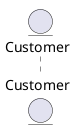

### Adding attributes

Give the entity a body in braces and list one attribute per line. Attributes are rendered as the "fields" of the box:

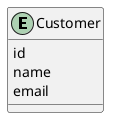

### Aliases, types and stereotypes

For real schemas you usually want a display name plus a short alias to reference in relations, typed attributes, and stereotypes that annotate each column. The pattern `entity "Display Name" as alias` gives you a stable handle, `attribute : type` documents the column type, and `<<...>>` adds a stereotype badge such as `<<generated>>`, `<<PK>>`, `<<FK>>` or `<<unique>>`:

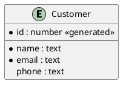

## Mandatory attributes and the separator line

Two conventions in the example above are worth calling out explicitly.

### The `*` mandatory modifier

IE adds `*` as an extra visibility modifier meaning **mandatory** (NOT NULL). Prefix an attribute with `*` to mark it required; leave it off for optional (nullable) columns. If the attribute text itself starts with Creole bold markup (`**bold**`), put a **space after the `*`** so PlantUML does not merge the modifier into the bold sequence:

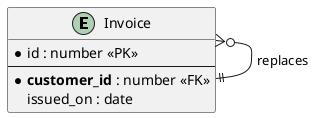

### The `--` separator

A line containing only `--` draws a horizontal divider inside the entity box. The idiomatic use is to separate the **identifying attributes (primary key)** in the top compartment from the **descriptive/foreign-key attributes** below it — exactly the visual grammar of an IE entity.

## Relationships and crow's-foot cardinality

Relations are written `EntityA <connector> EntityB`, where the connector encodes cardinality at *both* ends using crow's-foot symbols. Each end is a **two-character token**; the two tokens are joined by a line body of dashes (`--`, solid) or dots (`..`, dashed).

### The four endpoint tokens

Read the token nearest each entity as the cardinality *at that entity's end*. The left-hand and right-hand forms are mirror images:

| Cardinality              | Left token | Right token | Meaning                         |
|--------------------------|-----------:|:------------|---------------------------------|
| Zero or one              | `\|o`      | `o\|`       | optional, at most one           |
| Exactly one (one and only one) | `\|\|` | `\|\|`      | required, exactly one           |
| Zero or many             | `}o`       | `o{`        | optional, any number            |
| One or many              | `}\|`      | `\|{`       | required, at least one          |

The `|` bar means "one", the `o` circle means "zero (optional)", and the `}`/`{` crow's foot means "many". Combine a left token, a line body, and a right token to build any relationship. For example `||--o{` reads *"exactly one on the left, zero-or-many on the right"* — the canonical one-to-many.

### A one-to-many relationship

The most common relationship: one `User` has zero or more `Order`s, and every `Order` belongs to exactly one `User` (its foreign key):

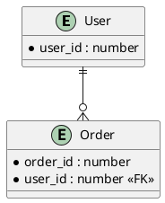

### All four cardinalities side by side

Each connector below pairs a mirrored token on both ends so you can see every base cardinality once:

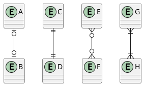

- `A |o--o| B` — zero-or-one to zero-or-one
- `C ||--|| D` — exactly one to exactly one
- `E }o--o{ F` — zero-or-many to zero-or-many (a classic many-to-many)
- `G }|--|{ H` — one-or-many to one-or-many

### Solid vs. dashed lines

The line body controls the stroke: `--` draws a **solid** line, `..` draws a **dashed** line. Dashed lines are conventionally used for *non-identifying* relationships (the child's foreign key is not part of its primary key), solid for *identifying* ones — though PlantUML imposes no semantics, so use whichever convention your team follows:

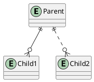

### Labeling relationships

Append `: label` to name the relationship (usually a verb phrase read from the "one" side to the "many" side). Quote the label if it contains spaces or punctuation:

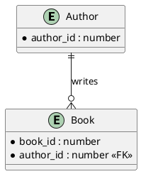

You can label several relations at once; here each connector also documents which base cardinality it uses:

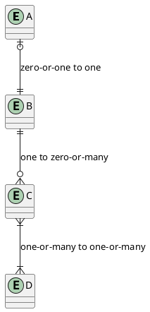

## Primary keys and foreign keys

PlantUML has no dedicated "key" syntax, so keys are expressed by **convention** using stereotypes plus the `--` separator. Two widely used styles follow.

### Stereotype badges

Tag the primary key with `<<PK>>`, foreign keys with `<<FK>>`, and unique columns with `<<unique>>`. Keep identifying columns above the `--` line:

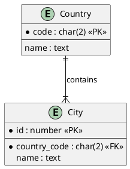

### Highlighting keys with `!define` macros

If you want keys to stand out visually, define small text macros once and reuse them. Here `PK(x)` renders bold red and `FK(x)` renders blue:

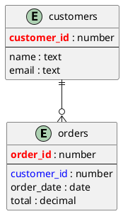

## Modeling patterns

### Self-referential relationships

An entity can relate to itself — the classic "an employee has one manager, a manager has many reports":

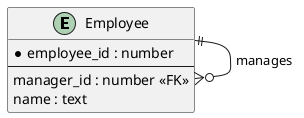

A one-to-one self relation (a person married to at most one other person) uses `|o--o|`:

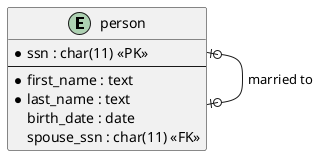

### Many-to-many via an associative (junction) entity

Relational databases cannot store a raw many-to-many relationship; you resolve it with a **junction entity** whose primary key is the pair of foreign keys. Model each side as one-to-many *into* the junction table:

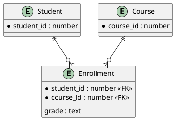

If you also want to show the *logical* many-to-many between the two ends, add a dashed derived relation alongside the physical junction table:

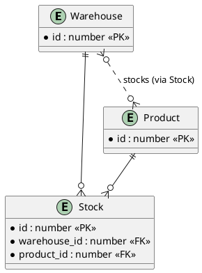

## Styling and layout

### Orthogonal (right-angle) connectors

Crow's-foot glyphs read most cleanly on horizontal/vertical lines. `skinparam linetype ortho` routes every relation with right angles instead of diagonals — strongly recommended for schema diagrams. This is the canonical IE example from the PlantUML documentation:

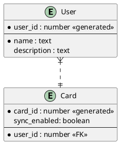

### Per-entity colors

Because entities are classes, you can color them individually with the `#back:...;line:...` syntax (or a simple `#Color`):

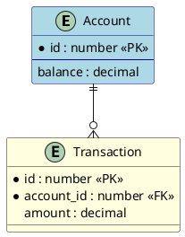

### Global styling, titles and `hide`

`title` adds a caption, `skinparam class { ... }` restyles every box, and `hide circle` / `hide empty methods` remove class-diagram chrome (the type circle and empty method compartment) that is meaningless for pure data models:

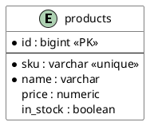

### Layout direction

`left to right direction` flips the default top-down flow to left-right, which often produces a more compact schema:

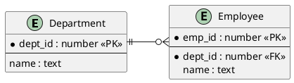

## The class-diagram approach to ER

Since `entity` is just an alias for `class`, you can build the very same diagram with the `class` keyword and standard class-diagram visibility markers (`+` public, `-` private, `#` protected). This is handy when your model straddles code and data:

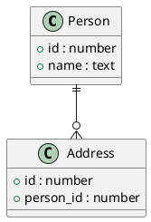

## A complete schema example

Putting it together — a small e-commerce schema using orthogonal routing, `hide circle`, typed columns, PK/FK stereotypes, and the full range of cardinalities:

```plantuml
@startuml
skinparam linetype ortho
hide circle

entity "customer" as customer {
  * id : uuid <<PK>>
  --
  * name : varchar
  * email : varchar
  created_at : timestamp
}

entity "address" as address {
  * id : uuid <<PK>>
  --
  * customer_id : uuid <<FK>>
  street : varchar
  city : varchar
  country : varchar
}

entity "order" as order {
  * id : uuid <<PK>>
  --
  * customer_id : uuid <<FK>>
  status : varchar
  total : decimal
}

entity "order_item" as order_item {
  * id : uuid <<PK>>
  --
  * order_id : uuid <<FK>>
  * product_id : uuid <<FK>>
  quantity : int
}

entity "product" as product {
  * id : uuid <<PK>>
  --
  * name : varchar
  price : decimal
}

customer ||--o{ address
customer ||--o{ order
order ||--|{ order_item
product ||--o{ order_item
@enduml
```

And a second full model — a blog with users, posts, comments and a tag junction table — showing labeled relations end to end:

```plantuml
@startuml
title Blog Data Model

entity User {
  * id : number <<PK>>
  --
  * username : text
  email : text
}
entity Post {
  * id : number <<PK>>
  --
  * author_id : number <<FK>>
  title : text
  body : text
}
entity Comment {
  * id : number <<PK>>
  --
  * post_id : number <<FK>>
  * author_id : number <<FK>>
  body : text
}
entity Tag {
  * id : number <<PK>>
  --
  name : text
}
entity PostTag {
  * post_id : number <<FK>>
  * tag_id : number <<FK>>
}

User ||--o{ Post : authors
User ||--o{ Comment : writes
Post ||--o{ Comment : has
Post ||--o{ PostTag
Tag ||--o{ PostTag
@enduml
```

## Quick reference

- **Entity:** `entity Name` or `entity "Display" as alias { ... }`
- **Attribute:** `name : type <<stereotype>>`, one per line
- **Mandatory attribute:** prefix with `*` (space after `*` if the text begins with `**bold**`)
- **Key compartment separator:** a line containing only `--`
- **Endpoint tokens:** `|o` zero-or-one · `||` exactly one · `}o` zero-or-many · `}|` one-or-many (mirror on the right: `o|`, `||`, `o{`, `|{`)
- **Line body:** `--` solid · `..` dashed
- **Label:** append `: text` to the relation
- **Recommended styling:** `skinparam linetype ortho`, `hide circle`

## Render it via the API

Any example above can be rendered with a single POST to the render endpoint. Save the source and send it as JSON:

```bash
curl -sS -X POST https://plantuml.joor.net/api/v1/render \
  -H 'content-type: application/json' \
  -d '{
    "format": "svg",
    "source": "@startuml\nentity User {\n  * user_id : number\n}\nentity Order {\n  * order_id : number\n  * user_id : number <<FK>>\n}\nUser ||--o{ Order\n@enduml"
  }'
```

Set `"format"` to `svg`, `png` or `txt` depending on the output you want. The response contains the rendered diagram; a non-200 status indicates a syntax error in the `source`.
