# Gantt Charts

A **Gantt chart** is a project-scheduling diagram: horizontal bars laid out along a calendar timeline, one per task, showing when each piece of work starts, how long it lasts, how tasks depend on one another, and where the key checkpoints (milestones) fall. PlantUML draws Gantt charts from a plain-text description between `@startgantt` and `@endgantt`, so you can keep a project plan in version control, diff it, and render it on demand through the API instead of maintaining a spreadsheet.

Reach for a Gantt chart when you need to communicate *scheduling over time*: sprint plans, release roadmaps, construction phases, onboarding timelines, or any sequence of dated activities with dependencies and deadlines. If you only care about the logical order of steps (not dates), a [Work Breakdown Structure](wbs-diagrams) or an [Activity diagram](activity-diagrams) is usually a better fit.

This page covers the full Gantt syntax: declaring tasks by duration/start/end, aliases, dependencies and constraints, milestones, the "today" marker, colors and completion, resources, separators, the calendar and closed days, print scale and zoom, links, notes, pausing, deleting, day ranges, styling, and label positioning. Every example below is a complete diagram that renders as-is.

## Anatomy of a Gantt description

Every Gantt diagram is wrapped in the `@startgantt` / `@endgantt` tags (note: **not** `@startuml`). Inside, each line is a statement. Statements fall into a few families:

- **Task declarations** — name a task and give it a duration and/or start/end.
- **Constraints** — tie one task's timing to another's (`then`, `starts at ...`).
- **Milestones** — zero-duration checkpoints (`happens`).
- **Calendar setup** — project start date, closed days, colored/named ranges.
- **Presentation** — colors, completion, scale, zoom, notes, links, style.

Task names are written in **square brackets**: `[Design]`. The simplest possible chart is a single task with a duration.

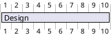

Without a project start date, PlantUML numbers the timeline by day index (day 1, day 2, ...). The keyword `lasts` is the modern spelling; the older `requires` is an accepted synonym (`[Design] requires 10 days`).

## Task duration

A task's length is given with `lasts N days` or `lasts N weeks`, and the two can be combined (`lasts 1 week and 2 days`). By default a **week is 7 days** and a **month is 30 days**; if you close weekends (see [Closed days](#closed-days-weekends-and-the-calendar)) a week effectively becomes 5 working days.

Multiple tasks declared in sequence each start on day 1 unless you constrain them — they stack as parallel bars.

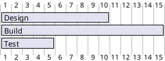

## Anchoring to real dates: `Project starts`

To place the chart on a real calendar, declare `Project starts <date>`. Dates accept the ISO form `YYYY-MM-DD` (and also long forms like `the 20th of september 2017`). Once a project start is set, the timeline shows real dates and you can anchor tasks to absolute or relative days.

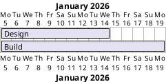

### Absolute and relative start/end

A task can specify its own boundaries several ways:

- `starts <date>` — absolute start.
- `starts D+N` — relative to project start (day 0 is the project start day).
- `ends <date>` or `ends D+N` — absolute or relative end.
- `starts <date> and ends <date>` — both boundaries fixed.
- `starts <date> and lasts N days` — start plus duration.

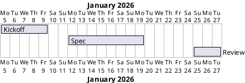

## Aliases

Long, human-readable task names get repetitive when you reference them in constraints. Assign a short alias with `as [Alias]` at declaration time, then use the alias everywhere else.

```plantuml
@startgantt
[Task A] as [A] lasts 5 days
[Task B] as [B] lasts 3 days
[B] starts at [A]'s end
[Extra] lasts 2 days
[Extra] displays on same row as [B]
@endgantt
```

The `[X] displays on same row as [Y]` statement packs two non-overlapping tasks onto a single line to save vertical space.

## Dependencies and constraints

Constraints describe how one task's timing derives from another's — this is what turns a list of bars into a schedule.

### Sequential chaining: `then` and `->`

- `[A] then [B]` — B begins the moment A ends.
- `[A] -> [B]` — arrow notation for the same relationship (draws a dependency arrow).

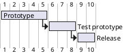

### Explicit anchors: `starts at ... 's end/start`

For finer control, pin a task to another task's start or end:

- `[B] starts at [A]'s end`
- `[B] starts at [A]'s start`

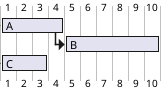

### Offsets and working days

You can add a lag before the anchor. Using `working days` skips closed days (weekends, holidays) when counting the offset, whereas plain `days` counts calendar days.

```plantuml
@startgantt
saturday are closed
sunday are closed
[A] lasts 5 days
[B] lasts 3 days
[B] starts 2 days after [A]'s end
[C] lasts 2 days
[C] starts 3 working days after [A]'s end
@endgantt
```

The offset forms are `starts N days after [X]'s end` and `starts N working days after [X]'s end` (and the corresponding `... 's start`).

## Milestones

A **milestone** is a zero-duration marker for an event or deadline — rendered as a diamond. Declare it with `happens`:

- `[Milestone] happens at [Task]'s end` — anchored to another task.
- `[Milestone] happens <date>` — on a fixed date.

If the same milestone is declared to `happen at` several task ends, it lands at the latest of them (useful for "all of these must finish first").

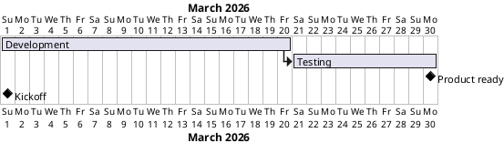

Milestones can also anchor a task's window via `[Task] occurs from [M1] to [M2]`; more commonly you just place two milestones at the ends of the surrounding tasks:

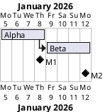

## The "today" marker

Highlight the current point on the timeline with `today`. Position it relative to the project start and give it a color:

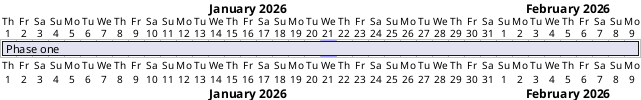

Any color works — a named color, or a `#RGB`/`#RRGGBB` hex value like `#AAF`.

## Colors

Color a task bar with `is colored in <color>`. A single color fills the bar; the `Foreground/Background` two-color form (e.g. `Fuchsia/FireBrick`) sets the completed-portion color and the remaining-portion color separately.

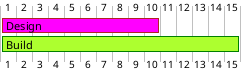

You can attach the color inline at declaration too — e.g. `[Design] lasts 10 days and is colored in GreenYellow/Green`.

## Completion percentage

Show progress by marking how much of a task is done with `is N% completed` (or `is N% complete`). The completed fraction of the bar is filled darker.

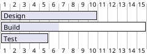

## Resources

Assign people or machines to tasks with `on {Resource}`. Multiple resources are listed space-separated, and a resource can be committed at a partial capacity with `{Name:NN%}`. A resource's unavailability is declared with `{Name} is off on <date>` (single day) or a date range.

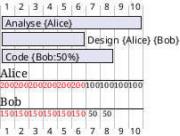

To omit the resource column or footbox, add `hide resources names` or `hide resources footbox`.

## Separators

Break a long chart into labeled sections. A **horizontal separator** is a full-width band written with double dashes: `-- Label --`.

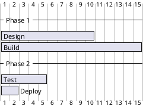

A **vertical separator** is a dated line drawn down the timeline, declared with `Separator just at [Task]'s end`, `Separator just N days after [Task]'s end`, or `Separator just before [Task]'s start`.

## Closed days, weekends, and the calendar

Weekends and holidays remove working days from the schedule, pushing durations out. Configure them once, near the top:

- `saturday are closed` / `sunday are closed` — recurring weekly closures.
- `<date> is closed` — a specific holiday.
- `<date> to <date> is closed` — a closed range.
- `<date> is open` — reopen a day that a broader rule closed.

Closed days appear shaded, and task bars skip over them.

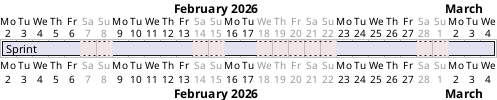

### Colored and named day ranges

Beyond closures, you can highlight or label arbitrary calendar ranges:

- `<date> is colored in <color>` / `<date> to <date> are colored in <color>` — tint days without closing them.
- `<date> to <date> are named [Label]` — annotate a period (e.g. a review window).

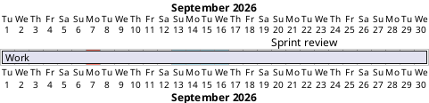

## Print scale and zoom

The timeline granularity is controlled by `printscale` / `projectscale`:

- `printscale daily` — one column per day (the default).
- `printscale weekly` — one column per week.
- `projectscale monthly`, `projectscale quarterly`, `projectscale yearly` — coarser grids.

`zoom N` scales the column width (larger = wider). The two combine, e.g. `printscale weekly zoom 2`.

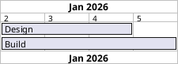

At monthly/quarterly/yearly scale, durations expressed in months read naturally:

```plantuml
@startgantt
projectscale monthly
Project starts 2026-01-01
[Planning] lasts 2 months
[Execution] lasts 4 months
[Execution] starts at [Planning]'s end
@endgantt
```

### Week numbering and calendar dates

With a weekly scale you can label columns by week number instead of dates: `printscale weekly with week numbering from N` (N sets the number of the first visible week; it may be negative). Use `printscale weekly with calendar date` to show dates instead.

```plantuml
@startgantt
Project starts 2026-01-05
printscale weekly with week numbering from 1
[Design] lasts 3 weeks
[Build] lasts 5 weeks
@endgantt
```

### Limiting the printed window

`Print between <date> and <date>` clips the visible timeline to a window even when tasks extend beyond it — handy for zooming into one phase of a long project.

```plantuml
@startgantt
Project starts 2026-01-05
Print between 2026-01-05 and 2026-01-15
[Alpha] lasts 30 days
@endgantt
```

## Links (hyperlinks)

Make a task clickable in the rendered SVG with `links to [[url]]`. Because this build runs under `SECURITY_PROFILE=INTERNET`, links are for navigation only — they do not fetch remote content.

```plantuml
@startgantt
[Read docs] lasts 5 days
[Read docs] links to [[https://plantuml.com/gantt-diagram]]
@endgantt
```

## Notes

Attach explanatory text to a task with a `note` block. Creole/Markdown-style formatting (like `**bold**`) is honored inside.

```plantuml
@startgantt
[Prototype design] lasts 13 days
note bottom
  This is a **note**
  on several lines
end note
@endgantt
```

## Pausing tasks

A task can be paused on specific days or weekdays so the bar splits around them, without those days being closed for the whole project. Use `[Task] pauses on <date>` or `[Task] pauses on <weekday>`.

```plantuml
@startgantt
Project starts 2026-01-05
[Long task] lasts 20 days
[Long task] pauses on 2026-01-12
[Long task] pauses on monday
@endgantt
```

## Deleting tasks

`[Task] is deleted` removes a task from the chart. This is useful when a base template declares a task you want to suppress in a variant, or for quickly toggling items during planning.

```plantuml
@startgantt
[Old plan] lasts 5 days
[Old plan] is deleted
[New plan] lasts 8 days
@endgantt
```

## Link styling

Dependency arrows can be styled inline. On a constraint, append `with <color> <style> link` where style is `dotted`, `dashed`, or `bold`. On the arrow form, use the bracketed notation `-[#color]->` or `-[dotted]->`.

```plantuml
@startgantt
[A] lasts 5 days
[B] lasts 5 days
[B] starts at [A]'s end with blue dotted link
[C] lasts 5 days
[A] -[#green]-> [C]
@endgantt
```

## Label positioning

The task-name column defaults to the left. Move and align it with `Label on <first|last> column and <left|right> aligned`.

```plantuml
@startgantt
Label on first column and left aligned
[Design] lasts 10 days
[Build] lasts 15 days
@endgantt
```

## Styling with a `<style>` block

For consistent theming, put a `<style>` block inside the diagram and target Gantt sub-elements: `task`, `milestone`, `note`, `arrow`, `separator`, `timeline`, `closed`, `undone`, `unstarted`. Each accepts properties like `FontColor`, `FontSize`, `FontName`, `BackgroundColor`, `LineColor`, and `LineThickness`.

```plantuml
@startgantt
<style>
ganttDiagram {
  task {
    FontColor red
    BackgroundColor GreenYellow
    LineColor Green
  }
  milestone {
    FontColor blue
  }
}
</style>
[Design] lasts 10 days
[Done] happens at [Design]'s end
@endgantt
```

## Comments, title, and document elements

Single-line comments start with `'`; block comments are wrapped in `/'` ... `'/`. You can also add a `title`, `header`, `footer`, `caption`, and a `legend ... end legend` block, and `hide footbox`. Language for month/day names is set with `language de|ja|zh|ko|en`.

## A complete, realistic plan

The following brings the common features together: a dated project, closed weekends, a chained schedule with completion tracking, a milestone, and a today marker.

```plantuml
@startgantt
title Release Plan 2026
Project starts 2026-01-05
saturday are closed
sunday are closed
[Design] lasts 10 days
[Build] lasts 15 days
[Build] starts at [Design]'s end
[Test] lasts 5 days
[Test] starts at [Build]'s end
[Test] is 20% completed
[Ship] happens at [Test]'s end
today is 12 days after start and is colored in #AAF
@endgantt
```

## Render it via the API

Send any of the diagrams above to the `/api/v1/render` endpoint as JSON. The `source` field holds the full `@startgantt ... @endgantt` text; `format` may be `svg` or `png`.

```bash
curl -sS -X POST https://plantuml.joor.net/api/v1/render \
  -H 'content-type: application/json' \
  -d '{
    "source": "@startgantt\nProject starts 2026-01-05\n[Design] lasts 10 days\n[Build] lasts 15 days\n[Build] starts at [Design]'\''s end\n[Ship] happens at [Build]'\''s end\n@endgantt",
    "format": "svg"
  }'
```

A successful call returns HTTP 200 with the rendered image in the response body.
