# Getting Started with the API

This page is the practical, copy-paste introduction to **our** PlantUML REST API — the
service running at `https://plantuml.joor.net`. It is a self-hosted PlantUML server with a
small, modern JSON-and-native-media HTTP API in front of it. You send PlantUML source text,
and you get back a rendered diagram (SVG, PNG, PDF, or ASCII), a shareable link, or the
decoded source of an existing link.

> This is not the public `plantuml.com` server. The endpoints, request bodies, and behavior
> documented here are specific to this service. At the time of writing the backend is
> **PlantUML v1.2026.8**, exposed through **API version 1.0.0**.

By the end of this page you will be able to render a diagram from the command line, from
Python, and from JavaScript; produce a shareable URL that carries the diagram in the link
itself; check that the service is alive; and open the live web editor.

## The base URL and how the API is shaped

Everything lives under one host:

```
https://plantuml.joor.net
```

The API is versioned under `/api/v1`. A single unauthenticated `GET` on that prefix returns
a machine-readable map of the whole service, which is the fastest way to discover the current
version and every entry point:

```bash
curl -s https://plantuml.joor.net/api/v1
```

```json
{
  "service": "PlantUML API Server",
  "api_version": "1.0.0",
  "plantuml_version": "1.2026.8",
  "openapi": "/openapi.json",
  "docs": "/docs",
  "editor": "/editor",
  "health": "/health",
  "metrics": "/metrics",
  "libraries": "/api/v1/libraries",
  "themes": "/api/v1/themes",
  "examples": "/api/v1/examples"
}
```

The endpoints you will use most, and which this page covers, are:

| Method & path | Purpose |
|---|---|
| `POST /api/v1/render` | Render PlantUML source to SVG, PNG, TXT, UTXT, PDF, or EPS |
| `POST /api/v1/encode` | Turn source into a compact token and shareable URLs |
| `POST /api/v1/decode` | Recover the original source from an encoded token |
| `GET /health` | Liveness / readiness probe with backend status |
| `GET /api/v1` | Service metadata and endpoint map |
| `GET /editor` | Interactive browser editor |

There is no API key and no login. Requests are stateless: the server renders your source and
returns the result — it does not store your diagrams.

The full, authoritative machine description is always available at
`https://plantuml.joor.net/openapi.json`, and a human-browsable version at
`https://plantuml.joor.net/docs`.

## Rendering diagrams — `POST /api/v1/render`

This is the core of the API. You `POST` a JSON body describing what to render, and the server
responds with the diagram **in its native media type** — the SVG document, the PNG bytes, the
PDF file, or the plain text. Nothing is base64-wrapped; the response body *is* the image.

### The request body

`Content-Type: application/json` with these fields:

| Field | Type | Required | Default | Meaning |
|---|---|---|---|---|
| `source` | string | yes | — | Your PlantUML text, normally wrapped in `@startuml … @enduml` |
| `format` | string | no | `"svg"` | One of `png`, `svg`, `txt`, `utxt`, `pdf`, `eps` |
| `theme` | string | no | — | A PlantUML theme name, injected as `!theme <name>` |
| `libraries` | string[] | no | — | Known stdlib library ids whose `!include` lines are injected for you |
| `index` | integer ≥ 0 | no | — | Which diagram to return when the source has several `@startuml` blocks |

Only `source` is mandatory. The smallest possible request is just `{"source": "..."}`, which
renders SVG.

### The output formats

The `format` field selects both the rendering and the response `Content-Type`:

| `format` | Response `Content-Type` | What you get |
|---|---|---|
| `svg` (default) | `image/svg+xml` | Scalable vector XML — best for the web, crisp at any zoom |
| `png` | `image/png` | Raster bitmap — best when you need a fixed-size image |
| `pdf` | `application/pdf` | A one-page PDF — best for printing / documents |
| `eps` | `application/postscript` | Encapsulated PostScript vector — for print pipelines |
| `txt` | `text/plain` | ASCII-art rendering of the diagram |
| `utxt` | `text/plain` | Unicode ASCII-art using box-drawing characters |

> `svg`, `png`, `txt`, `pdf`, and `eps` are confirmed working on the current backend
> (v1.2026.8). `utxt` is advertised in the format list but the backend does not currently
> serve it — a `utxt` request presently comes back as a `422` error. Prefer `txt` for
> plain-text output until that changes.

Because the response is the raw media, save it straight to a file — don't try to parse it as
JSON. Only the *error* responses are JSON.

### A first render, from the command line

Save the SVG of a sequence diagram to a file. Note the `-o` to write the binary/text body
directly:

```bash
curl -s -X POST https://plantuml.joor.net/api/v1/render \
  -H 'Content-Type: application/json' \
  -d '{
        "source": "@startuml\nAlice -> Bob: Hello\nBob --> Alice: Hi!\n@enduml",
        "format": "svg"
      }' \
  -o diagram.svg
```

Ask for a PNG instead by changing `format` and the output filename:

```bash
curl -s -X POST https://plantuml.joor.net/api/v1/render \
  -H 'Content-Type: application/json' \
  -d '{"source":"@startuml\nAlice -> Bob: Hello\n@enduml","format":"png"}' \
  -o diagram.png
```

Or get the ASCII-art rendering straight to your terminal:

```bash
curl -s -X POST https://plantuml.joor.net/api/v1/render \
  -H 'Content-Type: application/json' \
  -d '{"source":"@startuml\nAlice -> Bob: Hello\n@enduml","format":"txt"}'
```

The diagram those requests render is this sequence diagram:

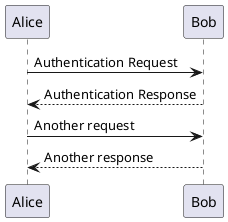

### Using `theme` and `libraries`

The optional `theme` and `libraries` fields are pure convenience: they inject header lines
into your source so you don't have to type them. Setting `"theme": "cerulean"` is exactly the
same as putting `!theme cerulean` at the top of your source, and listing
`"libraries": ["awslib"]` injects that library's `!include` line for you. You can always write
those lines yourself instead — both approaches are shown further down.

```bash
curl -s -X POST https://plantuml.joor.net/api/v1/render \
  -H 'Content-Type: application/json' \
  -d '{
        "source": "@startuml\nactor Client\nClient -> Server: request\nServer --> Client: response\n@enduml",
        "format": "svg",
        "theme": "cerulean"
      }' \
  -o themed.svg
```

Browse the catalog of available theme names at `GET /api/v1/themes` and library ids at
`GET /api/v1/libraries`.

### Selecting one diagram with `index`

If your `source` contains several `@startuml … @enduml` blocks, the server renders the first
by default. Pass a zero-based `index` to pick another:

```bash
curl -s -X POST https://plantuml.joor.net/api/v1/render \
  -H 'Content-Type: application/json' \
  -d '{"source":"@startuml\nA->B\n@enduml\n@startuml\nC->D\n@enduml","index":1,"format":"svg"}' \
  -o second.svg
```

### Rendering from Python

Using **httpx** (recommended — modern, async-capable). Because the response body is the raw
image, write `response.content` to a file:

```python
import httpx

source = """@startuml
actor User
participant "Web App" as A
database DB

User -> A: POST /login
activate A
A -> DB: SELECT user
activate DB
DB --> A: row
deactivate DB
A --> User: 200 OK
deactivate A
@enduml"""

resp = httpx.post(
    "https://plantuml.joor.net/api/v1/render",
    json={"source": source, "format": "png"},
    timeout=40,
)
resp.raise_for_status()
with open("login.png", "wb") as f:
    f.write(resp.content)
print("Content-Type:", resp.headers["content-type"])
```

The same thing with only the standard library (**urllib**), no dependencies:

```python
import json
import urllib.request

payload = json.dumps({
    "source": "@startuml\nAlice -> Bob: Hello\n@enduml",
    "format": "svg",
}).encode()

req = urllib.request.Request(
    "https://plantuml.joor.net/api/v1/render",
    data=payload,
    headers={"Content-Type": "application/json"},
    method="POST",
)
with urllib.request.urlopen(req, timeout=40) as r:
    svg = r.read()

with open("diagram.svg", "wb") as f:
    f.write(svg)
```

The httpx example renders this diagram:

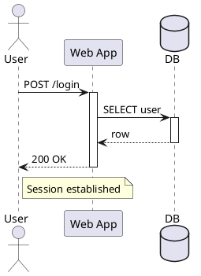

### Rendering from JavaScript (fetch)

In the browser or in Node 18+ (which has a global `fetch`). For SVG you can drop the returned
text straight into the DOM; for PNG/PDF grab a `blob()`:

```javascript
async function renderSvg(source) {
  const res = await fetch("https://plantuml.joor.net/api/v1/render", {
    method: "POST",
    headers: { "Content-Type": "application/json" },
    body: JSON.stringify({ source, format: "svg" }),
  });
  if (!res.ok) {
    // errors come back as JSON
    throw new Error(JSON.stringify(await res.json()));
  }
  return await res.text(); // SVG markup
}

const svg = await renderSvg(`@startuml
class Animal {
  +String name
  +makeSound()
}
Animal <|-- Dog
@enduml`);
document.getElementById("out").innerHTML = svg;
```

Saving a PNG to disk in Node:

```javascript
import { writeFile } from "node:fs/promises";

const res = await fetch("https://plantuml.joor.net/api/v1/render", {
  method: "POST",
  headers: { "Content-Type": "application/json" },
  body: JSON.stringify({ source: "@startuml\nA -> B\n@enduml", format: "png" }),
});
const buf = Buffer.from(await res.arrayBuffer());
await writeFile("diagram.png", buf);
```

### What comes back when something is wrong

Successful renders return `200` with the media body. Errors return JSON with the appropriate
HTTP status, so always branch on the status code:

| Status | Meaning | Typical cause |
|---|---|---|
| `200` | OK | The diagram body follows, in the requested media type |
| `422` | Invalid PlantUML source | Syntax error, or `source` empty / missing |
| `503` | Backend unavailable | The PlantUML engine is temporarily down |
| `504` | Render timed out | The diagram was too large / slow to render |

A `422` body is a JSON error object describing the problem — inspect its `detail` to see what
PlantUML rejected:

```json
{
  "type": "about:blank",
  "title": "Unprocessable Entity",
  "status": 422,
  "detail": "PlantUML backend returned HTTP 404"
}
```

## Sharing diagrams — `encode` and `decode`

PlantUML has a classic trick: a diagram can be packed into a compact, URL-safe **token** so
that the entire source travels inside a link. Our API exposes this through two endpoints. This
is how the live editor and image links work — and, importantly, **the source lives in the URL,
nothing is stored on the server.** Anyone with the link can reconstruct the exact diagram; the
service keeps no copy.

### `POST /api/v1/encode`

Send `{"source": "..."}` and receive the token plus a set of ready-made URLs:

```bash
curl -s -X POST https://plantuml.joor.net/api/v1/encode \
  -H 'Content-Type: application/json' \
  -d '{"source":"@startuml\nAlice -> Bob: Hello\n@enduml"}'
```

```json
{
  "encoded": "SoWkIImgAStDuNBCoKnELT2rKt3AJx9Iy4ZDoSddSaZDIm7A0G00",
  "editor_url": "https://plantuml.joor.net/editor/uml/SoWkIImgAStDuNBCoKnELT2rKt3AJx9Iy4ZDoSddSaZDIm7A0G00",
  "png_url":    "https://plantuml.joor.net/editor/png/SoWkIImgAStDuNBCoKnELT2rKt3AJx9Iy4ZDoSddSaZDIm7A0G00",
  "svg_url":    "https://plantuml.joor.net/editor/svg/SoWkIImgAStDuNBCoKnELT2rKt3AJx9Iy4ZDoSddSaZDIm7A0G00",
  "txt_url":    "https://plantuml.joor.net/editor/txt/SoWkIImgAStDuNBCoKnELT2rKt3AJx9Iy4ZDoSddSaZDIm7A0G00"
}
```

- `encoded` — the token itself; append it to any `/editor/<fmt>/…` path.
- `editor_url` — opens the diagram in the interactive editor.
- `png_url` / `svg_url` / `txt_url` — direct image links you can drop into a README,
  a wiki, or an `` tag. These are ideal for embedding because they render on demand
  and need no build step.

Encoding in Python:

```python
import httpx

r = httpx.post(
    "https://plantuml.joor.net/api/v1/encode",
    json={"source": "@startuml\nAlice -> Bob: Hello\n@enduml"},
    timeout=40,
)
links = r.json()
print(links["svg_url"])   # paste into a README as an image
```

### `POST /api/v1/decode`

The inverse: hand it a token and it returns the original source. This is how you recover the
diagram behind a shared link.

```bash
curl -s -X POST https://plantuml.joor.net/api/v1/decode \
  -H 'Content-Type: application/json' \
  -d '{"encoded":"SyfFKj2rKt3CoKnELR1Io4ZDoSa70000"}'
```

```json
{ "source": "Bob -> Alice : hello" }
```

A malformed token returns `422`. Encoding accepts any non-empty source; decoding accepts any
non-empty token.

## Embedding a diagram in Markdown or HTML by URL

Because the diagram source lives *inside* the encoded URL, you can drop a rendered diagram
straight into a Markdown file (a README, docs, a PR description) with **no committed image** — it
renders live wherever Markdown is displayed (GitHub, GitLab, Gitea, docs sites):

```markdown

```

Get the URL from `encode` (use `svg_url` for crisp scaling, or `png_url` for the widest renderer
compatibility), or build it yourself as `/editor/svg/<encoded>`. In HTML, use an ``:

```html

```

Both of the above render this diagram (which, on this page, is shown live from the same source):

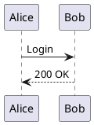

**Trade-offs (why it's optional):** the image always reflects the encoded source, nothing is
stored server-side, and no binary lands in git — but the URL grows with the diagram and
rendering depends on this service being reachable. For a permanent, offline-safe copy, render to
a file (`format` `svg` or `png`) and commit that instead. This URL-embed trick is exactly how the
live preview under every example in this guide is produced.

## Checking service health — `GET /health`

A tiny, dependency-free endpoint for uptime monitors, load-balancer probes, and CI
pre-flight checks. It reports both the API's own status and the health and version of the
PlantUML backend behind it:

```bash
curl -s https://plantuml.joor.net/health
```

```json
{
  "status": "healthy",
  "api_version": "1.0.0",
  "plantuml": {
    "status": "healthy",
    "version": "1.2026.8"
  }
}
```

`status` is `healthy` when everything works and `degraded` when the backend is impaired.
A simple readiness gate in a script:

```bash
if curl -sf https://plantuml.joor.net/health | grep -q '"status": "healthy"'; then
  echo "ready"
else
  echo "not ready" >&2
  exit 1
fi
```

## The web editor — `GET /editor`

For interactive, exploratory work open the editor in a browser:

```
https://plantuml.joor.net/editor
```

Type PlantUML on one side and watch the live preview update on the other. When you want to
share what you have, the URL updates to the `/editor/uml/<token>` form — the same token the
`encode` endpoint produces — so copying the address bar copies the whole diagram. This is the
friendliest way to prototype a diagram before wiring it into the `render` API.

## Writing the diagrams — a quick tour

The `source` field accepts any PlantUML the v1.2026.8 engine understands. Below are complete,
self-contained diagrams for the most common diagram types, each rendered live. Copy any of
them straight into the `source` field of a `render` or `encode` call.

### Sequence diagram

The most common PlantUML diagram: participants exchanging messages down the page.


### Use case diagram

Actors and the things they can do — great for scoping a feature.

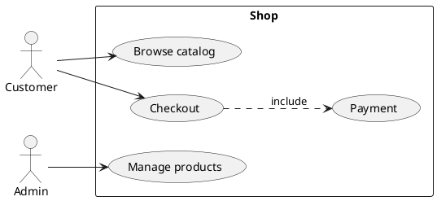

### Class diagram

Types, fields, methods, and inheritance.

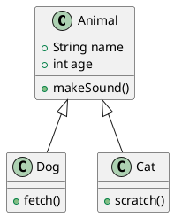

### Activity diagram

Control flow with branches — the modern `start/stop/if` syntax.

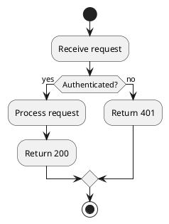

### Component diagram

Boxes and wiring — a good fit for architecture overviews.

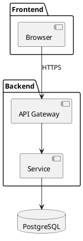

### State diagram

States and the transitions between them.

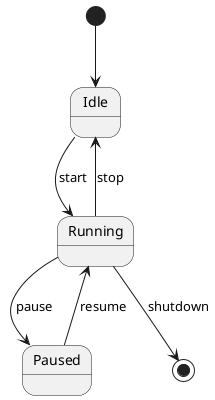

### Applying a theme inline

Instead of the request's `theme` field you can put `!theme <name>` directly in the source —
handy when the diagram must stay self-contained (for example, when sharing via `encode`).

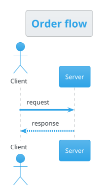

### Using a bundled standard library

Under `SECURITY_PROFILE=INTERNET` the server allows the **bundled** PlantUML standard library
via angle-bracket includes, `!include <...>`. Remote `!includeurl` to arbitrary hosts is
disabled for safety. The angle-bracket form pulls from libraries shipped with the server (AWS,
Azure, C4, Kubernetes icon sets, and more — browse `GET /api/v1/libraries`). Here the AWS
library provides ready-made icons:

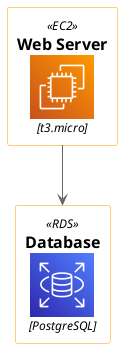

That same include can be requested via the `libraries` field instead of typing the `!include`
line yourself — both routes are equivalent.

### Non-UML diagrams: mindmaps, JSON, and more

PlantUML renders far more than UML. Mindmaps use their own `@startmindmap` block:

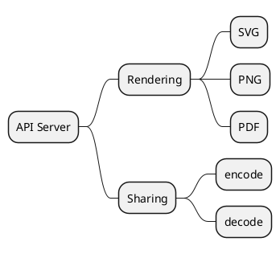

You can even pretty-print a JSON document as a diagram with `@startjson` — for example the
health response from earlier:

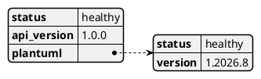

## Where to go next

- Explore the **libraries** catalog: `GET /api/v1/libraries` (and
  `GET /api/v1/libraries/{id}/examples` for ready-made snippets).
- Browse the **themes**: `GET /api/v1/themes`.
- Skim the built-in **examples**: `GET /api/v1/examples`.
- Read the full machine spec at `https://plantuml.joor.net/openapi.json` or the interactive
  docs at `https://plantuml.joor.net/docs`.
- Prototype interactively in the editor at `https://plantuml.joor.net/editor`.
