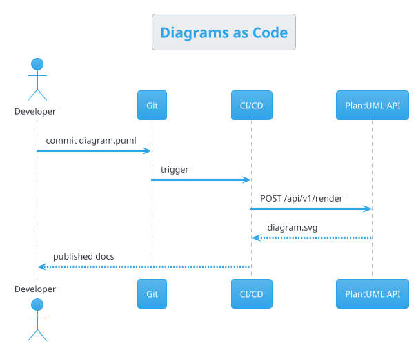

# PlantUML API — Documentation

Welcome. This is a complete, example-rich guide to creating diagrams **as code** with the
PlantUML API. Every PlantUML example on these pages is rendered live below the source, so you
can see exactly what each snippet produces — and you can open any of them straight in the
[editor](/editor).

You always write **plain PlantUML**. The API is a friendly facade around the official PlantUML
Server: it renders your source to PNG/SVG/TXT/PDF, gives you shareable URLs, and helps you
discover the rich ecosystem of architecture icon libraries. There is no new language to learn.

## Start here

- **[Getting Started](/help/getting-started)** — call the API in one `curl`, understand formats
  and the render/encode endpoints.
- **[REST API Reference](/help/api-reference)** — every endpoint, request and response.
- **[Claude Code Skill](/help/claude-skill)** — let an AI agent drive the API using these docs.

## Learn the language

- **[The PlantUML Language](/help/plantuml-language)** — the common syntax, notes, markup, colors.
- **[Preprocessing](/help/preprocessing)** — includes, macros, functions, conditionals, loops.
- **[Themes, Styles & Sprites](/help/themes-styling)** — restyle any diagram.

## Diagram types

Sequence, use case, class, object, activity, component, deployment, state, timing, entity
relationship, JSON/YAML, network (nwdiag), Salt wireframes, Gantt, mind maps and WBS — each has
its own page in the sidebar under **Diagram Types**, with the full syntax and many examples.

## Architecture as code

- **[Architecture Icon Libraries](/help/architecture-libraries)** — AWS, Azure, Kubernetes, GCP,
  OSA, Material, Office, Logos, Devicons, ArchiMate — with the exact, verified include paths.
- **[The C4 Model](/help/c4-model)** — Context, Container, Component, Deployment.
- **[Diagrams as Code](/help/diagrams-as-code)** — the philosophy and CI/CD workflows.
- **[Cookbook](/help/cookbook)** — advanced, mixed-library recipes.

## A taste

Use the navigation on the left to explore. Happy diagramming!
