# JSON & YAML Data

PlantUML can turn a raw **JSON** or **YAML** document straight into a diagram, without you writing any diagram-specific syntax. You paste the data, and PlantUML draws it as a tree of connected nodes: objects and maps become boxes of key/value rows, arrays and lists become indexed sub-nodes, and scalars (strings, numbers, booleans, `null`) are shown inline. This is ideal for documenting API payloads, configuration files, sample records, message schemas, or any nested data structure where a plain text dump is hard to read.

Two data-diagram flavours exist and they share almost identical features:

- **JSON diagrams** are wrapped in `@startjson … @endjson`.
- **YAML diagrams** are wrapped in `@startyaml … @endyaml`.

Both support the same extras: highlighting specific paths, per-node and per-highlight styling through a `<style>` block, Creole/HTML text formatting inside values, and — for JSON — embedding the data node inside a normal UML diagram. This page documents every feature, keyword, and gotcha, with complete, renderable examples for each.

---

## JSON diagrams

### Minimal example

A JSON diagram is just a valid JSON document between the two tags. Objects render as a node whose rows are the keys; the value of each key appears in the right-hand column, and nested objects/arrays are drawn as separate nodes linked by an arrow.

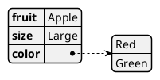

Here `fruit` and `size` are scalar rows shown inline, while `color` is an array and is rendered as its own node with numeric indices (`0`, `1`).

### All supported data types

PlantUML understands every standard JSON type:

- **`null`** — drawn as an empty/`null` value.
- **Booleans** — `true` and `false`.
- **Numbers** — integers, decimals, and exponential notation such as `1E5`.
- **Strings** — Unicode is supported directly or via `\uXXXX` escapes.
- **Objects** — `{ … }` nested key/value pairs.
- **Arrays** — `[ … ]` ordered lists.

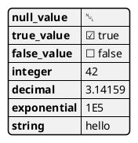

### Nested objects

Every nested object becomes a linked child node, so deep structures fan out into a readable tree instead of one giant box.

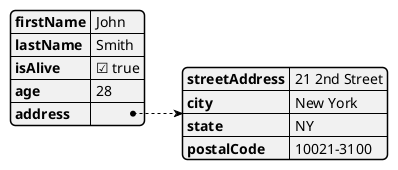

### Arrays of objects, empty values, and null

Arrays whose elements are objects are drawn as indexed child nodes. Note how `children` (an empty array) and `spouse` (`null`) render distinctly from populated values.

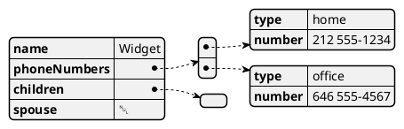

### Empty structures

An empty array `[]` and an empty object `{}` are valid and each render as an empty leaf.

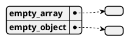

### Top-level scalars and arrays

The document does not have to be an object. A bare scalar or a bare array at the top level is perfectly valid — useful when you want to illustrate a single value or a flat list.

A single string:

```plantuml
@startjson
"Hello world!"
@endjson
```

A top-level array of numbers:

```plantuml
@startjson
[1, 2, 3]
@endjson
```

A top-level array of booleans:

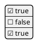

### Escapes and special characters

Standard JSON two-character escape sequences work: `\"`, `\\`, `\/`, `\b`, `\f`, `\n`, `\r`, `\t`, plus Unicode `\uXXXX`. The following example shows accented characters via `\u`, a newline and tab inside a value, an escaped quote, and a Windows path with escaped backslashes.

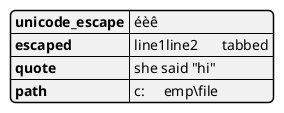

---

## Highlighting paths (JSON)

Use the `#highlight` directive, placed **before** the JSON body (between `@startjson` and the opening brace), to visually emphasise a specific key or a deeply nested value. The target is expressed as a **path**: each step is a quoted string, and steps are separated by a forward slash `/`. Array elements are addressed by their **numeric index** written as a quoted string (e.g. `"0"`).

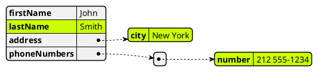

- `#highlight "lastName"` highlights a top-level key.
- `#highlight "address" / "city"` walks into the nested `address` object.
- `#highlight "phoneNumbers" / "0" / "number"` walks into array index `0`, then its `number` key.

You may add as many `#highlight` lines as you need.

### Different styles per highlight

By default every highlight shares one style. To give individual highlights their own look, define named style classes in a `<style>` block and reference a class with `<<className>>` at the end of the `#highlight` line. A highlight with no class uses the default `highlight` style.

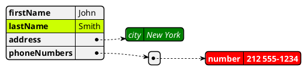

---

## Styling JSON nodes

The `<style>` block gives full control over the appearance of the diagram. For JSON diagrams the top-level selector is `jsonDiagram`, under which you can style `node`, `arrow`, `highlight`, and the row `separator`. The available properties include background and line colours, font (name, size, style, colour), corner rounding (`RoundCorner`), line thickness, and dashed line patterns (`LineStyle`, given as `dash-gap` values such as `10-5`).

```plantuml
@startjson
<style>
  jsonDiagram {
    node {
      BackGroundColor Khaki
      LineColor lightblue
      FontName Helvetica
      FontColor red
      FontSize 18
      FontStyle bold
      RoundCorner 0
      LineThickness 2
      LineStyle 10-5
      separator {
        LineThickness 0.5
        LineColor black
        LineStyle 1-5
      }
    }
    arrow {
      BackGroundColor lightblue
      LineColor green
      LineThickness 2
      LineStyle 2-5
    }
    highlight {
      BackGroundColor red
      FontColor white
      FontStyle italic
    }
  }
</style>
#highlight "size"
{
  "fruit": "Apple",
  "size": "Large",
  "color": ["Red", "Green"]
}
@endjson
```

- `node` styles the boxes themselves; its nested `separator` controls the thin lines between key/value rows.
- `arrow` styles the connectors between a parent node and its children.
- `highlight` sets the default appearance for any `#highlight` that does not name a class.

---

## Creole and HTML in JSON values

String values are not plain text — they accept PlantUML **Creole** markup and a subset of **HTML** tags, so you can format the displayed value. This applies inside JSON strings and YAML scalar values alike.

Creole markers:

- `**bold**`
- `//italics//`
- `--stricken-out--`
- `__underlined__`
- `~~wave~~`

HTML-style tags: `<b>`, `<i>`, `<s>` (stroked), `<u>`, `<w>` (waved), plus `<color:…>text</color>`, `<back:…>text</back>` (background), and `<size:N>text</size>`. You can also embed OpenIconic icons with `<&icon-name>`, arbitrary Unicode with `<U+XXXX>`, and emojis with `<:name:>`.

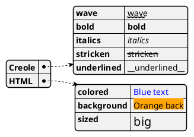

> Because Creole/HTML is interpreted, literal `**`, `//`, `<…>` etc. inside a value will be rendered as formatting rather than shown verbatim.

---

## Embedding JSON in other diagrams

A powerful feature of JSON diagrams is that the same data node can be dropped **inside a normal UML diagram** using the `json` keyword, and then linked to ordinary UML elements. This works in class, object, deployment, use-case, component, and state diagrams. The form is:

```
json <Alias> {
   … JSON body …
}
```

When you want to mix the JSON node with non-JSON element types (agents, databases, classes, etc.) in the same diagram, add the `allowmixing` directive near the top.

### JSON node beside a class

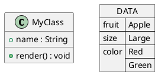

### JSON node wired into a deployment diagram

Here `allowmixing` lets an `agent` and a `database` coexist with the JSON node, and normal `->` arrows connect them.

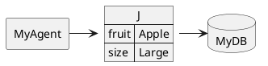

### JSON node in a state diagram

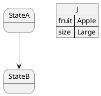

---

## YAML diagrams

YAML diagrams behave just like JSON diagrams but accept YAML syntax between `@startyaml` and `@endyaml`. Maps render as nodes of key/value rows, and sequences (`- item`) render as indexed child nodes.

### Minimal example


### A richer nested document

Scalars can be quoted or unquoted; numbers and booleans are recognised; maps and sequences nest to any depth by indentation.

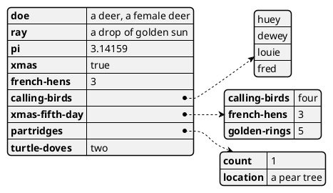

### Sequences of maps

A list whose items are themselves maps (a common shape for records) nests cleanly:

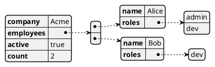

### Special characters in keys

Keys may contain symbols and Unicode. When a key starts with a character that YAML would otherwise treat specially (such as `@`, `$`, `&`), quote it so the parser accepts it as a plain string key.

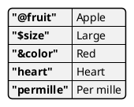

> **Gotcha:** unquoted `@`, `&`, `*`, `%`, and other YAML indicator characters at the start of a key or value can cause parse errors or be interpreted as anchors/aliases. Wrap such keys/values in quotes to be safe.

---

## Highlighting paths (YAML)

`#highlight` works exactly as in JSON: place the directives before the YAML body and address nodes by a slash-separated path of quoted steps.

```plantuml
@startyaml
#highlight "french-hens"
#highlight "xmas-fifth-day" / "partridges"
french-hens: 3
xmas-fifth-day:
  calling-birds: four
  partridges:
    count: 1
    location: "a pear tree"
@endyaml
```

### Styling the default highlight

Override the default highlight look via the `yamlDiagram` selector's `highlight` block.

```plantuml
@startyaml
<style>
yamlDiagram {
  highlight {
    BackGroundColor red
    FontColor white
    FontStyle italic
  }
}
</style>
#highlight "french-hens"
doe: "a deer"
french-hens: 3
turtle-doves: two
@endyaml
```

### Multiple highlight classes

Just like JSON, define `.h1`, `.h2`, … classes and reference them with `<<className>>`.

```plantuml
@startyaml
<style>
.h1 {
  BackGroundColor green
  FontColor white
  FontStyle italic
}
.h2 {
  BackGroundColor red
  FontColor white
  FontStyle italic
}
</style>
#highlight "french-hens" <<h1>>
#highlight "xmas-fifth-day" / "partridges" <<h2>>
french-hens: 3
xmas-fifth-day:
  partridges:
    count: 1
@endyaml
```

---

## Styling YAML nodes

The full node/arrow/separator styling is available under the `yamlDiagram` selector, mirroring `jsonDiagram`.

```plantuml
@startyaml
<style>
yamlDiagram {
  node {
    BackGroundColor lightblue
    LineColor lightblue
    FontName Helvetica
    FontColor red
    FontSize 18
    FontStyle bold
    RoundCorner 0
    LineThickness 2
    LineStyle 10-5
    separator {
      LineThickness 0.5
      LineColor black
      LineStyle 1-5
    }
  }
  arrow {
    BackGroundColor lightblue
    LineColor green
    LineThickness 2
    LineStyle 2-5
  }
}
</style>
fruit: Apple
size: Large
color:
  - Red
  - Green
@endyaml
```

---

## Creole and HTML in YAML values

YAML values accept the same Creole/HTML formatting, icons, Unicode and emojis as JSON.

```plantuml
@startyaml
Creole:
  wave: ~~wave~~
  bold: **bold**
  italics: //italics//
  stricken-out: --stricken-out--
  underlined: __underlined__
HTML_Creole:
  bold: <b>bold
  italics: <i>italics
  stroked: <s>stroked
  underlined: <u>underlined
  colored_text: <color:blue>Blue
  background: <back:orange>Orange
  sized: <size:20>big
Graphic:
  openiconic: <&account-login>
  unicode: <U+221E>
  emoji: <:calendar:>
@endyaml
```

---

## Tips and gotchas

- **Valid data required.** If the body is not valid JSON, PlantUML renders the message *"Your data does not sound like JSON data"* instead of a diagram; the YAML parser behaves similarly. Validate your data first.
- **`#highlight` goes before the body**, after the `@start…` tag (and after any `<style>` block). Paths are quoted, `/`-separated, and array indices are quoted numbers like `"0"`.
- **Style selectors differ by flavour:** use `jsonDiagram` for JSON and `yamlDiagram` for YAML. `node`, `arrow`, `highlight`, and `separator` are the same in both.
- **Creole is always active** inside values, so escape or avoid `**`, `//`, `<…>` if you need them shown literally.
- **Quote unusual YAML keys** beginning with `@`, `&`, `*`, `%`, `!`, etc. to avoid parser surprises.
- **Portability:** these examples use only bundled PlantUML features. Avoid remote `!includeurl` references — under the pinned build's INTERNET security profile only bundled stdlib `!include <…>` includes are permitted. None are needed for JSON/YAML diagrams.

---

## Render it via the API

Any example above can be sent to the render endpoint. Post the diagram source as JSON and choose an output `format` (`svg`, `png`, …):

```bash
curl -sS -X POST https://plantuml.joor.net/api/v1/render \
  -H 'content-type: application/json' \
  -d '{
    "format": "svg",
    "source": "@startjson\n{\n  \"fruit\": \"Apple\",\n  \"size\": \"Large\",\n  \"color\": [\"Red\", \"Green\"]\n}\n@endjson"
  }'
```

For multi-line sources it is safest to build the JSON payload programmatically rather than hand-escaping newlines:

```python
import json, requests

source = """@startyaml
fruit: Apple
size: Large
color:
  - Red
  - Green
@endyaml"""

resp = requests.post(
    "https://plantuml.joor.net/api/v1/render",
    json={"source": source, "format": "svg"},
    timeout=40,
)
resp.raise_for_status()
open("diagram.svg", "wb").write(resp.content)
```
