# MindMap & Work Breakdown (WBS)

PlantUML ships two closely related **tree diagrams** that share almost the same
syntax: the **MindMap** (`@startmindmap` … `@endmindmap`) and the **Work
Breakdown Structure**, or WBS (`@startwbs` … `@endwbs`).

A **MindMap** is a visual representation of information where one or more central
ideas branch out into related topics. Use it for brainstorming, capturing notes,
outlining a document, or presenting a hierarchy of concepts in a radial,
free-form layout that fans out to the left and right of the root.

A **WBS** is a key project-management tool that decomposes a project into
smaller, more manageable components or deliverables. It uses the very same tree
notation as the MindMap but draws crisper, boxier "work package" nodes and lets
you steer individual branches to the left or right, which makes it ideal for
org-charts, deliverable breakdowns, and phase/task hierarchies.

Because the two diagrams share their grammar, once you learn one you know the
other. Everything below is grouped so you can see exactly where they overlap and
where they differ (mainly: **arithmetic left/right control** exists in both;
**per-node `<`/`>` direction markers** are a WBS feature; **multiroot** is a
MindMap feature).

---

## Two ways to build the tree

Both diagram types accept two interchangeable notations for describing the
hierarchy. You may not mix an OrgMode line and an arithmetic line at random, but
you can freely choose one style per diagram.

### OrgMode notation (asterisks)

The number of leading asterisks (`*`) is the **depth** of the node. One asterisk
is the root, two asterisks is a first-level child, three is a second-level child,
and so on. This is called *OrgMode* notation after the Emacs outline format.

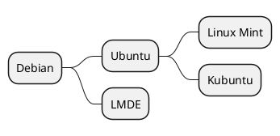

The identical notation drives a WBS — only the enclosing tags change:

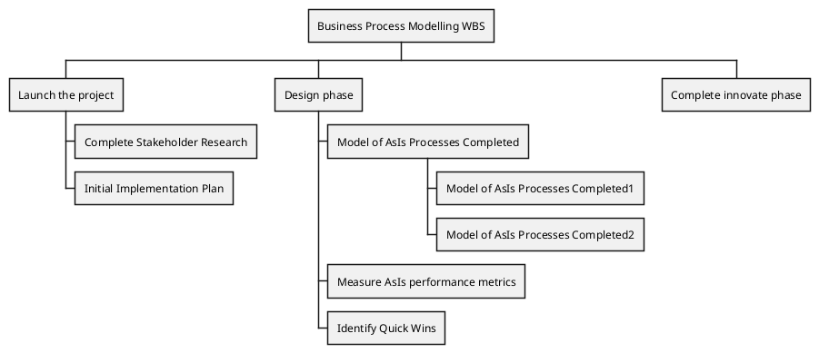

### Markdown-style headers and lists (MindMap)

A MindMap can also be described with Markdown-flavored markers. **`#` headers**
work like OrgMode asterisks — the count of `#` is the depth:

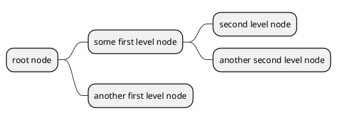

Markdown **list** markers use `-` (and `+`, see below) where the count of the
marker is again the depth. This is handy when you want the branch to hang to the
left of the root:

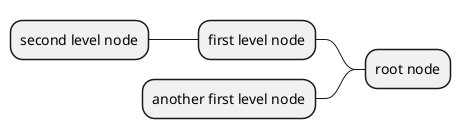

---

## Arithmetic notation: choosing the side

Instead of asterisks you can use **`+` and `-`** as the depth markers. The count
still sets the depth, but the *sign* now also decides which side of the root the
branch is drawn on: **`+` extends the branch to the right**, and **`-` extends it
to the left**. This "arithmetic" notation is available in both MindMap and WBS.

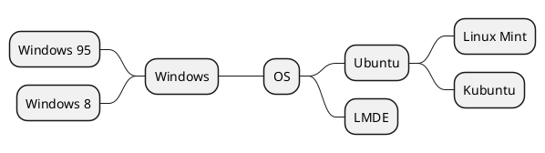

Note how `-- Windows` hangs off the left of the single `+ OS` root, while the
`++`/`+++` branches fan out on the right. In a WBS you can mix signs within a
single deep branch, so a sub-tree flips sides as it descends:

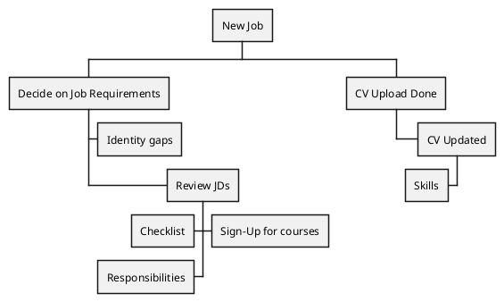

### WBS-only: `<` and `>` direction markers

A WBS gives you a second, more explicit way to place a single node: put a `<`
(left) or `>` (right) marker right after the OrgMode asterisks and before the
label. This lets you keep the clean asterisk notation while still overriding the
side of specific nodes.

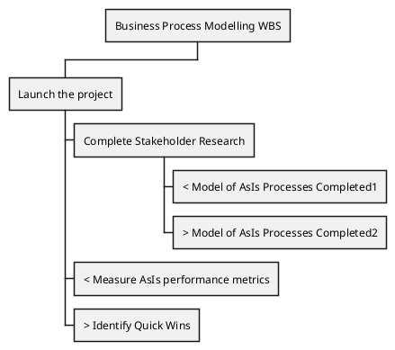

---

## Multiline nodes

To spread a node's label over several lines, open it with a colon `:` and close
it with a semicolon `;`. Everything between the two delimiters becomes the node
text (and may contain Creole/HTML markup, see below).

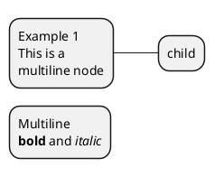

The same delimiters work in a WBS. Here the multiline node also carries an icon
prefix:

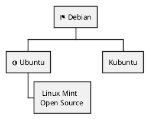

---

## Boxless nodes (the `_` suffix)

Appending an **underscore `_`** to the depth markers of a node removes the box
(and its border) around it, leaving just the label attached to the connector.
This is great for lightweight leaves that would otherwise clutter the diagram.

In a MindMap:

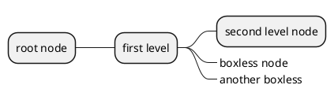

### Partial vs. fully boxless WBS

You can make only some nodes boxless:

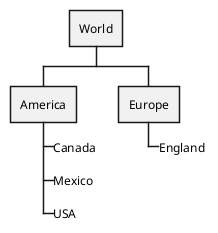

…or make **every** node boxless by suffixing `_` at every level, including the
root, for a pure text tree:

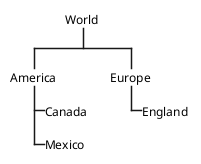

The `_` suffix also combines with arithmetic notation, so you can build a
boxless tree that still fans out to both sides:

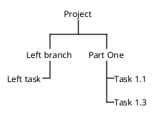

### Skipping a layer with an empty boxless node

A neat WBS trick: an **empty boxless node** (`**_` with no label) acts as an
invisible spacer, letting deeper children appear to report directly to a
higher-level parent. Below, engineers 5 and 6 visually attach to the Director
through the empty node under "Team Lead 2":

```plantuml
@startwbs
* Director
** Team Lead 1
*** Engineer 1
*** Engineer 2
** Team Lead 2
**_
*** Engineer 5 (reporting to Director)
*** Engineer 6 (reporting to Director)
@endwbs
```

---

## Colors

### Inline colors

Put a color in square brackets `[#color]` immediately after the depth markers to
paint that node's background. Colors may be a named color (`Orange`,
`lightgreen`, `SkyBlue`) or a hex value (`#FFBBCC`).

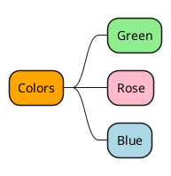

The same bracket syntax colors WBS work packages:

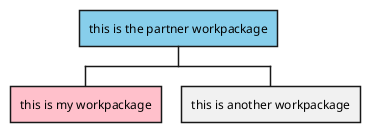

### Style classes with `<<name>>`

For reusable colors, declare **CSS-like classes** in a `<style>` block and apply
them to a node with the `<<className>>` stereotype after the label.

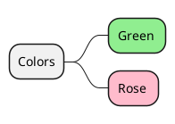

WBS uses the same mechanism, only inside a `wbsDiagram { … }` block:


### Styling a whole branch

Adding `*` (a descendant selector) to a class definition — e.g. `.myStyle *` —
makes the style cascade to every descendant of the node that carries the class,
so you can color an entire sub-tree by tagging just its top node:

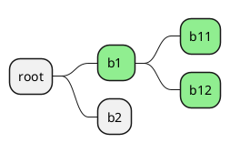

---

## Multiroot MindMaps

Unlike a WBS (which requires exactly one root), a MindMap may declare **several
root nodes** in the same diagram — simply start a new depth-1 line. Each root
becomes an independent tree.

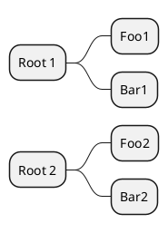

> Gotcha: this does **not** work in a WBS. A WBS with two depth-1 lines fails
> with *"WBS diagram only accepts one root first declared."*

---

## Diagram orientation

By default a MindMap grows **left to right** (the root on the left, or centered
with branches fanning both ways when you use arithmetic notation). You can change
the flow with a direction statement placed just after the start tag:

- `left to right direction` (default)
- `right to left direction`
- `top to bottom direction`
- `bottom to top direction` (as a workaround, use
  `top to bottom direction` combined with the left-side notation)

```plantuml
@startmindmap
top to bottom direction
* 1
** 2
*** 4
*** 5
** 3
@endmindmap
```

```plantuml
@startmindmap
right to left direction
* Root
** A
** B
@endmindmap
```

---

## Icons, Creole, and HTML

Both diagrams support **OpenIconic icons** via `<&icon-name>` (for example
`<&flag>`, `<&globe>`, `<&code>`):

```plantuml
@startmindmap
* <&flag> Root
** <&globe> Ubuntu
** <&code> Kubuntu
@endmindmap
```

Node labels understand the full **Creole** markup language and a subset of
**HTML**. Creole is easiest inside a multiline node. The common Creole markers
are `**bold**`, `//italics//`, `""monospaced""`, `--strikethrough--`,
`__underline__`, `~~wave~~`, and `==` for a heading.

```plantuml
@startmindmap
*:==Creole
This is **bold**
This is //italics//
This is ""monospaced""
;
** child
@endmindmap
```

A richer WBS example showing Creole and HTML tags side by side (`<b>`,
`<color:…>`, `<back:…>`):

```plantuml
@startwbs
* Creole on WBS
**: ==Creole
This is **bold**
This is //italics//
This is ""monospaced""
This is --stricken-out--
This is __underlined__ ;
**: <b>HTML
This is <b>bold</b>
This is <color:blue>Blue</color>
This is <back:orange>Orange background</back> ;
@endwbs
```

---

## Word wrap and fine styling

The `<style>` block exposes many properties for tuning the look of nodes:
`BackgroundColor`, `LineColor`, `LineThickness`, `LineStyle`, `RoundCorner`,
`Padding`, `Margin`, `FontColor`, `HorizontalAlignment`, and more. Long labels
can be wrapped automatically by setting **`MaximumWidth`** (in pixels) on the
node — text beyond that width flows onto a new line instead of stretching the
diagram.

```plantuml
@startmindmap
<style>
node {
  MaximumWidth 100
  Padding 12
  LineThickness 3.0
}
</style>
* Sometimes I have a node in which I want to write a long text
** child one
** child two
@endmindmap
```

Styles can also target structural selectors — `node`, `rootNode`, `leafNode`,
`boxless`, `arrow`, and `:depth(n)` (to style only nodes at a given depth). This
WBS combines several of them:

```plantuml
@startwbs
<style>
wbsDiagram {
  Linecolor black
  arrow {
    LineColor green
  }
  :depth(0) {
    BackgroundColor White
    RoundCorner 10
    LineColor red
  }
  node {
    :depth(2) {
      LineStyle 2
      LineThickness 2.5
    }
  }
  boxless {
    FontColor darkgreen
  }
}
</style>
* World
** America
*** Canada
*** Mexico
**** Chihuahua
** Europe
***_ England
@endwbs
```

And a full word-wrap-plus-styling WBS distinguishing the root node, generic
nodes, leaf nodes, and connector arrows:

```plantuml
@startwbs
<style>
node {
  Padding 12
  Margin 3
  HorizontalAlignment center
  LineColor blue
  LineThickness 3.0
  BackgroundColor gold
  RoundCorner 40
  MaximumWidth 100
}
rootNode {
  LineStyle 8.0;3.0
  LineColor red
  BackgroundColor white
  LineThickness 1.0
}
leafNode {
  LineColor gold
  RoundCorner 0
  Padding 3
}
arrow {
  LineStyle 4
  LineThickness 0.5
  LineColor green
}
</style>
* Hi =)
** sometimes i have node in wich i want to write a long text
*** this results in really huge diagram
@endwbs
```

The MindMap equivalents of these selectors work the same way — here a MindMap
uses `node`, `:depth(1)`, and `boxless`:

```plantuml
@startmindmap
<style>
mindmapDiagram {
  node {
    BackgroundColor lightGreen
  }
  :depth(1) {
    BackGroundColor white
  }
  boxless {
    FontColor darkgreen
  }
}
</style>
* root
** a
*** a1
**_ boxless
@endmindmap
```

---

## Arrows between WBS nodes

Beyond the strict tree, a WBS can draw **extra arrows** between arbitrary nodes.
Give nodes an alias, then link them. There are two ways to alias:

**Quoted label with `as`** — write `"label" as alias`, then connect the
aliases. Arrows can be solid (`->`), long (`-->`), or dotted (`..>`), and can
carry a `<<styleClass>>` or an inline `#color`:

```plantuml
@startwbs
<style>
.foo {
  LineColor #00FF00;
}
</style>
* Test
** A topic
*** "common" as c1
*** "common2" as c2
** "Another topic" as t2
t2 -> c1 <<foo>>
t2 ..> c2 #blue
@endwbs
```

**Parenthesis alias** — write the alias in parentheses right after the depth
markers: `**(t2) Another topic`. Then link by alias:

```plantuml
@startwbs
* Test
**(b) A topic
***(c1) common
**(t2) Another topic
t2 --> c1
b -> t2 #blue
@endwbs
```

---

## Titles and captions

Both diagram types accept the usual `title` and `caption` declarations (as well
as `header`/`footer`, `legend`/`endlegend`).

```plantuml
@startmindmap
title My MindMap
caption A simple caption
* Central Idea
** Topic A
** Topic B
@endmindmap
```

---

## Cheat sheet

| Feature | Syntax | MindMap | WBS |
|---|---|---|---|
| Start / end tags | `@startmindmap` / `@startwbs` | ✓ | ✓ |
| Depth by asterisks (OrgMode) | `*`, `**`, `***` | ✓ | ✓ |
| Markdown headers | `#`, `##`, `###` | ✓ | – |
| Markdown list markers | `-`, `--` | ✓ | – |
| Arithmetic side control | `+` right, `-` left | ✓ | ✓ |
| Per-node direction marker | `< label` / `> label` | – | ✓ |
| Multiline node | `:` … `;` | ✓ | ✓ |
| Boxless node | trailing `_` | ✓ | ✓ |
| Empty spacer node | `**_` with no label | ✓ | ✓ |
| Multiple roots | new depth-1 line | ✓ | ✗ (one root only) |
| Inline color | `*[#color] label` | ✓ | ✓ |
| Style class | `<<name>>` + `<style>` | ✓ | ✓ |
| Extra arrows | `alias -> alias` | – | ✓ |
| Direction statement | `top to bottom direction`, … | ✓ | ✓ |
| Icons / Creole / HTML | `<&icon>`, `**bold**`, `<b>` | ✓ | ✓ |

---

## Render it via the API

Every example above is a complete diagram; POST its source to the render
endpoint to get an image back. For instance, the minimal MindMap:

```bash
curl -sS -X POST https://plantuml.joor.net/api/v1/render \
  -H 'content-type: application/json' \
  -d '{
    "source": "@startmindmap\n* Debian\n** Ubuntu\n*** Linux Mint\n*** Kubuntu\n** LMDE\n@endmindmap",
    "format": "svg"
  }' \
  -o mindmap.svg
```

Set `"format"` to `svg`, `png`, or `txt` to choose the output. Swap the
`@startmindmap` block for any `@startwbs` block from this page to render a Work
Breakdown Structure instead.
