# Network Diagrams (nwdiag)

**nwdiag** is PlantUML's dedicated syntax for drawing *network topology* diagrams: LAN
segments drawn as horizontal buses (the "busbar"), the servers hanging off them, their IP
addresses, VLAN-style groupings and the point-to-point links between routers, firewalls
and the Internet. It descends from the classic [`nwdiag`](http://blockdiag.com/en/nwdiag/)
tool by Takeshi Komiya and is bundled directly into PlantUML — no external installation is
needed.

Reach for nwdiag when you want to show **how machines are wired together** — which subnet a
host lives on, which servers straddle two networks through multiple NICs, where the DMZ
ends and the internal LAN begins — rather than software behaviour (use sequence/activity
diagrams for that) or generic boxes-and-arrows (use deployment or component diagrams). The
strength of nwdiag is that networks are first-class citizens: each one gets an address
range, a coloured band, and every server attached to it is automatically annotated with its
address on that network.

---

## The container: `@startnwdiag` … `@endnwdiag`

Everything below lives inside a network-diagram block. The official
[plantuml.com/nwdiag](https://plantuml.com/nwdiag) documentation writes these diagrams
inside a normal `@startuml` … `@enduml` pair with a `nwdiag { … }` block inside it, and that
form works in the desktop JAR. **On this API server, however, the renderer auto-detects the
diagram type, and a `nwdiag` body wrapped in `@startuml` is misclassified as a sequence
diagram and rejected** with:

```
422 Unprocessable Entity — This looks like a network diagram.
Please use @startnwdiag instead of @startuml.
```

So on this server always open with `@startnwdiag` and close with `@endnwdiag`. You may keep
the inner `nwdiag { … }` wrapper (recommended — it mirrors the upstream docs and lets you
add `@startuml`-style directives such as `title` and `<style>` cleanly) or drop it. Both of
the following render identically:

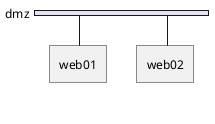

The bare form without the inner block is also accepted:

```plantuml
@startnwdiag
network dmz {
  address = "210.x.x.x/24"
  web01 [address = "210.x.x.1"];
  web02 [address = "210.x.x.2"];
}
@endnwdiag
```

For consistency the rest of this page uses the explicit `nwdiag { … }` wrapper.

---

## Networks and the busbar

A **network** is declared with the `network` keyword followed by a name and a brace block.
It is drawn as a horizontal bar (the busbar); every server declared inside the block is
drawn hanging below it and connected with a drop line. Statements inside a block are
separated by newlines and each server line is conventionally terminated with a semicolon
(the semicolon is optional but harmless).

The simplest possible diagram is one network with a couple of anonymous servers:


### Network address ranges

Give the network an `address` property to print a subnet/CIDR label on the busbar. The value
is a free-form string — `nwdiag` never validates it, so the placeholder style
`"210.x.x.x/24"` from the upstream docs is just as valid as a real CIDR like
`"192.168.10.0/24"`:

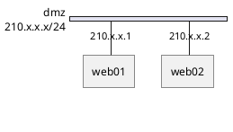

---

## Servers and addresses

A **server** (node) is just an identifier. Attributes go in square brackets after the name
as `key = value` pairs separated by commas. The most important attribute is `address`, the
host's address *on this particular network* — it is printed on the drop line between the
server and the busbar.

### Multiple addresses on one network

A host can expose several addresses on the same segment (for example a virtual IP alongside
its primary). List them comma-separated inside the quoted string:

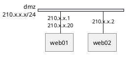

A larger single segment with several servers, some with addresses and some without:

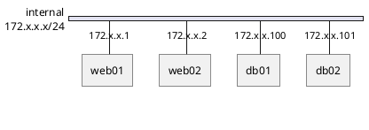

---

## Multiple networks and multi-NIC servers

This is the feature that makes nwdiag worth using. Declare a server with the **same name**
inside more than one `network` block and nwdiag understands it to be a single machine with
multiple network interfaces. It draws the host once and runs a "jump line" up to every
busbar it belongs to, with the correct per-network address on each drop.

Here `web01` and `web02` sit on both the public `dmz` and the private `internal` network,
while the database servers live only on `internal`:

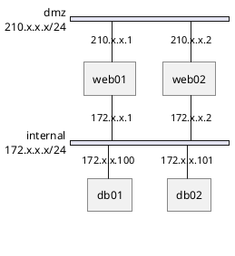

A three-network example: a gateway bridges the WAN and LAN, and a host bridges the LAN and a
storage network. Notice how `gw` and `host01` each appear on two segments with different
addresses:

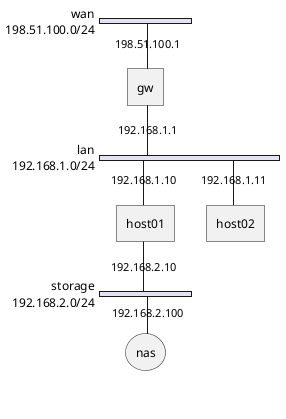

The order in which networks are declared is the order in which the busbars are stacked from
top to bottom.

---

## Point-to-point (peer) connections

Not every link is a shared segment. Two nodes can be wired directly with the `--` operator,
which draws a single line between them with **no busbar**. This is how you attach an
Internet cloud, a modem or a router uplink. A peer link is typically written outside (before)
the network blocks, and the nodes it names can then also appear inside a network.

Here an `inet` cloud connects point-to-point to `router`, which in turn sits on a shared
network with the web servers:

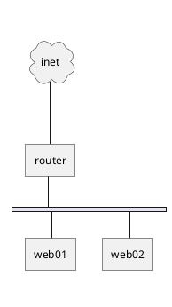

Peer links can be chained to model a simple uplink path with no shared segment at all:

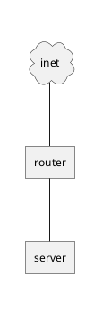

Peer links are also the way to connect two routers that each front their own LAN — the two
`network` busbars are joined by the direct `router01 -- router02` line:

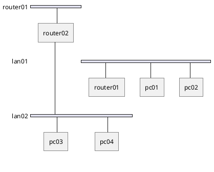

### Non-Ethernet / internal links

The same `--` operator, combined with per-link `address` labels, models internal buses such
as USB or serial chains where the "address" is a port name rather than an IP. Declare a
network for the anchor node, then chain devices off it:

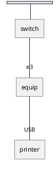

---

## Groups

**Groups** draw a coloured rectangle around a set of servers to show a logical tier
(web/app/db), a rack, or a security zone. They come in two flavours.

### Groups inside a network

Declared inside a single `network` block, a group clusters some of that network's servers.
Give the group a name after the `group` keyword:

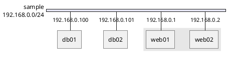

Groups take their own `description` and `color` attributes, so you can label and tint each
tier independently:

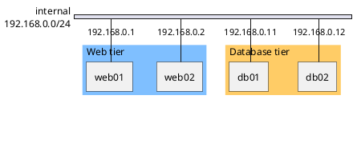

### Cross-network groups

Declared *outside* any network (before the network blocks), a group can span servers that
live on **different** networks. nwdiag reshuffles the layout so the grouped members sit
together and draws the group box across them. This is the idiomatic way to highlight, say,
all machines belonging to one application even though they straddle the DMZ and the internal
LAN:

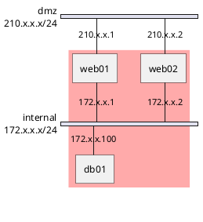

---

## Colouring networks

The `color` property on a `network` tints its busbar band. Both hex values (`"#FFDDDD"`)
and named colours (`"pink"`, `"LightBlue"`, `"Wheat"`) are accepted:

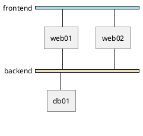

---

## Descriptions, shapes, sprites and icons

### `description`

A `description` on a network prints a caption on the busbar; on a server it *replaces* the
label with arbitrary text (and may contain markup and sprites, see below):

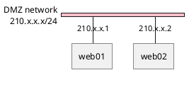

### `shape`

The `shape` attribute changes how a server is drawn. Available shapes include: `actor`,
`agent`, `artifact`, `boundary`, `card`, `cloud`, `collections`, `component`, `control`,
`database`, `entity`, `file`, `folder`, `frame`, `hexagon`, `interface`, `label`, `node`,
`package`, `person`, `queue`, `stack`, `rectangle`, `storage` and `usecase`. A quick sampler:

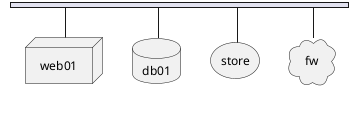

### OpenIconic glyphs

PlantUML bundles the [OpenIconic](https://useiconic.com/open) icon font, addressable as
`<&icon-name>`. Because these are built in, they work under any security profile. Put them
in a `description` and use `\n` to add a caption line; the `*N` suffix scales the glyph:

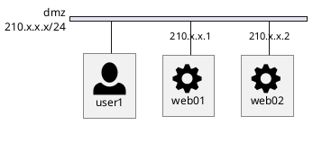

### Bundled sprite libraries

You can also pull richer sprites from the PlantUML standard library with the
angle-bracket `!include <…>` form, which resolves against the sprites shipped inside the
PlantUML JAR (so it works under the `INTERNET` security profile — there is no call out to an
arbitrary remote host). Reference an included sprite with `<$sprite_name>` inside a
`description`:

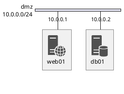

> Never use `!includeurl` to fetch from arbitrary hosts — only the bundled angle-bracket
> includes (`office`, `aws`, `azure`, `k8s`, `logos`, `devicons`, …) are available on this
> server.

---

## `width = full`

By default a busbar is only as wide as the servers it carries. Setting `width = full` on a
network stretches its band across the whole diagram, which is handy for a shared backbone
that visually underpins everything else:

```plantuml
@startnwdiag
nwdiag {
  network Sample_front {
    web01 [address = "192.168.10.1"];
    web02 [address = "192.168.10.2"];
  }
  network Sample_back {
    width = full
    web01 [address = "192.168.20.1"];
    web02 [address = "192.168.20.2"];
    db01;
  }
}
@endnwdiag
```

---

## Title, legend and caption

The usual PlantUML page furniture works inside a network diagram. Place `title`, `caption`
and `legend … end legend` outside the `nwdiag { … }` block:

```plantuml
@startnwdiag
nwdiag {
  network dmz {
    address = "210.x.x.x/24"
    web01 [address = "210.x.x.1"];
    web02 [address = "210.x.x.2"];
  }
}
title Front-end network
caption Figure 1 - DMZ layout
legend
  Servers exposed to the Internet
end legend
@endnwdiag
```

---

## Styling with `<style>`

For global control over fonts, colours and line weights, use a `<style>` block targeting the
`nwdiagDiagram` element and its `network`, `server`, `arrow` and `group` sub-elements. This
is cleaner than repeating per-element attributes:

```plantuml
@startnwdiag
<style>
nwdiagDiagram {
  network {
    BackGroundColor green;
    LineColor red;
    FontSize 18;
  }
  server {
    BackGroundColor pink;
    LineThickness 1.0;
    LineColor blue;
  }
  arrow {
    FontSize 17;
    FontColor red;
  }
  group {
    BackGroundColor cadetblue;
    FontStyle bold;
  }
}
</style>
nwdiag {
  group {
    web01;
    web02;
  }
  network dmz {
    web01;
    web02;
  }
}
@endnwdiag
```

To remove drop shadows on the boxes, add `<style> root { shadowing 0 } </style>`.

---

## Putting it all together

A realistic edge-to-core topology combining most of the features above: an Internet cloud
peered to a firewall, a coloured public DMZ, a coloured private LAN, multi-NIC web servers
bridging the two, database hosts drawn as databases, and per-network descriptions and
address ranges.

```plantuml
@startnwdiag
nwdiag {
  inet [shape = cloud, description = "Internet"];
  inet -- fw;
  fw [shape = node, description = "Firewall"];

  network dmz {
    address = "203.0.113.0/24";
    color = "#FFDDDD";
    description = "Public DMZ";
    fw    [address = "203.0.113.1"];
    web01 [address = "203.0.113.10"];
    web02 [address = "203.0.113.11"];
  }
  network internal {
    address = "10.0.0.0/24";
    color = "#DDFFDD";
    description = "Private LAN";
    web01 [address = "10.0.0.10"];
    web02 [address = "10.0.0.11"];
    db01  [address = "10.0.0.100", shape = database];
    db02  [address = "10.0.0.101", shape = database];
  }
}
@endnwdiag
```

A front/back split with named per-network colours and a shared database tier:

```plantuml
@startnwdiag
nwdiag {
  network Sample_front {
    address = "192.168.10.0/24"
    web01 [address = "192.168.10.1"];
    web02 [address = "192.168.10.2"];
  }
  network Sample_back {
    address = "192.168.20.0/24"
    web01 [address = "192.168.20.1"];
    web02 [address = "192.168.20.2"];
    db01;
    db02;
  }
}
@endnwdiag
```

---

## Quick reference

| Construct | Syntax | Notes |
|---|---|---|
| Container | `@startnwdiag … @endnwdiag` | Required on this server; `@startuml` is rejected |
| Inner block | `nwdiag { … }` | Optional wrapper; recommended |
| Network | `network NAME { … }` | Drawn as a horizontal busbar |
| Network address range | `address = "10.0.0.0/24"` | Free-form label, not validated |
| Server | `name [attr = val, …];` | Hangs off every network it appears in |
| Server address | `address = "10.0.0.1"` | Per-network; comma-separate for multiple |
| Multi-NIC host | same `name` in ≥2 networks | Draws jump lines to each busbar |
| Peer / point-to-point | `a -- b;` | Direct link, no busbar |
| Group (in network) | `group NAME { … }` | Clusters servers of one network |
| Group (cross-network) | `group { … }` outside networks | Spans servers on different networks |
| Colour | `color = "#RGB"` or `"named"` | On `network` or `group` |
| Description | `description = "…"` | Caption; on a server replaces its label |
| Shape | `shape = database` | `cloud`, `node`, `storage`, `database`, … |
| Full width | `width = full` | Stretch busbar across the diagram |
| Icons | `<&glyph>` / `<$sprite>` | OpenIconic built in; sprites via `!include <…>` |
| Styling | `<style> nwdiagDiagram { … } </style>` | `network` / `server` / `arrow` / `group` |

---

## Render it via the API

Send any of the examples above to `POST /api/v1/render`. The `source` is plain PlantUML text
and `format` may be `svg`, `png`, `txt` or `pdf`:

```bash
curl -sS -X POST https://plantuml.joor.net/api/v1/render \
  -H 'content-type: application/json' \
  -d '{
    "format": "svg",
    "source": "@startnwdiag\nnwdiag {\n  network dmz {\n    address = \"210.x.x.x/24\"\n    web01 [address = \"210.x.x.1\"];\n    web02 [address = \"210.x.x.2\"];\n  }\n  network internal {\n    address = \"172.x.x.x/24\"\n    web01 [address = \"172.x.x.1\"];\n    web02 [address = \"172.x.x.2\"];\n    db01  [address = \"172.x.x.100\"];\n  }\n}\n@endnwdiag"
  }' \
  --output network.svg
```

The response is the raw image (`image/svg+xml` here), streamed straight to `network.svg`.
Swap `"format": "png"` for a raster image or `"pdf"` for print. If the source is not a valid
network diagram the API returns `422 Unprocessable Entity` with a JSON body explaining the
problem — a handy signal that your syntax needs fixing before you embed the diagram.
