# Object Diagrams

An **object diagram** is a UML structural diagram that shows a snapshot of a system at a
particular moment in time. Where a *class diagram* describes the blueprint (the classes,
their attributes and their relationships), an *object diagram* shows concrete **instances**
of those classes, the actual **values** held in their fields, and the **links** that connect
one instance to another. Think of it as a photograph of the object graph on the heap rather
than the type hierarchy that produced it.

Object diagrams are ideal when you want to:

- Illustrate a **concrete example** of a data structure (a specific order, a specific user).
- Explain **relationships between live instances**, including cardinalities and roles.
- Document **configuration** or lookup tables as key/value **maps**.
- Embed a chunk of **JSON** next to the objects that consume or produce it.

In PlantUML, object diagrams share almost their entire syntax with
[class diagrams](https://plantuml.com/class-diagram) — the same relation arrows, the same
notes, packages, colors and `skinparam` options all apply. The main differences are the
`object` keyword (instead of `class`) and two instance-focused constructs unique to this
diagram type: the `map` associative array and the `json` block.

Every diagram is delimited by `@startuml` … `@enduml`. Nothing else is required — PlantUML
detects that a drawing is an object diagram from the keywords you use.

## Declaring objects

The `object` keyword declares a single instance. The simplest possible diagram is one bare
object:

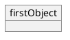

### Display names and aliases

If you want a label that contains spaces or characters that are not valid in an identifier,
put the label in double quotes and give the object a short **alias** with `as`. You then use
the alias everywhere else (in relations, notes, etc.):

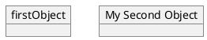

Here `firstObject` is drawn with its own name, while the second box shows the text
*My Second Object* but is referenced in code as `o2`.

## Fields (attributes)

Objects hold **fields** — the instance data. There are two equivalent ways to add fields.

### One field per line with a colon

Repeat the object name, a colon, and the field text. The text after the colon is free-form,
so you can write it as `name = value` to look like an assignment:

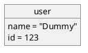

### Grouped in a brace block

The more compact form lists the fields inside `{ … }` directly after the object
declaration. This reads well for objects with several fields:

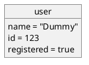

Both forms produce the same result. The `=` sign is purely conventional — the field body is
just text, so `user : balance : 1200` or `user : name` (a field with no value) are equally
valid.

## Links between objects

Objects are connected with the **same relation arrows as class diagrams**. Each arrow head
and line style carries UML meaning:

| Relation             | Symbol   | Meaning                                            |
|----------------------|----------|----------------------------------------------------|
| Extension / generalization | `<|--` | "is a" — specialization of a parent            |
| Implementation / realization | `<|..` | Realizes an interface (dashed)               |
| Composition          | `*--`    | Whole/part; the part **cannot** live without the whole |
| Aggregation          | `o--`    | Whole/part; the part **can** exist independently   |
| Dependency           | `-->`    | One instance uses / points to another              |
| Weak dependency      | `..>`    | A weaker, dashed dependency                        |
| Plain association    | `--`     | A simple link, no arrow head                       |

**Line style rule:** replace the two dashes `--` with two dots `..` anywhere to turn a solid
line into a **dotted** line (so `*--` becomes `*..`, `-->` becomes `..>`, and so on).

The example below shows several relation kinds at once. Note the `"4"` between
`Object05` and `Object06` — a quoted string placed on the relation line becomes a
**cardinality / multiplicity** annotation, and the text after `:` on the last line is a
**relation label**:

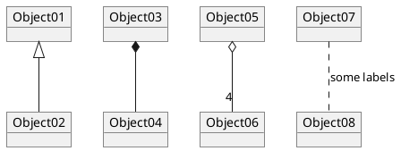

### Labels, roles and cardinalities on both ends

You can place a quoted multiplicity on **each** end of a relation and add a descriptive label
after the colon. This is the canonical way to say "one customer places many orders":

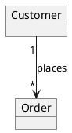

### Dependencies and dotted lines

Dotted relations express weaker coupling. `..>` is a dependency and `<|..` a realization:

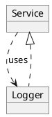

## Association points with `diamond`

Sometimes several objects meet at a shared association point rather than linking pairwise.
The `diamond` keyword (which you can abbreviate to `<>` in class-diagram contexts) creates
that junction node. Here three objects converge on `dia`:

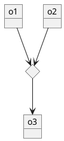

## Controlling layout and arrow direction

By default PlantUML lays diagrams out top-to-bottom. Two mechanisms let you influence this.

### Global direction

Add `left to right direction` near the top to lay the graph out horizontally. This often
produces a much more readable diagram for chains of objects:

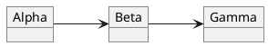

### Per-relation direction hints

The **number of dashes** and the arrow direction influence placement:

- A single dash (`->`, `<-`, `<->`) tends to draw a **horizontal** (side-by-side) link.
- A double dash (`-->`, `<--`, `<-->`) tends to draw a **vertical** (stacked) link.

You can also force a direction by embedding a keyword inside the arrow, e.g.
`-up->`, `-down->`, `-left->`, `-right->`.

## Maps (associative arrays)

The `map` keyword renders an object as a two-column **key/value table** — perfect for
configuration, lookup tables, dictionaries and enum-like data. Each entry uses the `=>`
arrow to separate the key from the value.

> **Gotcha (this build):** each map entry must be on **its own line**, and the opening `{`
> must not share a line with entries. A one-liner such as `map m { A => B }` is rejected as a
> syntax error — always break the body across multiple lines as shown below.

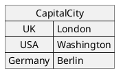

### Giving a map a title

Quote a display title and give the map an alias with `as`. The title accepts **creole
formatting** such as `**bold**`:

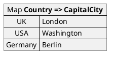

### Documenting the map's type

Because the title is free text, you can use it to record the map's generic type signature,
which is handy when the diagram documents a data model:

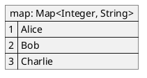

### Linking map entries to objects

A powerful feature is that a **map value can point at another object** instead of being plain
text. Use a relation arrow (`*->`, `=>` with arrows, etc.) on the right-hand side of an
entry. The value is then drawn as a link to that object's box:

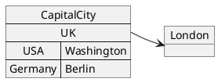

Here `UK` links to the real `London` object, while `USA` and `Germany` stay as plain text
values.

### Longer link arrows and addressing a single entry

Adding extra dashes lengthens the link arrow (`*->`, `*-->`, `*--->`). You can also target a
**specific entry** of a map from outside using the `MapName::key` syntax:

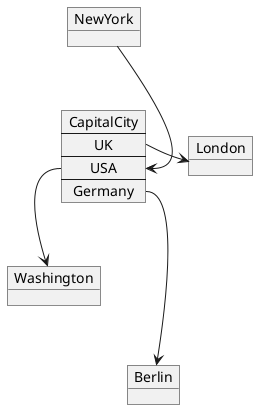

### Maps as a lookup between two tables

Maps are ordinary nodes, so you can link one map to another:

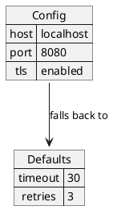

### A roster of objects

Combining linked entries lets a map act as an index into a set of objects:

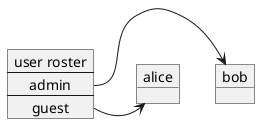

## Building PERT-style charts with maps

Because maps give you compact `key => value` cells and arbitrary links, they are commonly used
to sketch **PERT / project-network** charts, where each task is a small table and arrows
express the dependency order. Combine `left to right direction`, a `title`, and labeled
relations:

> **Gotcha:** avoid dots (`.`) inside a map name when you also use that name in a relation —
> in this build `task.1 --> task.4` is misparsed. Use plain identifiers or an `as` alias
> (e.g. `"Task 1" as t1`) instead.

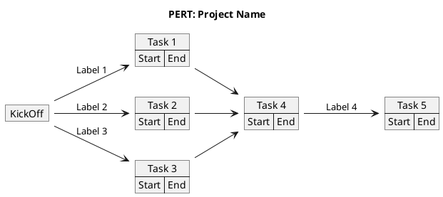

An empty map (`map KickOff { }`) is legal and renders as a titled box with no rows.

## Embedding JSON

The `json` keyword embeds a full [JSON data structure](https://plantuml.com/json) as a
node inside an object diagram. This is useful when you want to show the raw payload alongside
the objects that produce or consume it. Objects, classes and JSON can coexist in one drawing:

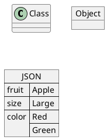

JSON blocks understand the full JSON grammar — nested objects, arrays, numbers, booleans and
`null` — and render them as a hierarchical table:

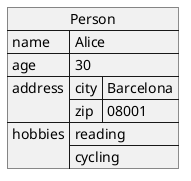

## Notes

Attach explanatory **notes** to any object with `note left of`, `note right of`,
`note top of` or `note bottom of`, closed by `end note` for multi-line text:

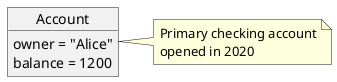

## Packages

Group related objects into visual **packages** to show module or namespace boundaries.
Relations may cross package borders freely:

```plantuml
@startuml
package "Domain Model" {
  object Invoice
  object LineItem
}
package "Billing" {
  object Payment
}
Invoice *-- LineItem
Invoice --> Payment
@enduml
```

## Colors and styling

### Inline colors

Append a `#color` (a named color or `#RRGGBB` hex value) directly after an object declaration
to tint its background:

```plantuml
@startuml
object Server #palegreen
object Database #lightblue
Server : host = "10.0.0.1"
Database : engine = "postgres"
Server --> Database : queries
@enduml
```

### skinparam

For diagram-wide theming use `skinparam`. Object diagrams honor the `object*` family of
parameters — background, border, and font color, among others:

```plantuml
@startuml
skinparam objectBackgroundColor #FDF6E3
skinparam objectBorderColor #657B83
skinparam objectFontColor #073642
object Node1
object Node2
Node1 : role = "master"
Node2 : role = "replica"
Node1 --> Node2 : replicates
@enduml
```

## Hiding and showing members

As with class diagrams you can toggle visibility of an object's fields with `hide` and
`show`. This lets you collapse detail and then re-expose it selectively:

```plantuml
@startuml
object Employee {
  name = "Jane Doe"
  title = "Engineer"
  salary = 90000
}
hide Employee
show Employee
@enduml
```

You can also use `hide members`, `hide empty members`, etc., exactly as in class diagrams.

## A worked example

Putting several features together — a `title`, objects with grouped fields, and relations
carrying both cardinalities and labels — produces a compact object graph for a small order
domain:

```plantuml
@startuml
title Simple Order Object Graph
object customer {
  id = 42
  name = "Alice"
}
object order {
  number = "ORD-001"
  total = 250.00
}
object product {
  sku = "SKU-9"
  price = 125.00
}
customer "1" --> "*" order : places
order "*" o-- "*" product : contains
@enduml
```

## Keyword and syntax cheat sheet

- `object Name` / `object "Display" as alias` — declare an instance.
- `Name : field = value` — add one field.
- `object Name { … }` — add many fields in a block.
- `A <|-- B`, `A *-- B`, `A o-- B`, `A --> B`, `A ..> B`, `A -- B` — relations
  (swap `--` for `..` to dot the line).
- `"card"` on a relation end — multiplicity; `: text` after a relation — a label.
- `diamond D` — an association junction.
- `map Name { key => value }` — an associative array (entries one per line).
- `key *-> Object` inside a map — link an entry to an object.
- `MapName::key` — address a single map entry from outside.
- `json Name { … }` — embed a JSON structure.
- `note {left|right|top|bottom} of X … end note` — annotate.
- `package "P" { … }` — group instances.
- `#color` suffix and `skinparam object*` — styling.
- `left to right direction` — horizontal layout.
- `hide` / `show` — toggle field visibility.

## Render it via the API

Every example above is a complete, self-contained diagram, so you can render any of them by
POSTing its source to the `/api/v1/render` endpoint. Send a JSON body with a `source` string
and the desired `format` (`svg`, `png`, or `txt`):

```bash
curl -sS -X POST https://plantuml.joor.net/api/v1/render \
  -H 'content-type: application/json' \
  -d '{
    "source": "@startuml\nobject user {\n  name = \"Dummy\"\n  id = 123\n}\n@enduml",
    "format": "svg"
  }' \
  -o user-object.svg
```

The response body is the rendered diagram in the requested format (here an SVG document
written to `user-object.svg`). A non-`200` status with a JSON `detail` message indicates a
syntax error in the `source`.
