# The PlantUML Language

Every PlantUML diagram - whether it is a sequence diagram, a class diagram, an
activity diagram or a mind map - is written in the same small text language. On
top of the syntax that is specific to each diagram type, there is a large body
of **common commands** and **common markup** that works everywhere: the tags that
delimit a diagram, comments, titles and captions, headers and footers, legends,
notes, colors, scaling, and a rich text-formatting dialect called **Creole**.

This page is the reference for that shared layer. Master it once and it applies
to all diagram families. Every example below is a complete, self-contained
diagram that renders live - copy any block, change a word, and watch the picture
update.

> **Environment note.** These pages document PlantUML **v1.2026.8** running under
> `SECURITY_PROFILE=INTERNET`. In that profile only the diagram sources you send
> are rendered, and the only includes allowed are the **bundled standard library**
> via angle-bracket syntax (`!include <...>`). Remote `!includeurl` to arbitrary
> hosts is disabled. Everything on this page is pure language syntax and needs no
> includes at all.

---

## Start and end tags

A PlantUML source is always wrapped in a pair of tags. The tags tell the engine
which diagram family to parse. The most common pair is `@startuml` / `@enduml`,
which covers sequence, use-case, class, object, activity, component, deployment,
state and timing diagrams.

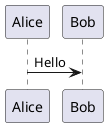

Other diagram families use their own tag pair. The opening tag selects the
grammar for everything until the matching closing tag:

| Tag pair | Diagram family |
|----------|----------------|
| `@startuml` / `@enduml` | Sequence, class, activity, state, use-case, component, ... |
| `@startmindmap` / `@endmindmap` | Mind maps |
| `@startwbs` / `@endwbs` | Work-breakdown structures |
| `@startgantt` / `@endgantt` | Gantt charts |
| `@startsalt` / `@endsalt` | Salt wireframes / GUI mock-ups |
| `@startjson` / `@endjson` | JSON data |
| `@startyaml` / `@endyaml` | YAML data |
| `@startditaa` / `@endditaa` | Ditaa ASCII-art conversion |
| `@startdot` / `@enddot` | Raw Graphviz DOT |

A mind map, for instance, is exactly the same shared language with a different
tag pair:

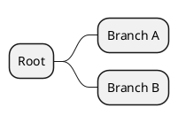

And a Salt wireframe:

```plantuml
@startsalt
{
  Login    | "MyName   "
  Password | "****     "
  [Cancel] | [  OK   ]
}
@endsalt
```

You can optionally give a diagram a name right after the opening tag
(`@startuml MyName`). This is used when a single file contains several diagrams
and by some export workflows to name the output file.

---

## Comments

Comments let you annotate the source without affecting the rendered picture.

- A **single-line comment** starts with an apostrophe `'` and runs to the end of
  the line.
- A **block comment** starts with `/'` and ends with `'/`; it can span several
  lines, or sit inline on a single line.

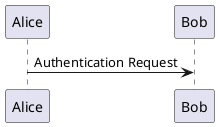

Block comments can also be placed inline in the middle of a line:

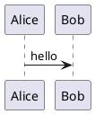

---

## Title

The `title` command adds a heading above the diagram. In its single-line form,
use `\n` to force a line break:

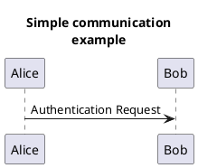

For a longer or multi-line title, use the **block form**: put `title` on its own
line and close with `end title`. Inside the block you may use Creole and
HTML-like tags freely:

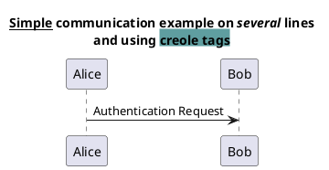

> **Tip.** The `title ...` inline form and the `title ... end title` block form
> are distinct. If you want an `end title`, start the block with a bare `title`
> line; do not put text on the same line as `title` when you also close with
> `end title`.

The look of the title box is controlled with skinparams:

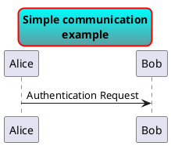

Note how `Aqua-CadetBlue` is a **gradient** color (see [Colors](#colors) below).

---

## Caption

A `caption` places a short line of text **below** the diagram - handy for figure
numbering in a document.

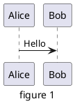

---

## Header and footer

`header` and `footer` add text to the very top and very bottom of the image.
Each can be a single line (`header some text`) or a block terminated by
`endheader` / `endfooter`. Alignment is chosen with `left`, `right` or `center`
placed just before the keyword.

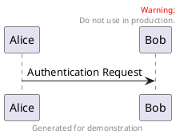

Headers and footers accept HTML-like tags such as `<font color=red>` and are
repeated on every page when a diagram is split.

---

## Legend

A `legend` renders a boxed caption, typically used as a key. Position it with one
or two keywords out of `top`, `bottom`, `left`, `right`, `center`.

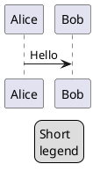

Because the legend body accepts full Creole, a common use is a colored key table:

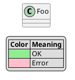

---

## Notes

Notes attach explanatory text to diagram elements. They exist in every diagram
family, though the exact placement keywords differ slightly.

### Placement in sequence diagrams

Use `note left`, `note right`, or `note over <participant>` (one or two
participants). A note can be a one-liner with `:` or a block ended by `end note`.

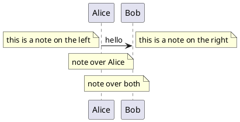

The multi-line block form:

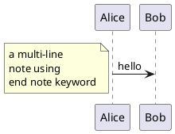

### Placement relative to a named element

In class, object, component and similar diagrams, attach a note to a specific
element with `note top of`, `note bottom of`, `note left of`, `note right of`:

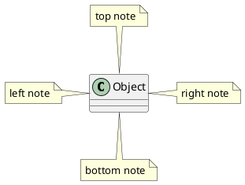

### Floating notes with an alias

Declare a standalone note, give it an alias with `as`, and link it manually:

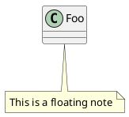

### Creole inside notes

Note bodies are full Creole, so you can mix bold, italics, lists and more:

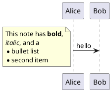

### Shaped notes: hnote and rnote

`hnote` draws a **hexagonal** note and `rnote` draws a plain **rectangular** note
(without the folded corner). They accept the same placements and an optional
color, and have block forms ending in `endrnote` / `endhnote`.

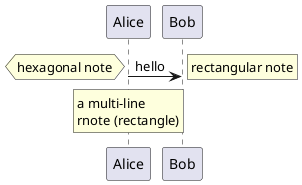

Add a color right after the placement:

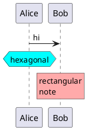

---

## Creole and HTML-like markup

Creole is PlantUML's lightweight text-formatting dialect. It works in every
place that renders text: notes, titles, legends, headers, labels, arc messages,
and so on. For backward compatibility, an HTML-like tag set is accepted in the
same places, and the two can be freely mixed.

### Text styling

| Effect | Creole | HTML-like |
|--------|--------|-----------|
| Bold | `**text**` | `<b>text</b>` |
| Italic | `//text//` | `<i>text</i>` |
| Monospaced | `""text""` | `<font:monospaced>text</font>` |
| Strikethrough | `--text--` | `<s>text</s>`, `<s:#color>` |
| Underline | `__text__` | `<u>text</u>`, `<u:#color>` |
| Wave underline | `~~text~~` | `<w>text</w>`, `<w:#color>` |

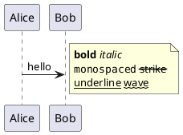

The HTML-like tags additionally give you color, background, size, sub/superscript
and a `<plain>` reset:

```plantuml
@startuml
Alice -> Bob : hello
note right
<b>bold</b> <i>italic</i>
<color:blue>blue</color> <back:yellow>bg</back>
<size:20>big</size> H<sub>2</sub>O x<sup>2</sup>
end note
@enduml
```

### Lists

Bulleted lists use `*`, numbered lists use `#`; repeat the marker to nest one
level deeper. (You cannot mix bullets and numbers within the same list/sublist.)

```plantuml
@startuml
Alice -> Bob : hello
note right
Bulleted:
* item one
** sub item
* item two
Numbered:
# first
## nested
# second
end note
@enduml
```

### Headings

One to four `=` signs at the start of a line create decreasing-size headings:

```plantuml
@startuml
Alice -> Bob : hello
note right
= Level 1
== Level 2
=== Level 3
end note
@enduml
```

### Horizontal lines and separators

A run of line characters draws a rule; embedding text turns it into a titled
separator:

- `----` simple line, `====` double line, `____` strong line
- `..dotted..` dotted line with a title
- `==Title==` double-line title, `--sub--` single-line title

```plantuml
@startuml
Alice -> Bob : hello
note right
first line
----
==Title==
--sub--
..dotted..
end note
@enduml
```

### Tables

Tables use `|` to separate cells; a leading `|=` marks a header (bold) cell. A
`<#color>` right after the opening `|` sets that cell's background.

```plantuml
@startuml
Alice -> Bob : hello
note right
|= |= a |= table |
|<#red> 1 | 2 | 3 |
|<#lightblue> x | y | z |
end note
@enduml
```

You can also give foreground/background pairs (`<#fg,#bg>`), use `<color:...>`
for text color, and `<#transparent,#transparent>` to hide borders.

### Links and tooltips

The `[[url]]` syntax creates a hyperlink; add a label after a space and an
optional `{tooltip}` in braces.

```plantuml
@startuml
Alice -> Bob : hello
note right
See [[https://plantuml.com the PlantUML site]]
end note
@enduml
```

### Icons, emoji, tree and code

- OpenIconic icons: `<&icon_name>` (e.g. `<&heart>`, `<&wifi>`).
- Emoji: `<:name:>`, colorized with `<#color:name:>`.
- Tree branches: lines beginning with `|_`.
- Verbatim code: wrap in `<code> ... </code>`.

```plantuml
@startuml
Alice -> Bob : hello
note right
Icon: <&heart> <&wifi>
Emoji: <:smile:> <#red:heart:>
end note
@enduml
```

```plantuml
@startuml
Alice -> Bob : hello
note right
|_ Root
|_ **Bold branch**
|_ Leaf
<code>
int x = 1;
</code>
end note
@enduml
```

### Escaping special characters

Prefix a Creole marker with `~` to display it literally instead of interpreting
it:

```plantuml
@startuml
Alice -> Bob : hello
note right
Not underlined: ~__text~__
end note
@enduml
```

---

## Unicode

PlantUML sources are UTF-8, so you can type Unicode characters directly:

```plantuml
@startuml
Bob -> Alice : I love Unicode ∞ ♥ €
@enduml
```

When you cannot type a glyph, reference it by code point with `<U+hhhh>` (hex) or
the HTML entity `&#nnnnnn;` (decimal):

```plantuml
@startuml
Alice -> Bob : hello <U+221E>
@enduml
```

---

## Hyperlinks and tooltips

Besides Creole `[[...]]` inside text, most diagram elements accept a hyperlink in
double brackets right after their declaration. Clicking the element in an SVG
output opens the link.

```plantuml
@startuml
class ArrayList [[https://docs.oracle.com/javase/8/docs/api/java/util/ArrayList.html]]
@enduml
```

The full link form is `[[url{tooltip} label]]` - the tooltip appears on hover and
the label overrides the visible text:

```plantuml
@startuml
Alice -> Bob : hello [[https://plantuml.com{This is a tooltip} click me]]
@enduml
```

---

## Colors

Colors are written with a leading `#` and can be given in several notations:

- **Named** color, using its standard/CSS name: `#Red`, `#LightBlue`.
- **6-digit hex** `#RRGGBB`: `#88AA00`.
- **8-digit hex** `#RRGGBBaa` adds an alpha channel (transparency).
- **3-digit hex** `#RGB` expands each digit (`#eee` → `#eeeeee`).
- **1-digit hex** `#x` is a grayscale shortcut (`#f` white ... `#0` black).
- The keyword **`transparent`** (equivalent to `#00000000`).

```plantuml
@startuml
class A #Red
class B #88AA00
class C #ffcc00
class D #eee
@enduml
```

Alpha and transparency:

```plantuml
@startuml
rectangle Solid #FF0000
rectangle Alpha #FF000080
rectangle Trans #transparent
@enduml
```

Grayscale one-digit shortcuts:

```plantuml
@startuml
rectangle White #f
rectangle Mid #8
rectangle Dark #0
@enduml
```

### Gradients

A gradient is two colors joined by a **direction symbol**:

| Symbol | Direction |
|--------|-----------|
| `-` | horizontal |
| `\|` | vertical |
| `/` | diagonal (bottom-left to top-right) |
| `\` | diagonal (top-left to bottom-right) |

```plantuml
@startuml
rectangle Vertical #White/Red
rectangle Horizontal #Silver-SeaGreen
rectangle DiagA #GreenYellow/Green
rectangle DiagB #LightBlue\Blue
@enduml
```

Gradients work anywhere a color does - for example on sequence actors:

```plantuml
@startuml
actor Bob #Red/Yellow
actor Alice #FF0000/FFFF00
Alice -> Bob : hello
@enduml
```

```plantuml
@startuml
rectangle "Gradient with border" #GreenYellow-LightGoldenRodYellow
@enduml
```

### Automatic (contrast-aware) font color

The `#?light:dark` syntax picks the first color on light backgrounds and the
second on dark ones, keeping text legible whatever the fill:

```plantuml
@startuml
<style>
document { BackGroundColor darkblue }
root { FontColor #?black:white LineColor white }
</style>
alice -> bob : hello
@enduml
```

### Color functions

The preprocessor can derive colors from a base one - useful for consistent
palettes:

```plantuml
@startuml
rectangle R1 #darken("red", 20)
rectangle R2 #lighten("red", 20)
@enduml
```

Other functions include `%reverse_color(...)`, `%reverse_hsluv_color(...)`, and
the predicates `%is_dark()` / `%is_light()`.

### Listing the color palette

The special one-line diagram `colors` renders the full table of named colors -
handy as a live reference:

```plantuml
@startuml
colors
@enduml
```

---

## Zoom and scale

The `scale` command resizes the whole output. It accepts a plain multiplier, a
fraction, an explicit width or height, an exact `width*height`, or a `max`
bounding box.

```plantuml
@startuml
scale 1.5
Alice -> Bob : Hello
@enduml
```

```plantuml
@startuml
scale 400 width
Alice -> Bob : Hello
Bob --> Alice : Hi
@enduml
```

```plantuml
@startuml
scale max 300*200
Bob -> Alice : Hello
@enduml
```

Forms at a glance: `scale 1.5`, `scale 2/3`, `scale 200 width`,
`scale 200 height`, `scale 200*100`, `scale max 300*200`.

---

## Hide and show

`hide` and `show` toggle the visibility of parts of a diagram. In class diagrams
this filters members; you can target everything, empty compartments, or a
specific class.

Hide all members, then reveal one compartment of one class:

```plantuml
@startuml
class Dummy {
  +field1
  method1()
}
hide members
show Dummy method
@enduml
```

Hide empty compartments so plain classes render as compact boxes:

```plantuml
@startuml
class Foo
class Bar {
  +value : int
}
hide empty members
@enduml
```

In sequence diagrams, `hide footbox` removes the repeated participant boxes at
the bottom:

```plantuml
@startuml
hide footbox
Alice -> Bob : Authentication Request
Bob --> Alice : Authentication Response
@enduml
```

---

## Mainframe

`mainframe` wraps the entire diagram in a labeled frame reminiscent of UML
interaction frames. Its label accepts Creole:

```plantuml
@startuml
mainframe This is a **mainframe**
Alice -> Bob : Hello
@enduml
```

---

## Putting it together

The commands on this page compose freely. A single diagram can carry a title, a
header and footer, notes with Creole, colored elements and a legend all at once:

```plantuml
@startuml
title Order **checkout** flow
header Draft
center footer (c) Example Corp

actor Customer #LightBlue/White
Customer -> Bob : place order
note right
Payment is
//authorized// here
end note
Bob --> Customer : confirmation

legend right
|= Step |= Status |
|<#lightgreen> pay | OK |
endlegend
@enduml
```

That final example, like every block above, was validated against the live
rendering API for PlantUML v1.2026.8.
