# Preprocessing (includes, macros, functions)

Before PlantUML draws a single line, it runs your source through a **preprocessor**.
This is a text-transformation stage — conceptually like the C preprocessor, but using
`!` as the special character instead of `#`, and `%` for built-in functions. It lets you
factor diagrams into reusable pieces, compute values, branch, loop, and pull in data,
all before the diagram engine ever sees the result.

The preprocessor is **diagram-agnostic**: the exact same directives work in sequence,
class, component, activity, state, deployment, gantt, mindmap, JSON — every diagram type.
Everything on this page is evaluated first; what survives is a plain PlantUML diagram.

This page is a complete reference to the preprocessor as shipped in **PlantUML
v1.2026.8**. Every rendered example below is a complete, self-contained diagram that you
can copy verbatim.

> **Security note.** This server runs under `SECURITY_PROFILE=INTERNET`. That profile
> **allows only the bundled standard-library** angle-bracket includes — `!include <...>`
> — and forbids reading arbitrary local files or fetching arbitrary remote URLs
> (`!includeurl`, `!include http://...`, `%load_json("http://...")`). Every technique on
> this page that needs external content is shown either with a **bundled stdlib** include
> or with **inline data** (`%str2json`, literal JSON) so it works under INTERNET. The
> local-file and URL forms are documented for completeness but are disabled here.

---

## Variables

Variables start with `$`. The preprocessor infers one of three types from the value you
assign: **integer**, **string**, or **JSON**.

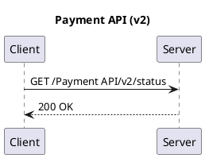

Key points:

- `!$name = value` defines (or reassigns) a variable.
- Bare `$name` inside diagram text is **substituted** with the value. You can put it
  anywhere text is accepted — titles, labels, aliases, notes.
- Strings use double quotes; integers are written bare; JSON uses `{ ... }` / `[ ... ]`
  (see [JSON in the preprocessor](#json-in-the-preprocessor)).

### Conditional assignment (`?=`)

`?=` assigns **only if the variable is not already defined**. This is the idiom for
"defaults that a caller can override" — the first `?=` that runs wins, later ones are
no-ops.

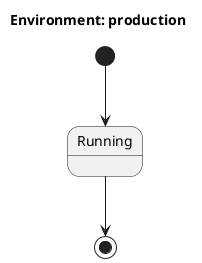

Here `$env` becomes `"production"`; the second `?=` is ignored because `$env` already
exists.

### The three data types

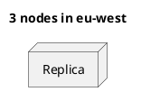

Integers participate in arithmetic (`+ - * /`, `%mod()`), strings concatenate with `+`,
and JSON values are navigated with `.field` / `[index]`.

### Scope: global vs. local

A variable assigned at top level is **global**. A variable created with `!local` inside a
function or procedure is **local** — it shadows any global of the same name for the
duration of the call and disappears afterward.

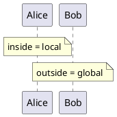

---

## Including other files

`!include` pulls the contents of another file (or stdlib entry) into the current source
at that point. This is the backbone of reusable style sheets, macro libraries, and shared
skinparams.

### Include modes

| Directive | Behavior |
|---|---|
| `!include target` | Include the target. If the **same target** was already included, it is **silently skipped** (deduplicated). |
| `!include_once target` | Include the target, but **raise an error** if it was already included. Use to catch accidental double-includes. |
| `!include_many target` | Include the target **every time**, even if already included (no deduplication). |

```text
' Local-file forms — DISABLED under SECURITY_PROFILE=INTERNET, shown for reference:
!include common/style.iuml
!include_once macros/actors.iuml
!include_many templates/row.iuml
```

### Selecting a block or sub-part

A single file can hold several diagrams or reusable fragments; you can include just one.

```text
!include file.puml!0            ' the FIRST @startuml...@enduml block in the file
!include file.puml!MY_ID        ' the block whose @startuml carries id=MY_ID

' Sub-parts delimited by !startsub / !endsub in the source file:
!startsub HEADER
  ... reusable lines ...
!endsub
!includesub other.puml!HEADER   ' pull in just that sub-part
```

### Standard-library (angle-bracket) includes — the INTERNET-safe form

`!include <path>` reads from PlantUML's **bundled standard library**. These are the only
includes permitted under the INTERNET profile, and they need no network access — the
library ships inside PlantUML itself. Popular collections include `C4`, `awslib`,
`azure`, `gcp`, `kubernetes`, `logos`, `material`, `office`, and `tupadr3` (Devicons /
Font Awesome).


Many stdlib collections expose sprites and macros. AWS icons, for example, come from
`awslib`:

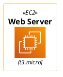

> **Path gotcha.** The path inside the brackets must match the library's real layout
> exactly, including case. `!include <awslib/Compute/EC2>` works; a wrong folder or
> element name yields a syntax error. Use `%get_all_stdlib()` (below) to discover what is
> bundled.

### Custom libraries and the search path

`!import /path/to/library.zip` registers a ZIP archive so subsequent `!include` calls can
reference files inside it. The include search path can also be set on the JVM:

```bash
# -D options must come BEFORE -jar
java -Dplantuml.include.path="/srv/plantuml/includes" -jar plantuml.jar diagram.puml
```

Both custom-library and filesystem search-path features are only relevant to a local
CLI; under the hosted INTERNET profile you rely on the bundled `<...>` stdlib.

---

## Functions and procedures

The preprocessor lets you define your own callables. There are two flavors:

- **`!function`** computes and **returns a value** with `!return`. It produces no diagram
  text by itself; you use its result in an expression.
- **`!procedure`** **emits diagram text** (it "prints" lines into the output) and returns
  nothing.

### `!function` — returns a value

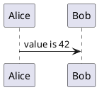

### `!procedure` — emits diagram lines

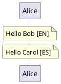

### Default argument values

Any parameter can declare a default with `=`. Callers may omit trailing arguments and the
defaults fill in. This works for both functions and procedures.

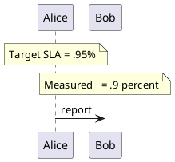

### Keyword arguments

You do not have to pass arguments positionally — you can name them (`$param=value`). This
lets you skip earlier optional parameters and only set the ones you care about.

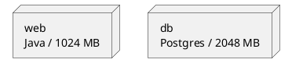

The first call keeps the default `$tech="Java"` but overrides `$ram`; the second names
both optional arguments.

### Unquoted functions and procedures

By default, string arguments must be quoted at the call site. Declaring the callable with
`!unquoted` (`!unquoted function` / `!unquoted procedure`) lets callers pass **bare,
unquoted text** — handy for terse macros.

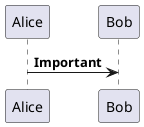

### Argument concatenation with `##`

Inside a macro body, `##` glues text directly onto an argument with no space — essential
when building unique aliases from a base name.

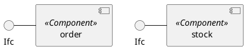

Each call yields a distinct interface alias (`orderIfc`, `stockIfc`).

### Dynamic invocation

You can call a procedure or function whose **name is computed at runtime**:

- `%invoke_procedure("$name", args...)` calls a procedure by name.
- `%call_user_func("$name", args...)` calls a function by name and yields its return
  value.

```plantuml
@startuml
!procedure $box($label)
rectangle "$label" as $label
!endprocedure
!function $tag($t)
!return "[" + $t + "]"
!endfunction
%invoke_procedure("$box", "Cache")
note top of Cache : %call_user_func("$tag", "hot")
@enduml
```

---

## Control flow

### `!if` / `!elseif` / `!else` / `!endif`

Conditionally include diagram text. In a condition, integer `0` is **false**; any nonzero
number or any string is **true**. Combine tests with `&&`, `||`, `==`, `!=`, comparisons,
and parentheses.

```plantuml
@startuml
!$role = "admin"
!if ($role == "admin")
Alice -> Server : full access
!elseif ($role == "editor")
Alice -> Server : write access
!else
Alice -> Server : read only
!endif
@enduml
```

### `!while` / `!endwhile`

Repeat a block while a condition holds. Remember to advance the loop variable inside the
body, or you will loop forever.

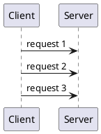

A counting loop that builds a row of nodes:

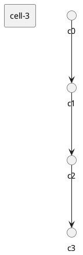

### `!foreach` / `!endfor`

Iterate over a JSON **array** or over the elements of any collection. The loop variable
takes each element in turn.

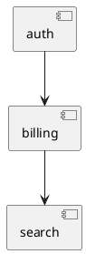

`!foreach` shines with arrays of JSON **objects** — each element carries its own fields:

```plantuml
@startuml
!$team = [ { "name": "Ada", "role": "Dev" }, { "name": "Lin", "role": "Ops" } ]
!foreach $member in $team
class "$member.name" as $member.name {
  $member.role
}
!endfor
@enduml
```

### Combining branches and loops

Control-flow directives nest freely. A common pattern is looping over a data set and
styling each item by one of its fields:

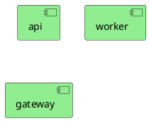

---

## Built-in `%functions`

Built-in functions begin with `%` and are always available (no include needed). They
cover date/version metadata, string manipulation, type conversion, math, colors,
booleans, and introspection. The most useful groups are below.

### Metadata and environment

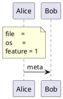

| Function | Returns |
|---|---|
| `%date("yyyy-MM-dd")` | Current date/time, formatted (default format if omitted). |
| `%version()` | The running PlantUML version. |
| `%filename()` | Name of the current source file. |
| `%dirpath()` | Directory of the current source. |
| `%getenv("NAME")` | An environment variable (empty if unset). |
| `%feature("theme")` | Whether an engine feature is supported. |
| `%now()` | Current time as epoch seconds. |

`%getenv` for an undefined variable simply yields empty text (as above), so it is safe to
reference optional variables.

### Date and version in practice

```plantuml
@startuml
note over Alice
  Rendered on %date("yyyy-MM-dd")
  Engine version %version()
  Upper: %upper("plantuml")
  Char 65 = %chr(65), ord A = %ord("A")
end note
Alice -> Bob : ping
@enduml
```

### String functions

```plantuml
@startuml
!$s = "abcdef"
note over Alice
  len   = %strlen($s)
  sub   = %substr($s, 3, 2)
  pos   = %strpos($s, "ef")
  toint = %intval("42")
  tostr = %string(1 + 2)
end note
Alice -> Bob : done
@enduml
```

| Function | Meaning | Example → result |
|---|---|---|
| `%strlen(s)` | Length in characters | `%strlen("foo")` → `3` |
| `%substr(s, start[, len])` | Substring from **0-based** `start` | `%substr("abcdef", 3, 2)` → `"de"` |
| `%strpos(s, sub)` | 0-based index of `sub`, or `-1` | `%strpos("abcdef", "ef")` → `4` |
| `%lower(s)` / `%upper(s)` | Change case | `%upper("Hello")` → `"HELLO"` |
| `%string(x)` | Any value → its string form | `%string(1+2)` → `"3"` |
| `%intval(s)` | String → integer | `%intval("42")` → `42` |
| `%chr(n)` / `%ord(c)` | Unicode code point ↔ character | `%chr(65)` → `"A"`, `%ord("A")` → `65` |

Note the **0-based indexing**: in `"abcdef"`, `%substr(s, 3, 2)` is `"de"` and
`%strpos(s, "ef")` is `4`.

### Type conversion, math, and color

| Function | Meaning | Example → result |
|---|---|---|
| `%hex2dec("d")` / `%dec2hex(12)` | Hex ↔ decimal | `13` / `"c"` |
| `%mod(a, b)` | Modulo | `%mod(10, 3)` → `1` |
| `%random()` / `%random(n)` / `%random(a,b)` | Random values | `0/1`, `0..n-1`, `a..b` |
| `%size(x)` | Element count / string length | `%size("foo")` → `3` |
| `%darken(c, pct)` / `%lighten(c, pct)` | Adjust brightness | `%darken("red", 20)` → `"#CC0000"` |
| `%reverse_color(c)` | Invert RGB | `%reverse_color("#FF7700")` → `"#0088FF"` |
| `%hsl_color(h,s,l)` | HSL → RGB hex | `%hsl_color(120,100,50)` → `"#00FF00"` |
| `%is_dark(c)` / `%is_light(c)` | Brightness test | `1` / `0` |

Colors returned by these functions can be dropped straight into skinparams:

```plantuml
@startuml
!$base = "#3366CC"
skinparam actorBackgroundColor $base
skinparam sequenceLifeLineBorderColor %darken($base, 20)
skinparam sequenceBoxBorderColor %lighten($base, 20)
actor Alice
Alice -> Bob : colored
@enduml
```

### Booleans and logic

The preprocessor has a full boolean vocabulary. Use it to make `!if` conditions readable.

| Function | Result |
|---|---|
| `%true()` | `1` |
| `%false()` | `0` |
| `%not(expr)` | Logical negation |
| `%boolval(expr)` | Coerce to boolean (`1`/`0`) |

```plantuml
@startuml
!$debug = %true()
!if (%not($debug))
Alice -> Bob : production path
!else
Alice -> Bob : debug path (%boolval($debug))
!endif
@enduml
```

### Reading and writing variables by name

`%get_variable_value("$name")` and `%set_variable_value("$name", value)` read and write a
**global** variable when you only know its name as a string — the dynamic counterpart to
`!$name = ...`.

```plantuml
@startuml
!$counter = 5
%set_variable_value("$counter", %get_variable_value("$counter") + 1)
note over Alice : counter = %get_variable_value("$counter")
Alice -> Bob : go
@enduml
```

Related introspection helpers: `%variable_exists("$x")`, `%function_exists("$f")`, and
`%file_exists("path")` return `1`/`0`.

### Discovering the bundled library

`%get_all_stdlib()` returns a JSON array of every bundled standard-library name, and
`%get_all_theme()` returns every bundled theme. These are handy when you are unsure of an
exact stdlib path or theme name — you can iterate over them with `!foreach`.

### Escape helpers

When you need a literal special character (or a newline), use these instead of fighting
the parser: `%dollar()` → `$`, `%percent()` → `%`, `%backslash()` → `\`,
`%newline()` / `%n()` → a newline in the rendered text, and `%breakline()` → a line break
in the generated source.

---

## Themes: `!theme`

`!theme name` applies one of PlantUML's bundled color/style themes to the whole diagram.
It is technically a preprocessor directive because it injects a bundle of skinparams
before rendering.

```plantuml
@startuml
!theme cerulean
title Themed sequence
Alice -> Bob : Hello
Bob --> Alice : Hi
@enduml
```

Bundled themes include `plain`, `cerulean`, `spacelab`, `sketchy`, `cyborg`, `superhero`,
`mono`, and many more. Enumerate them all with `%get_all_theme()`.

---

## Assertions: `!assert`

`!assert` evaluates a boolean expression and, if it is **false**, aborts rendering with
your message. Use it to guard your macros' assumptions. When the expression is true (as
below), rendering proceeds normally.

```plantuml
@startuml
!assert %strpos("abcdef", "cd") == 2 : "cd should be at index 2"
Alice -> Bob : assertion passed
@enduml
```

(Because indexing is 0-based, `"cd"` starts at position `2`.)

---

## Debugging the preprocessor

Two directives help you see what the preprocessor is doing:

- `!log message` writes a message to the processing log (visible in verbose/CLI output).
  It never appears in the diagram.
- `!dump_memory [label]` prints the current state of all variables — invaluable when a
  substitution is not what you expected.

```plantuml
@startuml
!$region = "eu-west"
!log Building diagram for region $region
note over Alice : region = $region
Alice -> Bob : deploy
@enduml
```

---

## JSON in the preprocessor

The preprocessor can hold structured JSON data and navigate it — perfect for
data-driven diagrams where the same shape is drawn many times.

### Defining and accessing JSON

Assign an object with `{ ... }` or an array with `[ ... ]`. Read fields with dot notation
(`$var.field`) and array elements with bracket notation (`$var[index]`). Access nests
arbitrarily.

```plantuml
@startuml
!$db = { "employees": [ { "name": "Ada", "salary": 90 }, { "name": "Lin", "salary": 80 } ] }
!$field = "name"
note over Node : first = $db.employees[0][$field]
Client -> Node : lookup
@enduml
```

Notice `$db.employees[0][$field]`: the **key can itself be a variable** — bracket
notation with a string variable gives dynamic field access.

### Building JSON from a string: `%str2json`

When your JSON arrives as a string (a common shape when data is generated elsewhere),
`%str2json` parses it into a navigable structure. This is the INTERNET-safe alternative to
loading a remote file.

```plantuml
@startuml
!$raw = '{ "nodes": ["a", "b", "c"] }'
!$data = %str2json($raw)
!foreach $n in $data.nodes
agent $n
!endfor
@enduml
```

> Use **single quotes** around a JSON literal passed to `%str2json` so the inner double
> quotes survive.

### Inspecting JSON: type, keys, membership, size

```plantuml
@startuml
!$data = { "name": "svc", "tags": ["a","b"], "active": true }
note over Node
  name -> %get_json_type($data.name)
  tags -> %get_json_type($data.tags)
  has 'active'? %json_key_exists($data, "active")
  size -> %size($data)
end note
Client -> Node : query
@enduml
```

| Function | Purpose |
|---|---|
| `%get_json_type(x)` | `"object"`, `"array"`, `"string"`, `"number"`, `"boolean"`, or `"null"`. |
| `%get_json_keys(obj)` | Array of an object's keys — iterate it with `!foreach`. |
| `%json_key_exists(obj, "k")` | `1`/`0` membership test. |
| `%size(x)` | Object → pair count, array → length, string → char count. |

### Iterating an object's keys with `%get_json_keys`

`!foreach` walks arrays directly; to walk an **object**, iterate its keys and index back
in with `[$key]`.

```plantuml
@startuml
!$cfg = { "cpu": "4", "ram": "8GB" }
!foreach $key in %get_json_keys($cfg)
note over Node : $key = $cfg[$key]
!endfor
Client -> Node : x
@enduml
```

### Splitting strings into arrays: `%splitstr`

`%splitstr(text, delimiter)` returns a JSON array — a quick way to turn CSV-ish
configuration into something `!foreach` can consume. (There is also `%splitstr_regex`
for a regular-expression delimiter.)

```plantuml
@startuml
!foreach $part in %splitstr("web~app~db", "~")
node $part
!endfor
@enduml
```

### Mutating JSON

Several helpers modify JSON in place or return a new structure: `%json_add`,
`%json_remove`, `%json_set`, and `%json_merge`. For example, `%json_set($a, name, Sally)`
sets a key, `%json_remove($a, 1)` drops an array element, and `%json_merge($a, $b)`
combines two objects.

### Loading JSON from a file or URL (disabled under INTERNET)

For completeness, `%load_json` reads JSON from a local file or URL:

```text
' Both DISABLED under SECURITY_PROFILE=INTERNET:
!$users = %load_json("myDir/list.json")
!$users = %load_json("http://example.com/list.json")
```

Under this server's INTERNET profile, use inline JSON literals or `%str2json` instead, as
shown above.

---

## Legacy directives and migration

Older diagrams use C-style macros. They still work, but the modern equivalents are
clearer and are recommended for new work.

`!define` creates a simple textual constant (no `$`, uppercase by convention):

```plantuml
@startuml
!define SEQUENCE_COLOR #A9DCDF
skinparam sequenceArrowColor SEQUENCE_COLOR
Alice -> Bob : legacy define
@enduml
```

| Legacy | Modern replacement |
|---|---|
| `!define NAME value` | `!$name = value` (or `!function` for computed values) |
| `!definelong ... !enddefinelong` | `!procedure ... !endprocedure` |
| `!undef NAME` | Not needed — reassign or use scoping (`!local`) |
| `%date%` (old inline form) | `%date()` |
| `!includeurl http://...` | `!include http://...` (and only stdlib `<...>` under INTERNET) |

---

## Quick reference

| Category | Directives / functions |
|---|---|
| Variables | `!$x = v`, `?=` (assign if unset), `!local`, `%get_variable_value`, `%set_variable_value`, `%variable_exists` |
| Includes | `!include`, `!include_once`, `!include_many`, `!include <stdlib>`, `!includesub`, `!startsub`/`!endsub`, `!import` |
| Callables | `!function`/`!return`/`!endfunction`, `!procedure`/`!endprocedure`, `!unquoted ...`, default args, keyword args, `##`, `%invoke_procedure`, `%call_user_func` |
| Control flow | `!if`/`!elseif`/`!else`/`!endif`, `!while`/`!endwhile`, `!foreach`/`!endfor` |
| Booleans | `%true`, `%false`, `%not`, `%boolval`, `&&`, `\|\|`, `==`, `!=` |
| Strings | `%strlen`, `%substr`, `%strpos`, `%lower`, `%upper`, `%string`, `%intval`, `%chr`, `%ord`, `%splitstr`, `%splitstr_regex` |
| Metadata | `%date`, `%version`, `%filename`, `%dirpath`, `%getenv`, `%feature`, `%now` |
| Color/math | `%darken`, `%lighten`, `%reverse_color`, `%hsl_color`, `%is_dark`, `%is_light`, `%mod`, `%random`, `%hex2dec`, `%dec2hex` |
| JSON | `%str2json`, `%get_json_type`, `%get_json_keys`, `%json_key_exists`, `%size`, `%json_add`, `%json_remove`, `%json_set`, `%json_merge`, `%load_json` (disabled) |
| Theme | `!theme name`, `%get_all_theme`, `%get_all_stdlib` |
| Diagnostics | `!assert ... : "msg"`, `!log`, `!dump_memory` |
| Escapes | `%dollar`, `%percent`, `%backslash`, `%newline`/`%n`, `%breakline` |
