# Salt — UI Wireframes

**Salt** is a sub-project of PlantUML for drawing **graphical user interface (GUI) wireframes**, website mockups, page schematics and screen blueprints. Where the other PlantUML diagram types describe behaviour or structure, Salt describes *layout*: buttons, text fields, radio buttons, checkboxes, drop-lists, trees, tables, tabs, menus and scrollbars, arranged on a grid. It deliberately favours **functionality over aesthetics** — the output looks like a low-fidelity sketch, which is exactly what you want early in a design conversation, in a specification document, or inline inside a larger diagram (for example a UI mockup shown on a decision node of an activity diagram).

Everything in Salt is text, so wireframes live in version control next to your code, diff cleanly, and can be rendered on demand through the PlantUML API.

> This page targets the pinned build **PlantUML v1.2026.8** running under `SECURITY_PROFILE=INTERNET`. All examples are self-contained and were validated against the live render API. Only bundled standard-library includes (angle-bracket `!include <...>`) are available; remote `!includeurl` to arbitrary hosts is disabled.

## Getting started

### The `@startsalt` block

A Salt diagram is opened with `@startsalt` and closed with `@endsalt`. The wireframe content itself lives inside a pair of curly braces `{ ... }`. The braces are the **window/container**; every widget you want to draw goes between them.

```plantuml
@startsalt
{
  Hello, this is a minimal Salt window
}
@endsalt
```

Any line that is not recognised as a widget is rendered as **plain text label**. That is the whole trick of Salt: you describe rows of widgets, one per line, and PlantUML lays them out on an implicit grid.

### The two golden rules

1. **The window is enclosed in `{ }`.** You can nest braces to build sub-layouts (more on that later).
2. **Columns are separated by the pipe character `|`.** A line with two pipes has three columns; the grid auto-sizes to the widest cell in each column.

### A classic login form

Adding a `+` immediately after the opening brace (`{+`) draws an external border around the whole window. The `|` splits each row into a label column and a widget column.

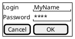

Note how the trailing spaces inside the `"..."` text fields make them wider — Salt sizes a field to the text it contains, so pad with spaces to reserve visual width.

## Basic widgets

Salt recognises a small vocabulary of bracket/quote characters, each of which becomes a widget. The table below is the complete set; the example that follows uses every one of them.

| Widget | Syntax | Meaning |
|--------|--------|---------|
| Plain text | `any text` | A static label |
| Button | `[ text ]` | A push button |
| Radio button (off) | `() text` | Unselected radio |
| Radio button (on) | `(X) text` | Selected radio |
| Checkbox (off) | `[] text` | Unchecked box |
| Checkbox (on) | `[X] text` | Checked box |
| Text field | `"text"` | Editable input; width follows the text |
| Drop-list | `^text^` | Combo box / drop-down |

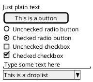

### Buttons

A button is any text wrapped in square brackets `[ ]`. Pad the label with spaces to widen the button, and embed Creole/HTML tags (see [Creole](#creole-formatting)) to colour or style the caption.

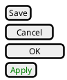

### Radio buttons

Round brackets make a radio button. An `X` between the brackets marks it selected. Radios are visually grouped simply by placing them on consecutive rows.

```plantuml
@startsalt
{
  Choose a size:
  (X) Small
  ()  Medium
  ()  Large
}
@endsalt
```

### Checkboxes

Square brackets with nothing (or a space) inside make an unchecked checkbox; an `X` inside checks it. Beware the ambiguity: `[Save]` is a **button**, but `[]`, `[ ]` and `[X]` followed by a label are **checkboxes**. The distinguishing factor is whether the brackets wrap a caption (button) or stand alone before the label (checkbox).

```plantuml
@startsalt
{
  Formatting:
  [X] Bold
  []  Italic
  [X] Underline
}
@endsalt
```

### Text fields

Double quotes create an editable text field. The field is sized to its contents, so pad with trailing spaces to make it wider. This is the idiomatic way to draw form inputs, and works nicely in a two-column label/field grid.

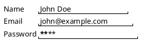

### Drop-lists (combo boxes)

A caret pair `^text^` draws a **closed** drop-list. To show an **open** drop-list with its items expanded, chain several caret-delimited entries together: `^Item 1^^Item 2^^Item 3^` — the first entry is the visible/selected value and the rest are the drop-down options.

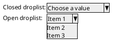

## Layout: the grid

Whenever a row contains a `|`, Salt switches that block into a **grid**. Columns line up across every row, and each column is as wide as its widest cell. You control the grid's *lines* with a single character placed immediately after the opening brace.

| Prefix | Effect |
|--------|--------|
| `{`  | No lines (default) |
| `{#` | All lines — vertical **and** horizontal |
| `{!` | Vertical lines only |
| `{-` | Horizontal lines only |
| `{+` | External border only (no internal lines) |

### All lines with `{#`

Use a lone `.` as an empty cell (handy for the top-left corner of a table with row and column headers).

```plantuml
@startsalt
{#
  .            | Column A | Column B
  Row 1        | value 1  | value 2
  Row 2        | value 3  | value 4
}
@endsalt
```

### Vertical lines only with `{!`

```plantuml
@startsalt
{!
  A | B | C
  D | E | F
}
@endsalt
```

## Separators

Inside a window you can draw horizontal rules between rows. Put one of the following on its own line:

| Separator | Style |
|-----------|-------|
| `..` | Dotted line |
| `==` | Double / bold line |
| `~~` | Wavy line |
| `--` | Dashed line |

```plantuml
@startsalt
{
  Section one
  ..
  Section two
  ==
  Section three
  ~~
  Section four
  --
  Section five
}
@endsalt
```

## Group boxes

A group box is a titled, bordered panel. Open it with `{^"Title"` — the caret means "group", and the quoted string is the caption drawn on the border.

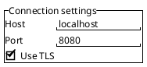

## Tabs

A tab bar is a nested block opened with `{/`. Each tab caption is separated by `|`, and you can mark the active tab with Creole bold (`<b>...`). Follow the tab bar with a normal `{ ... }` block holding the active tab's content.

### Horizontal tabs

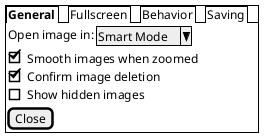

### Vertical tabs

To stack the tabs down the left side instead of across the top, put each tab caption on its own line inside the `{/ ... }` block, then place the content block to the right, separated by a `|` column.

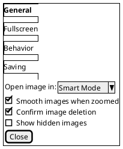

## Menus

A menu bar is a nested block opened with `{*`. The **first line** lists the top-level menu titles separated by `|`.

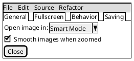

### Menu with an open drop-down

Add extra lines inside the `{* ... }` block to open a drop-down. The **first token** of such a line names the parent menu, and the remaining `|`-separated tokens are its items. A lone `-` produces a menu separator.

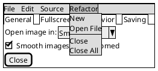

## Trees

A tree is a nested block opened with `{T`. Indentation is expressed with leading `+` characters: one `+` is a root node, `++` is a child, `+++` a grandchild, and so on.

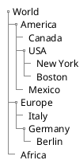

### Tree tables

Combine a tree with columns to build a tree-table. Open with `{T` plus a line-style suffix, and add `|`-separated columns to each row. The suffixes mirror the grid line styles:

- `{T!` — vertical lines only
- `{T-` — horizontal lines only
- `{T+` — external border only
- `{T#` — all lines

```plantuml
@startsalt
{
  {T!
   +Region      | Population   | Age
   + World      | 7.13 billion | 30
   ++ America   | 964 million  | 30
   +++ Canada   | 35 million   | 30
   +++ USA      | 319 million  | 30
   ++ Europe    | 601 million  | 30
  }
}
@endsalt
```

## Advanced tables: empty and spanning cells

Inside any grid, two special cell tokens control layout:

- `.` — an **empty cell** (nothing drawn). Commonly used for the empty top-left corner.
- `*` — a **spanning cell**: the cell to its left extends to fill this column.

```plantuml
@startsalt
{#
  .            | Column 2    | Column 3
  Row header 1 | value 1     | value 2
  Row header 2 | A long cell | *
}
@endsalt
```

## Scrollbars

Wrap content in a scroll block to draw scrollbars around it. The dots `.` on their own lines act as filler to give the pane some height.

- `{S` — both horizontal and vertical scrollbars
- `{SI` — vertical scrollbar only
- `{S-` — horizontal scrollbar only

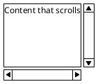

Vertical-only variant:

```plantuml
@startsalt
{SI
  Vertical scroll only
  .
  .
  .
  .
}
@endsalt
```

## Colors

Salt honours Creole/HTML colour tags on most widgets and on plain text. Use `<color:NAME>` or `<color:#RRGGBB>` for foreground text, and `<back:NAME>` for a background highlight. Named colours and hex are both accepted.

```plantuml
@startsalt
{
  <color:Blue>Just plain blue text
  [This is my default button]
  [<color:green>This is my green button]
  () <color:#a9a9a9>Disabled option
}
@endsalt
```

## Creole formatting

Salt supports both **Creole** markup and a subset of **HTML-like** tags inside labels, buttons and cells. Creole uses paired delimiters; HTML uses angle-bracket tags.

| Effect | Creole | HTML tag |
|--------|--------|----------|
| Bold | `**text**` | `<b>text</b>` |
| Italics | `//text//` | `<i>text</i>` |
| Monospaced | `""text""` | — |
| Struck out | `--text--` | `<s>text</s>` |
| Underlined | `__text__` | `<u>text</u>` |
| Wave underline | `~~text~~` | — |
| Colour | — | `<color:red>...</color>` |
| Highlight | — | `<back:yellow>...</back>` |

Keep the styled fragment inside a longer line so a leading `--` or `~~` is not mistaken for a separator.

```plantuml
@startsalt
{
  This is **bold**
  This is //italics//
  This is ""monospaced""
  This is --stricken-out--
  This is __underlined__
  This is ~~wave-underlined~~
  This is <b>HTML bold</b> and <i>HTML italics</i>
  This is <color:red>red</color> and <back:yellow>highlighted</back>
}
@endsalt
```

## Icons (OpenIconic)

Salt bundles the **OpenIconic** icon set. Reference an icon inline with `<&icon-name>` — for example `<&person>`, `<&key>`, `<&circle-x>`, `<&account-login>`. Icons work inside buttons, labels and cells, which is perfect for toolbars and form adornments.

```plantuml
@startsalt
{
  Login    <&person> | "MyName "
  Password <&key>    | "****   "
  [Cancel <&circle-x>] | [OK <&account-login>]
}
@endsalt
```

## Nesting: building "pyramid" layouts

Salt has no dedicated *pyramid* widget; instead you compose complex screens by **nesting braces**. Any `{ ... }` (or its typed variants `{+`, `{#`, `{^`, `{/`, `{*`, `{T`, `{S`) can appear as a single cell inside another grid. This lets you stack containers into a pyramid of panels — a bordered group holding a lined table above a titled group box, and so on — with unlimited depth.

```plantuml
@startsalt
{
  {+
    Outer group
    {#
      A | B
      C | D
    }
  }
  {^"Nested group box"
    Inner field | "value    "
    [OK]
  }
}
@endsalt
```

## Titles, headers, footers and legends

Salt accepts the same document-level directives as other PlantUML diagrams. Place `title`, `header`/`endheader`, `footer`, `caption` and `legend`/`end legend` **outside** the `{ }` window block. Headers and footers may use `|` to define left / center / right zones, and footers understand `%page%` / `%lastpage%` variables.

```plantuml
@startsalt
title Login Dialog
header
Company Portal | | Confidential
endheader
{+
  Login    | "MyName   "
  Password | "****     "
  [Cancel] | [   OK   ]
}
legend
A simple authentication mockup
end legend
footer Page %page% of %lastpage%
@endsalt
```

## Styling: skinparam, handwritten and `<style>`

Salt supports only a limited amount of skinning. The reliably-working knobs are the **background colour** and the **handwritten** look; most font-related skinparams are ignored.

```plantuml
@startsalt
skinparam backgroundColor palegreen
!option handwritten true
{+
  Login    | "MyName   "
  Password | "****     "
  [Cancel] | [   OK   ]
}
@endsalt
```

The modern `<style>` block is also supported via the `saltDiagram` element:

```plantuml
@startsalt
<style>
saltDiagram {
  BackgroundColor palegreen
}
</style>
{+
  Login    | "MyName   "
  [Cancel] | [   OK   ]
}
@endsalt
```

## Embedding a wireframe in another diagram

One of Salt's most useful tricks is embedding a mockup **inside another PlantUML diagram** using a double-brace `{{ salt ... }}` block. This works in notes, and on the conditions of activity diagrams, so you can annotate a flow with the actual screen the user sees at that step.

```plantuml
@startuml
start
repeat :read data;
       :generate diagrams;
repeat while (more data?) is (yes) not (no)
->no;
stop
note right
{{
salt
{^"Wizard"
  Continue to next step?
  [Yes] | [No]
}
}}
end note
@enduml
```

## A complete IDE mockup

Putting many features together — a menu bar, a tree pane beside an editor pane, a horizontal-only scroll region, a tab bar and a button row — shows how nesting scales to a realistic screen.

```plantuml
@startsalt
{+
  {* File | Edit | View | Help }
  {
    {T
     + Project
     ++ src
     +++ main.py
     +++ utils.py
     ++ tests
     +++ test_main.py
    } |
    {
      == Editor ==
      "def main():          "
      "    print('hello')   "
      .
      {S-
        Console output here...
      }
    }
  }
  {/ <b>Build | Debug | Terminal }
  [ Run ] | [ Stop ] | [<color:green>Deploy]
}
@endsalt
```

## Gotchas and tips

- **Buttons vs checkboxes.** `[Text]` is a button; `[] Text`, `[ ] Text` and `[X] Text` are checkboxes. The difference is whether the brackets *wrap* a caption or *precede* a label.
- **Field width follows content.** A `"..."` text field is exactly as wide as the text inside it — pad with trailing spaces to reserve width.
- **A `|` turns a block into a grid.** Columns line up across all rows; use `.` for an empty cell and `*` to span the previous cell into the current column.
- **Separator vs Creole clash.** A line that is only `--...--` or `~~...~~` may be read as a separator; keep styled text embedded in a longer line.
- **Nesting is the layout engine.** There is no absolute positioning — you build screens by nesting typed braces (`{+`, `{#`, `{^`, `{/`, `{*`, `{T`, `{S`) as cells within grids.
- **Limited skinning.** Background colour and handwritten mode work; most font skinparams do not.

## Render it via the API

Send any of the examples above to the render endpoint as JSON. The `source` is the full `@startsalt … @endsalt` text; `format` can be `svg`, `png` or `txt`.

```bash
curl -sS -X POST https://plantuml.joor.net/api/v1/render \
  -H 'content-type: application/json' \
  -d '{
    "format": "svg",
    "source": "@startsalt\n{+\n  Login    | \"MyName   \"\n  Password | \"****     \"\n  [Cancel] | [   OK   ]\n}\n@endsalt"
  }' \
  -o login-wireframe.svg
```

A successful request returns HTTP 200 with the rendered image in the response body (written here to `login-wireframe.svg`).
