# Sequence Diagrams

A **sequence diagram** shows how a set of participants (objects, actors, services…) exchange messages over time. Each participant owns a vertical *lifeline* that runs top to bottom, and each message is a horizontal arrow between two lifelines. Time flows downward, so the vertical order of the arrows is the order in which things happen. Sequence diagrams are the workhorse of PlantUML: they are ideal for documenting API call flows, authentication handshakes, message-queue interactions, protocol exchanges, and any "who talks to whom, and in what order" scenario.

Every sequence diagram is wrapped in `@startuml` / `@enduml`. The simplest possible diagram is just two participants and one arrow — PlantUML infers the participants from the arrows, so you rarely have to declare anything up front. This page walks through the full syntax, from a one-line message to teoz-powered anchors and durations, with a complete, renderable example for each feature.

## Basic messages

You draw a message with an arrow between two names. Participants that are not explicitly declared are created automatically, in order of first appearance. The text after the colon is the message label.

The four core arrows are:

- `->` solid line, solid arrowhead — a synchronous call.
- `-->` dashed line, solid arrowhead — conventionally a reply/return.
- `<-` and `<--` the same arrows drawn right-to-left. These "reverse" arrows exist only in sequence diagrams; using them mainly changes the left/right ordering of the two participants, so prefer forward arrows for clarity.

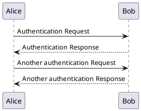

## Declaring participants

Although participants are auto-created, declaring them explicitly lets you control their **left-to-right order**, give them a **display name** different from the short alias you type, assign **colors**, and choose a **shape** other than the default box.

### Participant shapes

PlantUML offers ten participant keywords, each drawn with a distinct UML icon:

- `participant` — the default rectangle.
- `actor` — a stick figure.
- `boundary` — a boundary/interface symbol.
- `control` — a controller symbol.
- `entity` — an entity symbol.
- `database` — a cylinder.
- `collections` — stacked rectangles.
- `queue` — a queue symbol.

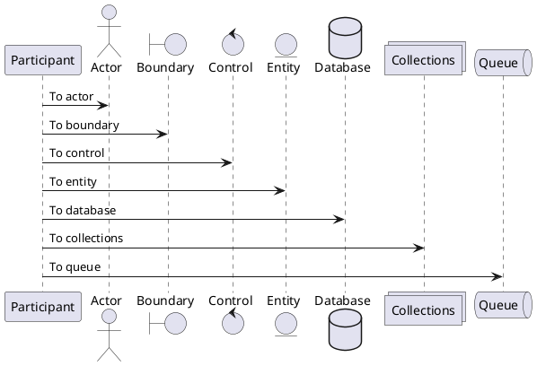

### Aliasing with `as`

The `as` keyword separates the **display label** (which can contain spaces and Creole markup) from the short **alias** you use in the arrows. This keeps your message lines terse while the rendered boxes stay readable.

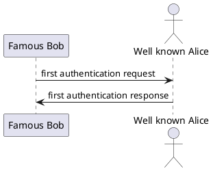

### Forcing display order with `order`

Participants normally appear in order of first use. Add `order <number>` to override that — lower numbers sit further left. This is the reliable way to lay out participants regardless of which message mentions them first.

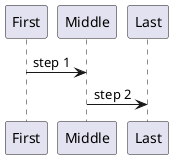

### Colors and multi-line participants

You can append a color (a named color or a `#RRGGBB` value) to a declaration to tint the participant box. A participant can also carry a two-part label with a bold title and a smaller subtitle, using the `[= Title ---- Subtitle]` form.

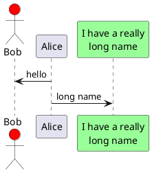

## Arrow styles

Arrows are extremely configurable. You can vary the **line** (solid vs. dashed, thin vs. normal) and the **arrowhead** (full, thin, open circle, cross), and you can set a per-arrow **color and style** inline.

### Heads and lines

- `->x` — a *lost* message (the arrowhead is a cross).
- `->o` — a circle at the end of the arrow.
- `o->o` — circles at both ends.
- `<->` — a bidirectional arrow.
- `->>` — a thin (open) arrowhead.
- `-\` and `\\-` — only the top or bottom half of the arrowhead.
- `//--` and `->>` combined with dashes — thin dashed variants.

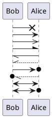

### Inline color and style

Put a bracketed spec directly inside the arrow to color or restyle just that one message: `-[#red]>`, `-[#0000FF]->`, and so on. The color sits between the two dashes.

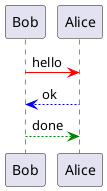

## Message to self

A participant can send a message to itself simply by using the same name on both sides. PlantUML draws a self-loop, and the label can span multiple lines with `\n`.

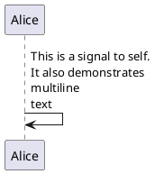

## Text alignment and wrapping

Two skinparams control how message text is laid out. `sequenceMessageAlign` positions the label (`left`, `right`, `center`, or `direction`/`reverseDirection`), while `responseMessageBelowArrow true` moves reply text to just under its arrow.

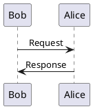

To wrap long labels automatically instead of using manual `\n`, set `skinparam maxMessageSize` to a pixel width.

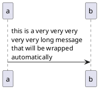

## Autonumbering

`autonumber` prefixes every message with an incrementing counter — invaluable for referring to a specific step in prose.

- `autonumber` starts at 1, incrementing by 1.
- `autonumber <start> <increment>` sets the starting value and step.
- `autonumber "<format>"` applies a Java `DecimalFormat` pattern (e.g. `<b>[000]`), where `0` is a mandatory digit and `#` an optional one. Creole/HTML markup is allowed in the format.
- `autonumber stop` pauses numbering; `autonumber resume` restarts it (optionally with a new increment and/or format).
- `%autonumber%` inserts the current number into a message label.

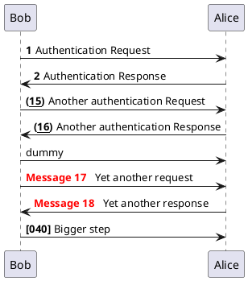

You can also splice the current counter into any label with the `%autonumber%` variable:

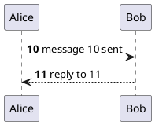

## Lifeline activation, deactivation and destruction

An **activation bar** (a narrow rectangle on the lifeline) shows when a participant is busy handling a call. Use `activate`/`deactivate` explicitly, or the shortcut suffixes on an arrow: `++` activates the target, `--` deactivates the source, and `!!` destroys a participant. Activations nest, and you can color each bar (`activate A #color` or `A ++#color`). `destroy` ends a lifeline with a large cross.

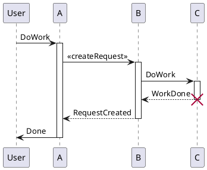

The same flow written with the shortcut suffixes is much more compact. `++` / `--` attach to the arrow, and a color can follow `++`:

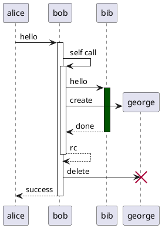

## Return messages

`return` draws a dashed reply arrow from the most recent activation back to whoever called it, and then deactivates that bar. It optionally takes a label. This pairs naturally with `++`.

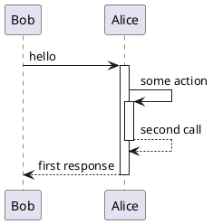

### Automatic activation

Turn on `autoactivate on` and PlantUML activates a participant on each incoming call and deactivates it on each `return`, so you never write `activate`/`deactivate` by hand.

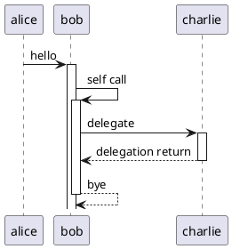

## Grouping messages

Combined fragments group messages under a labeled frame. The keywords are:

- `alt` / `else` — alternatives (branches).
- `opt` — an optional block.
- `loop` — a repeated block (label often "N times" or a condition).
- `par` — parallel blocks separated by `else`.
- `break` — an exception/break-out block.
- `critical` — a critical region.
- `group <label>` — a generic frame with a custom keyword; you can add a secondary label in square brackets: `group Label [details]`.

Every fragment is closed with `end`. Fragments nest freely.

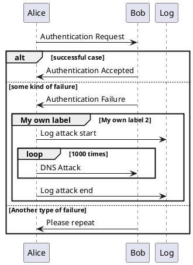

Here are `opt`, `par`, `break` and `critical` together:

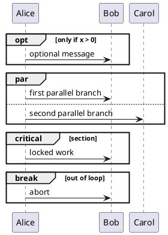

### Colored groups

You can color a group's frame: put the frame color right after the keyword, and (for `alt`) a per-branch background after `else`.

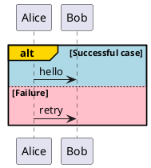

## Notes

Notes attach explanatory text to the diagram. Place a note relative to one participant with `note left of`, `note right of`, or `note over`, or span two participants with `note over A, B`. A note placed immediately after a message with just `note left` / `note right` attaches to that message. Multi-line notes go between `note ... end note`.

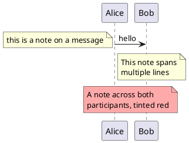

### Note shapes and color

`hnote` draws a hexagonal note and `rnote` a plain rectangle; both accept the same positioning and an optional color.

```plantuml
@startuml
caller -> server : conReq
hnote over caller : idle
caller -> server : conConf
rnote over server
"r" as rectangle
"h" as hexagon
end rnote
rnote over caller, server #aaddaa : shared rectangle note
@enduml
```

## Dividers and delays

A **divider** splits the diagram into labeled sections with `== text ==`. A **delay** marks the passage of time with `...`; add a label as `...text...`.

```plantuml
@startuml
== Initialization ==
Alice -> Bob : Request
Bob --> Alice : Response

== Repetition ==
Alice -> Bob : Another request
...
Bob --> Alice : delayed response
...5 minutes later...
Bob --> Alice : Good Bye !
@enduml
```

## Spacing

Insert extra vertical space with `|||`, or a specific number of pixels with `||nn||`. This is handy for visually separating phases.

```plantuml
@startuml
Alice -> Bob : message 1
Bob --> Alice : ok
|||
Alice -> Bob : message 2
Bob --> Alice : ok
||45||
Alice -> Bob : message 3
Bob --> Alice : ok
@enduml
```

## References

`ref over` draws a reference frame across one or more participants, typically pointing at another diagram. Multi-line references use `ref over ... end ref`.

```plantuml
@startuml
participant Alice
actor Bob

ref over Alice, Bob : init

Alice -> Bob : hello

ref over Alice
  This can be on
  several lines
end ref
@enduml
```

## Incoming and outgoing messages

To draw messages that come from or go to outside the diagram (e.g. an unseen caller), use bracketed lifeline endpoints: `[->` starts from the left border and `->]` ends at the right border. Short variants `?->` and `->?` start/end just next to the participant. All arrow styles work with these.

```plantuml
@startuml
[-> Alice : incoming from the left
Alice ->] : outgoing to the right
[o-> Alice : incoming with circle
Alice ->o] : outgoing with circle
?-> Alice : short incoming
Alice ->? : short outgoing
@enduml
```

## Stereotypes and spots

A participant can carry a UML stereotype in guillemets, `<< stereotype >>`. Add a spot — a small colored letter circle — with `<< (X, #color) >>`. `skinparam stereotypePosition` moves the stereotype above or below the name.

```plantuml
@startuml
participant "Famous Bob" as Bob << Generated >>
participant Alice << (C,#ADD1B2) Testable >>

Bob -> Alice : First message
@enduml
```

## Titles, headers, footers, captions and legends

Frame-level text elements:

- `title` — a heading above the diagram (can be multi-line with `title ... end title`).
- `header` — text in the top-right corner of every page.
- `footer` — text in the bottom-right corner.
- `caption` — a small centered caption under the diagram.
- `legend` / `end legend` — a boxed legend, positionable with `legend top/bottom left/right/center`.

```plantuml
@startuml
header Page Header
footer Page %page% of %lastpage%

title Example Sequence Diagram

Alice -> Bob : Authentication Request
Bob --> Alice : Authentication Response

caption This is a caption

legend right
  Short
  legend text
end legend
@enduml
```

## Boxes around participants

`box "Label" ... end box` draws a colored rectangle around a group of adjacent participants — great for showing which service a set of components belongs to. An optional color follows the label.

```plantuml
@startuml
box "Internal Service" #LightBlue
    participant Bob
    participant Alice
end box
participant Other

Bob -> Alice : hello
Alice -> Other : contact external
@enduml
```

## Creating participants during the diagram

Declaring a participant with `create` (before its first message) shows it being instantiated at that point in time rather than existing from the start. The `create` keyword accepts any participant shape, and the `**` arrow suffix is the shortcut form.

```plantuml
@startuml
Bob -> Alice : hello

create Other
Alice -> Other : new

create control String
Alice -> String
note right : You can also create control instances

Alice --> Bob : ok
@enduml
```

## Hiding the footer box

By default PlantUML repeats the participant boxes at the bottom of the diagram (the "footbox"). Remove them with `hide footbox`. You can also hide participants that have no messages with `hide unlinked`.

```plantuml
@startuml
hide footbox
title Footer removed

Alice -> Bob : Authentication Request
Bob --> Alice : Authentication Response
@enduml
```

## Anchors and duration (teoz)

The newer **teoz** rendering engine enables horizontal *anchors* and message *durations*. Enable it with `!pragma teoz true`. Name a point on a message with `{name}` and then use two anchors to draw a timing/duration arrow between them. Teoz also allows parallel messages joined with `&` and nested boxes.

```plantuml
@startuml
!pragma teoz true

Bob -> Alice : hello
note right Alice : some note
Alice -> Bob : ok
@enduml
```

Parallel messages fired at the same instant use `&`:

```plantuml
@startuml
!pragma teoz true
Alice -> Bob : start
Bob -> Charlie : first & Bob -> David : second
@enduml
```

## Page splitting

`newpage` breaks a long diagram into multiple images/pages; supply optional title text for the new page. The `%page%` and `%lastpage%` variables (see the footer example above) then number the pages.

```plantuml
@startuml
Alice -> Bob : message 1
Alice -> Bob : message 2

newpage

Alice -> Bob : message 3
Alice -> Bob : message 4

newpage A title for the\nlast page

Alice -> Bob : message 5
Alice -> Bob : message 6
@enduml
```

## Styling with skinparam

`skinparam` restyles the whole diagram. Useful sequence-specific parameters include the `sequence { ... }` block (arrow, actor, lifeline, participant colors and borders), `sequenceArrowThickness`, `roundcorner`, `ParticipantPadding`, `BoxPadding`, and `actorStyle` (`stick`, `awesome`, `hollow`). Setting `style strictuml` produces UML-compliant thin triangular arrowheads.

```plantuml
@startuml
skinparam sequenceArrowThickness 2
skinparam roundcorner 20
skinparam actorStyle awesome
skinparam sequence {
    ArrowColor DeepSkyBlue
    ActorBorderColor DeepSkyBlue
    LifeLineBorderColor blue
    LifeLineBackgroundColor #A9DCDF
    ParticipantBorderColor DeepSkyBlue
    ParticipantBackgroundColor DodgerBlue
    ParticipantFontColor White
    ActorBackgroundColor aqua
}

actor User
participant "First Class" as A
participant "Second Class" as B

User -> A : DoWork
activate A
A -> B : Create Request
activate B
B --> A : Request Created
deactivate B
A --> User : Done
deactivate A
@enduml
```

## Putting it together

A slightly larger example that combines participants, activation, groups, notes, autonumber and a divider — the kind of diagram you would actually ship in docs:

```plantuml
@startuml
title Login Flow

autonumber
actor User
participant "Web App" as Web
participant "Auth Service" as Auth
database "User DB" as DB

== Credentials ==
User -> Web ++ : submit login form
Web -> Auth ++ : POST /login
Auth -> DB ++ : lookup user
DB --> Auth -- : user record

alt valid password
    Auth --> Web : 200 + token
    note right : session established
else invalid password
    Auth --> Web : 401 Unauthorized
end
deactivate Auth
Web --> User -- : render result
@enduml
```

## Render it via the API

Any of the examples above can be rendered through the PlantUML API. POST the diagram source as JSON to `/api/v1/render`:

```bash
curl -sS -X POST https://plantuml.joor.net/api/v1/render \
  -H 'content-type: application/json' \
  -d '{
    "source": "@startuml\nAlice -> Bob: Authentication Request\nBob --> Alice: Authentication Response\n@enduml",
    "format": "svg"
  }' \
  -o sequence.svg
```

Set `"format"` to `"svg"`, `"png"`, or `"txt"` (ASCII art) to control the output type. The response body is the rendered diagram.
