# State Diagrams

A **state diagram** (a UML state machine diagram) describes the life-cycle of a single object or
system: the discrete **states** it can be in, and the **transitions** that move it from one state to
another in response to events. Use it whenever behaviour is best explained as "when I am *here* and
*this* happens, I go *there*" — protocol handshakes, UI screens, order/payment workflows, device
power modes, retry/back-off logic, and embedded controllers are all classic fits.

PlantUML renders state diagrams from a compact text syntax. Every example below is a complete,
self-contained diagram delimited by `@startuml` … `@enduml`, so you can paste any one of them
straight into the API and get a picture back. This page walks through every feature the language
supports, from a two-line sketch to concurrent regions, history pseudostates, choice/fork/join and
full styling.

> This page targets the pinned build **PlantUML v1.2026.8** running under
> `SECURITY_PROFILE=INTERNET`. All includes must use bundled standard-library entries with
> angle brackets (`!include <...>`); remote `!includeurl` to arbitrary hosts is disabled. None of the
> examples here need any include.

## The building blocks

Two symbols do most of the work:

- **`[*]`** is the pseudo-state used for both the **initial** (start) point and the **final** (end)
  point of a diagram or of a composite state. Its meaning is inferred from the direction of the
  arrow: `[*] --> X` is a start, `X --> [*]` is an end.
- **`-->`** declares a **transition** (a directed arrow) from one state to another. Writing a state
  name on either side of an arrow is enough to *declare* that state — you rarely need to declare
  states explicitly.

### A minimal state machine

The smallest useful diagram is a start, one state, and an end:

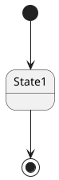

## State descriptions

You can attach one or more lines of descriptive text to a state with `StateName : text`. Repeating
the line adds more rows inside the state box — handy for listing entry/exit actions or invariants.

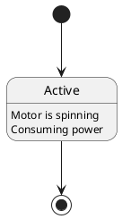

You can freely mix descriptions with transitions. The `scale` command below is a generic PlantUML
directive that rescales the whole image, and `->` is just a shorter arrow (see
[Direction & arrow style](#direction-arrow-style)).

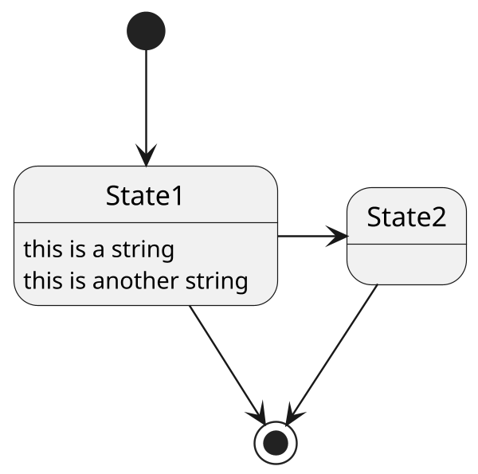

## Long names with `as`

State names are used verbatim as identifiers, so names with spaces, punctuation or line breaks are
awkward to reference. Declare the state once with a quoted label and an **alias** using the `as`
keyword, then use the short alias everywhere else. `\n` inside the quoted label forces a line break.

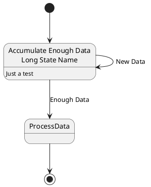

Note that `long1 --> long1` is a **self-transition** — a state can transition back to itself, which is
how you model an event that keeps you in place while running an effect.

## Transitions: events, guards and effects

A transition label is written after a colon: `A --> B : label`. UML gives that label three optional
parts, all of which PlantUML renders as free text (it does not enforce the grammar, but following the
convention keeps diagrams readable):

- **event** — the trigger that fires the transition (e.g. `start`, `stop`, `tick`).
- **guard** — a boolean condition in square brackets, e.g. `[ready]`; the transition only fires when
  it is true.
- **effect** — an action to run, written after a slash, e.g. `/ initialize()`.

The full form is `event [guard] / effect`:

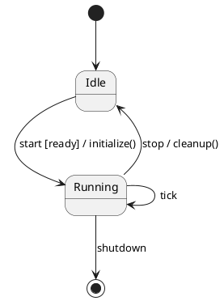

## Composite (nested) states

A **composite state** contains its own sub-states. Open a block with
`state Name { … }` and put transitions (including a nested `[*]` start/end) inside. Nesting can go
several levels deep.

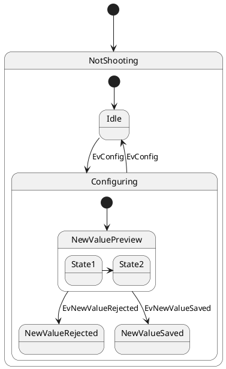

Transitions may cross composite boundaries — declare states inside their blocks and then draw arrows
between them at the top level:

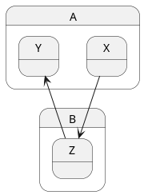

## Concurrent (orthogonal) states

A composite state can contain several **concurrent regions** that are all active at the same time —
for example the independent Num-Lock / Caps-Lock / Scroll-Lock sub-machines of a keyboard. Separate
the regions with a divider *inside* the composite block:

- `--` gives **horizontally** stacked regions (one above the next).
- `||` gives **vertically** stacked regions (side by side).

### Horizontal regions with `--`

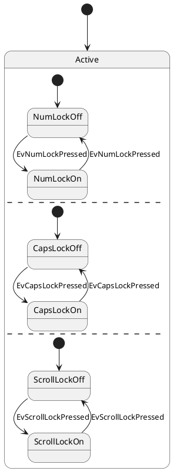

### Vertical regions with `||`

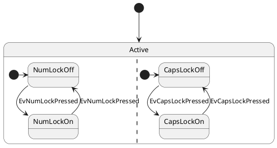

## History pseudostates

A **history** pseudostate remembers which sub-state of a composite was active when the composite was
last exited, so that re-entering resumes there instead of restarting.

- **`[H]`** — *shallow* history: restores the last active sub-state of the immediate region.
- **`[H*]`** — *deep* history: restores the last active configuration at every nesting level.

Draw a transition into `[H]` to model "resume where we left off":

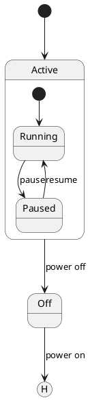

Deep history (`[H*]`) placed inside a composite:

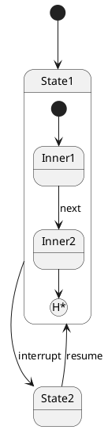

## Choice, fork and join

Special pseudostates are declared by giving a state a **stereotype** in `<<…>>` after its name. The
renderer draws them with the correct UML glyph.

### Choice — conditional branching

`<<choice>>` renders a diamond. Outgoing transitions carry guards and the machine takes whichever
branch matches:

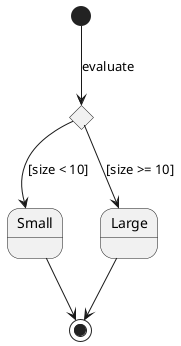

### Fork and join — splitting and merging concurrency

`<<fork>>` splits one flow into several concurrent flows; `<<join>>` synchronises them back into one.
Both render as a thick bar.

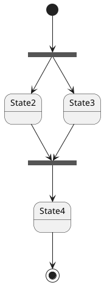

### SDL receive

`<<sdlreceive>>` renders the concave "receive signal" shape used in SDL diagrams:

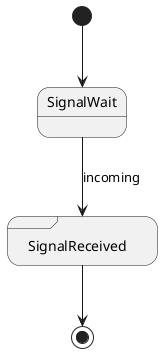

## Entry and exit points

Composite states can expose named connection points on their boundary using `<<entryPoint>>` and
`<<exitPoint>>`. Transitions from the outside connect to these points, and internal transitions
continue from them — this keeps a composite's internal wiring hidden while still exposing well-defined
ports.

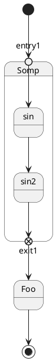

## Pins

Pin-style connection points are available too — `<<inputPin>>` / `<<outputPin>>` (and the expansion
variants `<<expansionInput>>` / `<<expansionOutput>>`). They render as small square ports on the
composite boundary.

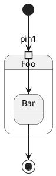

## Notes

Notes attach explanatory text to states or transitions.

- **`note left of X : text`** / **`note right of X : text`** — a one-line note anchored to a state
  (also `note top of` / `note bottom of`).
- A **multi-line** note uses the block form `note … end note`.
- **`note "text" as N1`** — a *floating* note not attached to anything.

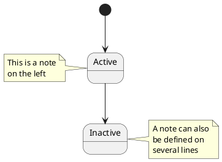

### Notes on a transition

Place a note directly on the most recently declared link with `note on link`:

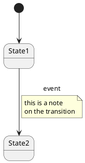

### Floating note

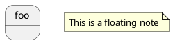

## Direction & arrow style

PlantUML lays states out automatically, but you can nudge the direction of any single transition and
restyle its line.

**Direction** is encoded inside the arrow: `-up->`, `-down->`, `-left->`, `-right->` (single-letter
shorthands `-u->`, `-d->`, `-l->`, `-r->` also work). A bare `->` is the default (usually rightward)
and `-->` is the default (usually downward).

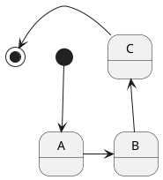

**Line style and colour** go inside square brackets in the arrow: `-[#color]->`, `-[dashed]->`,
`-[dotted]->`, and combinations like `-[#green,dashed]->`.

```plantuml
@startuml
[*] --> A
A -[#red]-> B : red
B -[#green,dashed]-> C : green dashed
C -[dotted]-> [*]
@enduml
```

## Colours and styling

### Inline colours

A state can be tinted inline with `#color` right after its declaration. A richer form lets you set the
fill, line and text independently, choose a gradient (`#red-green`) and set line style with the
`##[dashed]color` suffix:

```plantuml
@startuml
state A #pink
state B #palegreen;line:green;line.bold;text:green
state C #red-green ##[dashed]blue
[*] --> A
A --> B
B --> C
C --> [*]
@enduml
```

### `skinparam state`

The classic way to theme every state at once is a `skinparam state { … }` block. Common keys include
`StartColor`, `EndColor`, `BackgroundColor`, `BorderColor` and `FontName`:

```plantuml
@startuml
skinparam state {
  StartColor MediumBlue
  EndColor Red
  BackgroundColor Peru
  BorderColor Gray
  FontName Impact
}
[*] --> Ready
Ready --> Running
Running --> [*]
@enduml
```

### Style blocks

The modern styling mechanism is a `<style> … </style>` block. Inside `stateDiagram { … }` you can set
box colours and, in a nested `arrow { … }`, the transition colours and fonts:

```plantuml
@startuml
<style>
stateDiagram {
  BackgroundColor Peru
  LineColor Black
  FontColor White
  arrow {
    FontColor Blue
    LineColor Blue
  }
}
</style>
[*] --> A
A --> B
B --> [*]
@enduml
```

## `hide empty description`

By default a state without any description line still draws an empty description compartment. The
`hide empty description` directive removes it, giving simple boxes — often what you want for a clean
control-flow view:

```plantuml
@startuml
hide empty description
[*] --> A
A --> B
B --> [*]
@enduml
```

## Embedding JSON

State diagrams can embed a `json` block, useful for annotating a state with a concrete payload or
configuration document rendered as a structured tree:

```plantuml
@startuml
state A : holds config
json Config {
  "fruit":"Apple",
  "size":"Large",
  "color": ["Red", "Green"]
}
@enduml
```

## Putting it together

This last example combines many of the features above: a start point, nested composite states, a
guarded transition with an effect, a `<<choice>>` pseudostate, a stereotyped state coloured through a
scoped `skinparam`, `hide empty description`, and a note on a composite.

```plantuml
@startuml
hide empty description
skinparam state {
  BackgroundColor<<error>> #ffdddd
}

[*] --> Idle : power on

state Idle {
  [*] --> Waiting
  Waiting --> Ready : configured
}

Idle --> Processing : start [hasJob] / lockResource()

state Processing {
  [*] --> Fetching
  Fetching --> Working : dataReady
  Working --> [*] : done
}

state decide <<choice>>
Processing --> decide
decide --> Idle : [moreJobs]
decide --> Shutdown : [queueEmpty]

state Shutdown <<error>>
Shutdown --> [*]

note right of Processing : Runs the main\nwork loop
@enduml
```

## Quick reference

| Syntax | Meaning |
| --- | --- |
| `[*] --> S` / `S --> [*]` | start point / end point |
| `A --> B : e [g] / f` | transition with event, guard, effect |
| `S : text` | add a description line to state `S` |
| `state "Long name" as s` | declare a state with an alias |
| `state P { … }` | composite (nested) state |
| `--` / `\|\|` | horizontal / vertical concurrent-region separator |
| `[H]` / `[H*]` | shallow / deep history pseudostate |
| `state c <<choice>>` | choice (diamond) |
| `state f <<fork>>` / `<<join>>` | fork / join bar |
| `state r <<sdlreceive>>` | SDL receive shape |
| `<<entryPoint>>` / `<<exitPoint>>` | composite entry / exit port |
| `<<inputPin>>` / `<<outputPin>>` | pin ports |
| `-up-> -down-> -left-> -right->` | force transition direction |
| `-[#red,dashed]->` | colour + line style on a transition |
| `state S #pink` | inline state colour |
| `note left of S : …` / `note on link` | notes on states / transitions |
| `hide empty description` | drop empty description compartments |

## Render it via the API

Send any of the diagrams above to the render endpoint as JSON. The `source` field holds the full
`@startuml … @enduml` text and `format` selects the output (`svg`, `png`, …):

```bash
curl -sS -X POST https://plantuml.joor.net/api/v1/render \
  -H 'content-type: application/json' \
  -d '{
    "source": "@startuml\n[*] --> Idle\nIdle --> Running : start [ready] / initialize()\nRunning --> Idle : stop / cleanup()\nRunning --> [*] : shutdown\n@enduml",
    "format": "svg"
  }' \
  -o state-machine.svg
```

A successful call returns **HTTP 200** with the rendered image in the response body (written to
`state-machine.svg` above). Swap `"format": "svg"` for `"png"` to get a raster image instead.
