# Themes, Styles & Sprites

Every diagram PlantUML draws has a *look*: background colour, line colour, fonts,
corner radius, shadows, arrow shapes. By default you get the classic yellow-boxes
style, but you almost never have to keep it. PlantUML gives you **three layers** of
appearance control, from the highest level to the lowest:

1. **Themes** (`!theme name`) — a single line swaps the entire visual identity of a
   diagram for a curated, ready-made look (dark, sketchy, corporate, retro CRT, …).
2. **Modern styles** (`<style> … </style>`) — a CSS-like language that targets diagram
   elements with selectors and properties. This is the *current, recommended* way to
   customise appearance and is what themes themselves are built on.
3. **Classic `skinparam`** — the original key/value tuning knobs. Still fully supported
   and often the quickest way to flip one switch (`handwritten`, `monochrome`,
   `linetype ortho`), but being progressively superseded by `<style>`.

On top of appearance, PlantUML supports **sprites** — tiny reusable monochrome (or SVG)
images you can drop into titles, notes, stereotypes and element labels with `<$name>`.
Sprites are how the huge icon libraries (AWS, Azure, Kubernetes, font-awesome, office …)
put logos on your diagrams.

This page teaches all four, top to bottom, with runnable examples.

> **Security profile note.** This server runs PlantUML **v1.2026.8** under
> `SECURITY_PROFILE=INTERNET`. Bundled themes and the standard-library sprite sets ship
> *inside* the PlantUML jar and are always available via `!theme name` and
> `!include <...>` angle-bracket includes. Pulling a theme from an **arbitrary remote
> host** (`!theme foo from https://some-host/...`) or using `!includeurl` to fetch
> from external URLs is **blocked** by this profile. Everything documented here uses
> bundled resources only.

---

## Themes

A theme is a pre-packaged bundle of style rules. Applying one is a single directive,
placed anywhere after `@startuml` (conventionally the first line):

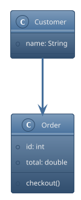

Themes are stored as files named `puml-theme-<name>.puml`; the `<name>` part is exactly
what you pass to `!theme`. Because the theme rules are just style rules, a theme works
across *every* diagram type — sequence, class, activity, component, state, and so on.

### The same diagram under different themes

The best way to feel what a theme does is to render one diagram under several. Here is
the identical sequence diagram four times. Compare backgrounds, arrows and fonts.

**`plain`** — a clean, minimal, flat theme (great default for documentation):

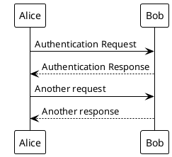

**`cyborg`** — a dark theme (Bootswatch-derived):

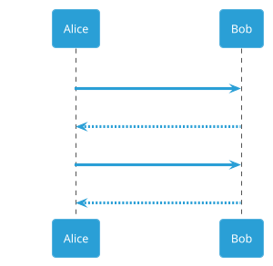

**`crt-green`** — a retro amber/green CRT-terminal look:

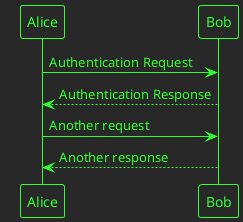

**`sketchy-outline`** — a hand-drawn, whiteboard-style theme:

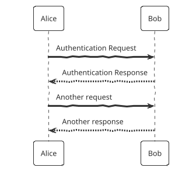

Themes are not limited to sequence diagrams. Here is `mono` (black-and-white, ideal for
print) applied to an activity diagram:

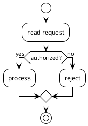

### Enumerating the available themes

There are (at the time of writing) **39 bundled themes**. Two directives let a diagram
document them itself — useful for building a live gallery.

`help themes` renders a table of all built-in themes:

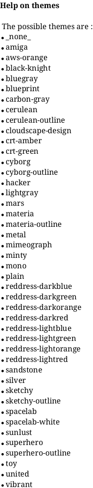

`%get_all_theme()` (a built-in function, PlantUML v1.2024.4+) returns a JSON array of
every theme name. Combined with a `@startjson` diagram it renders as a browsable JSON
tree:

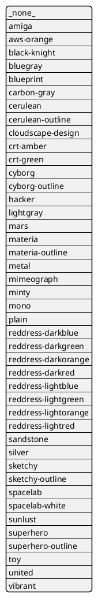

The complete bundled list is:

```
amiga, aws-orange, black-knight, bluegray, cerulean, cerulean-outline,
crt-amber, crt-green, cyborg, cyborg-outline, hacker, lightgray, mars,
materia, materia-outline, metal, minty, mono, plain,
reddress-darkblue, reddress-darkgreen, reddress-darkorange, reddress-darkred,
reddress-lightblue, reddress-lightgreen, reddress-lightorange, reddress-lightred,
sandstone, silver, sketchy, sketchy-outline, spacelab, spacelab-white,
sunlust, superhero, superhero-outline, toy, united, vibrant
```

### Discovering themes through this API

This server exposes the same list as a JSON endpoint, so tools and UIs can offer a theme
picker without parsing diagrams. `GET /api/v1/themes` returns an array of objects, each
with an `id`, a display `name`, and a ready-to-render `preview_source`:

```bash
curl -sS https://plantuml.joor.net/api/v1/themes
```

```json
[
  {
    "id": "amiga",
    "name": "amiga",
    "preview_source": "@startuml\n!theme amiga\nAlice -> Bob: Hello\nBob --> Alice: Hi!\n@enduml"
  },
  {
    "id": "cyborg",
    "name": "cyborg",
    "preview_source": "@startuml\n!theme cyborg\nAlice -> Bob: Hello\nBob --> Alice: Hi!\n@enduml"
  }
]
```

The `preview_source` is exactly what you would POST to `/api/v1/render` to draw that
theme's thumbnail.

The **render endpoint also accepts a `theme` field**, so you can apply a theme *without*
editing the source — handy when the same diagram body is rendered under different looks:

```bash
curl -sS -X POST https://plantuml.joor.net/api/v1/render \
  -H 'content-type: application/json' \
  -d '{
        "source": "@startuml\nAlice -> Bob: Hello\n@enduml",
        "format": "svg",
        "theme": "cyborg"
      }'
```

A `theme` field and an in-source `!theme` directive can coexist; keep to one to avoid
surprises about which wins.

### Themed message helpers

Some sequence-oriented themes define helper procedures such as `$success("...")`,
`$failure("...")` and `$warning("...")` that emit pre-coloured messages. They only exist
when a theme that declares them is active, so guard their use to the specific theme's
documentation rather than assuming every theme provides them.

---

## Modern styling with `<style>`

The `<style> … </style>` block brings a **CSS-like** language into PlantUML. It is the
modern, recommended way to customise appearance and the mechanism themes are built on.
If you know CSS, you already know the shape of it: **selectors** target parts of the
diagram, and inside `{ … }` you set **properties**.

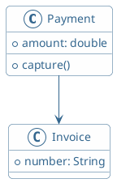

`element` is the **global** selector — it matches everything. That single rule restyled
the boxes, text and connectors of the whole diagram.

### Selectors

Selectors nest to narrow scope. From broadest to most specific:

| Selector kind | Examples | Matches |
|---|---|---|
| Global | `element` | every element in the diagram |
| Document | `document` | the diagram canvas as a whole (e.g. its background) |
| Diagram type | `sequenceDiagram`, `classDiagram`, `objectDiagram`, `mindmap`, `wbsDiagram`, `timingDiagram`, `ganttDiagram`, `jsonDiagram` | all elements of a specific diagram type |
| Component | `participant`, `arrow`, `object`, `node`, `task`, `rootNode`, `leafNode`, `timeline`, `visibilityIcon` | a kind of element inside a diagram |
| Class | `.primary`, `.myGroup` | elements tagged with a matching stereotype `<<primary>>` |
| Depth | `:depth(n)` | hierarchical elements at nesting depth *n* (mindmap/WBS) |

Nesting a component selector inside a diagram-type selector scopes it precisely:

```plantuml
@startuml
<style>
document {
  BackGroundColor #f7f7f7
}
sequenceDiagram {
  arrow {
    LineColor #2c6e49
    LineThickness 2
  }
  participant {
    BackGroundColor #d8f3dc
    LineColor #2c6e49
    RoundCorner 8
  }
}
</style>
participant Client
participant Server
Client -> Server: request
Server --> Client: response
@enduml
```

### Class (stereotype) selectors

Tag any element with a stereotype `<<name>>` and target it with the `.name` class
selector. This is the clean way to give categories of elements a consistent look:

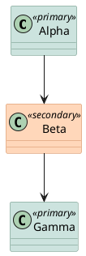

### Properties

The common properties you set inside a rule:

| Property | Effect |
|---|---|
| `BackGroundColor` | element fill colour |
| `LineColor` | border / connector colour |
| `LineThickness` | border / line width (e.g. `2`) |
| `LineStyle` | dash pattern, e.g. `4-2` (dash-gap in px), or `solid`/`dashed`/`dotted` |
| `FontName` | font family |
| `FontColor` | text colour |
| `FontSize` | text size |
| `FontStyle` | `bold`, `italic`, `normal` |
| `RoundCorner` | corner radius |
| `DiagonalCorner` | diagonal cut corner size |
| `Padding` / `Margin` | internal / external spacing |
| `MaximumWidth` | wrap text past this width |
| `Shadowing` | shadow distance (`0` disables) |
| `HorizontalAlignment` | `left`, `center`, `right` |
| `HyperLinkColor`, `HyperlinkUnderlineStyle`, `HyperlinkUnderlineThickness` | link styling |

`LineStyle` and `LineThickness` together give you dashed, thin or thick borders:

```plantuml
@startuml
<style>
element {
  LineStyle 4-2
  LineThickness 1.5
}
node {
  BackGroundColor #eaf4f4
  LineColor #457b9d
}
</style>
node "Web" as web
node "DB" as db
web --> db
@enduml
```

### Precedence

When several rules could apply, the more specific one wins, and later rules override
earlier ones:

- diagram-type selectors override the global `element` rule,
- component selectors override diagram-type rules,
- class selectors and inline definitions are more specific still,
- among equally specific rules, the last one defined wins.

A `<style>` block can live inline in the diagram (as above) or be pulled from a shared
`.puml` file with `!include` so every diagram in a project uses one house style.

---

## Classic `skinparam`

`skinparam` (skin parameter) is PlantUML's original styling mechanism: flat key/value
settings. It is being progressively superseded by `<style>` for complex work, but it is
still fully supported and frequently the fastest way to flip a single behaviour.

**Simple form** — one parameter per line:

```plantuml
@startuml
skinparam backgroundColor #EEEBDC
skinparam handwritten true
skinparam roundcorner 15
skinparam shadowing false
class Widget {
  +render()
}
@enduml
```

**Nested form** — group many parameters under a prefix to avoid repetition. The block
below is equivalent to writing `skinparam sequenceArrowColor …`, `skinparam
sequenceActorBorderColor …`, and so on:

```plantuml
@startuml
skinparam sequence {
  ArrowColor DeepSkyBlue
  ActorBorderColor DeepSkyBlue
  LifeLineBorderColor blue
  LifeLineBackgroundColor #A9DCDF
  ParticipantBorderColor DeepSkyBlue
  ParticipantBackgroundColor DodgerBlue
  ParticipantFontName Impact
  ParticipantFontSize 17
  ParticipantFontColor #A9DCDF
}
actor User
participant "First Class" as A
User -> A: DoWork
@enduml
```

### Frequently useful skinparams

| Skinparam | Effect |
|---|---|
| `backgroundColor <color>` | canvas background (`transparent` works for image output) |
| `handwritten true` | hand-drawn, wobbly line style |
| `monochrome true` | render black & white; `monochrome reverse` for dark background |
| `shadowing false` | turn off drop shadows |
| `roundcorner <n>` | rounded corners on boxes |
| `defaultFontName <font>` / `defaultFontSize <n>` | base font for the whole diagram |
| `linetype ortho` \| `polyline` | right-angle vs straight diagonal connectors |
| `nodesep <n>` / `ranksep <n>` | spacing between nodes / between ranks |
| `dpi <n>` | output resolution |
| `<xxx>FontColor` / `<xxx>FontSize` / `<xxx>FontName` | per-element-type font tuning |
| `sequenceMessageAlign <left\|center\|right\|direction\|reverseDirection>` | message text alignment |

`monochrome` plus a portable font gives clean print output (Helvetica and Courier are
available on all systems):

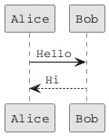

`linetype ortho` routes connectors as right angles — often much clearer for component and
deployment diagrams — and `nodesep`/`ranksep` open up the layout:

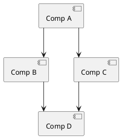

### Element- and stereotype-specific skinparams

Prefix a skinparam with an element type to scope it, and append `<<Stereotype>>` to
target only elements carrying that stereotype:

```plantuml
@startuml
skinparam class {
  BackgroundColor PaleGreen
  BorderColor DarkGreen
}
skinparam classBackgroundColor<<Human>> Gold
class Person <<Human>>
class Robot
Person --> Robot
@enduml
```

> To list every skinparam the engine knows, run the PlantUML jar locally with
> `java -jar plantuml.jar -language`. For new diagrams, prefer `<style>` — it is the
> direction PlantUML is heading and expresses the same intent more consistently.

---

## Sprites

A **sprite** is a small reusable image you embed in a diagram and reference with
`<$name>`. Sprites can appear anywhere text can: in titles, notes, element labels, and
stereotypes. Classic sprites are monochrome with 4, 8, or 16 grey levels; there is also
an inline-SVG form for full detail.

### Defining a sprite by hand

A monochrome sprite is a grid of hex digits. Each digit is one pixel; its value picks a
grey level. With 16 levels you use `0`–`F` (`0` = transparent/background, `F` = darkest).
The optional `[WxH/depth]` header declares width, height and colour depth:

```plantuml
@startuml
sprite $bug [15x15/16] {
  000000000000000
  000000000000000
  00000FEEEF00000
  0000FEEEEEF0000
  000FEE888EEF000
  000FE88888EF000
  00FEE88888EEF00
  0FEEE88888EEEF0
  0FEEEE888EEEEF0
  0FEEEEEEEEEEEF0
  00FEEEEEEEEEF00
  000FEEEEEEEF000
  0000FEEEEEF0000
  00000FEEEF00000
  000000000000000
}
class Report {
  <$bug> defects: int
}
title <$bug> Issue Tracker
@enduml
```

Note the two references: `<$bug>` inside the class member text and again in the `title`.
The same sprite is reused wherever you name it.

### Scaling and colouring

Because monochrome sprites carry no colour of their own, you can tint and resize them at
each use site with `scale=` and `color=`:

```plantuml
@startuml
sprite $star {
  00000F00000
  00000F00000
  0000FFF0000
  FFFFFFFFFFF
  0FFFFFFFFF0
  00FFFFFFF00
  000FFFFF000
  00FF0F0FF00
  0FF00F00FF0
  F000000000F
}
node "Rating" as r
note right of r
  <$star,scale=2,color=orange>
  Featured
end note
@enduml
```

(This sprite omits the `[WxH/depth]` header — PlantUML infers the size from the grid.)

### Listing sprites in a diagram

`listsprites` renders a catalogue of every sprite currently defined or included — the
quickest way to see what an icon library gave you after an `!include`:

```plantuml
@startuml
sprite $ok {
  00000000
  00000010
  00000110
  10001100
  11011000
  01110000
  00100000
  00000000
}
listsprites
@enduml
```

### Encoding sprites from image files

Hand-drawing a grid is fine for tiny icons; for real images use the encoder built into
the jar:

```bash
java -jar plantuml.jar -encodesprite 16z foo.png
```

The format argument is the colour depth — `4`, `8`, or `16` grey levels — with an
optional `z` suffix to compress the output (`4z`, `8z`, `16z`). It prints a
`sprite $foo { … }` block you paste into your diagram. The desktop app additionally
offers *File → Open Sprite Window* to convert clipboard images.

### Standard-library sprite collections

You rarely define sprites by hand in practice. PlantUML bundles large icon libraries
inside the jar — AWS, Azure, GCP, Kubernetes, C4, font-awesome, devicons, material,
office and more — each exposing named sprites (and often convenience macros). Pull them
in with **angle-bracket `!include`**, which is allowed under the INTERNET profile because
the files ship in the jar.

The **office** set gives you business/infrastructure icons; reference each with `<$name>`
after including its file:

```plantuml
@startuml
!include <office/Servers/database_server>
!include <office/Users/user>
rectangle "Client\n<$user>" as u
rectangle "Database\n<$database_server>" as d
u --> d : query
@enduml
```

The **tupadr3** collection wraps font-awesome/devicons and ships helper macros
(`FA_SERVER`, `FA_DATABASE`, …) that create a node *and* place the icon in one call.
Include `<tupadr3/common>` first, then each icon file:

```plantuml
@startuml
!include <tupadr3/common>
!include <tupadr3/font-awesome/server>
!include <tupadr3/font-awesome/database>
FA_SERVER(web, Web Server)
FA_DATABASE(store, Data Store)
web --> store
@enduml
```

> **Discovery tip.** After including a library, drop `listsprites` into a scratch diagram
> to see exactly which sprite names it defined. The macro names (like `FA_SERVER`) and
> the raw sprite names (like `<$database_server>`) are not always the same — check the
> library, or list them.

---

## Putting the layers together

- Reach for a **`!theme`** first — one line, whole-diagram identity, works everywhere,
  and this API can apply it via the `theme` field or list them at `/api/v1/themes`.
- Use **`<style>`** for precise, CSS-like control and for a reusable house style shared
  through `!include`. This is the modern, forward-looking layer.
- Use **`skinparam`** for quick single switches (`handwritten`, `monochrome`,
  `linetype ortho`) and legacy diagrams; migrate to `<style>` when a diagram's styling
  grows complex.
- Use **sprites** (`<$name>`) — hand-defined or, far more commonly, from the bundled
  stdlib icon libraries via `!include <...>` — to put real icons on your diagrams.
