# Timing Diagrams

A **timing diagram** describes how one or more signals change *value over time*. It is the
diagram of choice for hardware and protocol work — bus transactions, clock and enable lines,
digital waveforms, analog voltages — and for any "what state is the system in, and when?"
question: a request that walks through a browser, a DNS resolver and a server; a device that
boots, initializes and idles; a valve whose flow rate steps between levels.

Every timing diagram is a set of **signals** stacked vertically, sharing one horizontal
**time axis**. You declare each signal once (choosing a *rendering style* — `robust`,
`concise`, `binary`, `clock` or `analog`), then move the clock forward with `@` time markers
and assign the signal a new value with the `is` verb. PlantUML draws the transitions,
the waveform edges, and the time labels for you.

This page targets the pinned build **PlantUML v1.2026.8** running under
`SECURITY_PROFILE=INTERNET`. Every example below is complete (`@startuml … @enduml`) and has
been validated against the live rendering API — copy any block verbatim.

> **Build-specific gotcha — read this first.** In this build the **time marker and the state
> assignment must be on separate lines**. Write the marker `@100` on its own line, then the
> assignment `Signal is Value` on the next line. The compact one-liner form `@100 Signal is
> Value` that appears in some online tutorials is **rejected** here with
> *"Syntax Error? (Assumed diagram type: timing)"*. All examples on this page use the
> two-line form. (Messages, constraints, notes and the participant-oriented block form have
> their own single-line syntaxes, described in their sections.)

## Declaring signals

A signal declaration names a rendering style, gives a human-readable label in quotes, and
(optionally) binds a short alias with `as` that you use everywhere else:

```text
robust  "Web Browser" as WB
concise "Web User"    as WU
binary  "Enable"      as EN
clock   "Clock"       as C0 with period 50
analog  "VCC" between -4.5 and 6.5 as VCC
```

The five styles differ only in *how a value is drawn*, not in how you drive them:

| Style | Drawn as | Best for |
|-------|----------|----------|
| `robust` | A ribbon that steps between an arbitrary set of named states, each on its own band | Multi-state signals: `Idle → Loading → Ready` |
| `concise` | A single lane whose label changes; compact, one row high | High-level actors / modes where you only care about the current value |
| `binary` | A square wave between two levels (`low`/`high`, `0`/`1`) | Digital lines, strobes, enables |
| `clock` | An automatically repeating square wave | Reference clocks; you never assign its value |
| `analog` | A line plot with a numeric Y scale, linearly interpolated between points | Voltages, temperatures, flow rates |

### Setting an initial value

Any assignment placed **before the first `@` marker** sets the signal's value at the very
start of the timeline (time zero, before any transition):

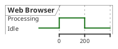

Here `WB is Idle` (with no preceding `@`) is the starting state; the ribbon then steps to
`Processing` at time 0 and back to `Idle` at 200.

## The time axis and the `@` marker

Time advances through **markers**. A marker is a line beginning with `@` followed by a time
value. Everything you write after a marker (until the next marker) happens *at that instant*.

### Absolute time

Plain integers are absolute positions on the axis:

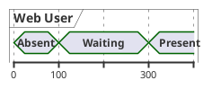

### Relative time with `@+`

Prefix the value with `+` to place the marker *relative to the previous marker*. This lets
you describe durations ("100 units later") instead of computing absolute offsets:

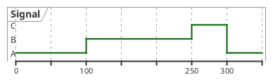

The markers resolve to absolute times 0, 100, 250 and 300.

### Negative time

Markers may be negative, which is handy for showing setup activity that precedes the "zero"
reference point (e.g. `@-200`).

### Anchors — naming a point in time

Give a marker a name with `@<time> as :name`, then refer back to it as `@:name`, optionally
with arithmetic (`@:name+300`, `@:name-2`). Anchors keep a diagram maintainable: shift one
number and everything pinned to it moves too.

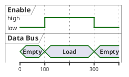

## Assigning values with `is`

Between markers, `Signal is Value` sets that signal's value. You can set several signals
under a single marker — just list one assignment per line:

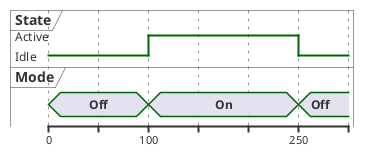

### Constraining the state set with `has`

For a `robust` signal you may declare the full ordered set of states up front with
`Signal has a,b,c`. This fixes the vertical order of the bands (top-to-bottom follows the
order you list) and guards against typos — a value not in the set becomes a new band:

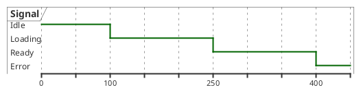

### Human-readable state labels: `has "…" as name`

You can drive a signal with a short internal token but display a friendlier label. Declare
the tokens with `has`, then map each to a display string:

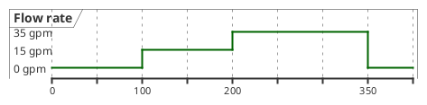

### Undefined / overlapping states with `{…}`

Wrap a comma-separated list in braces to draw an *ambiguous* value — the ribbon shows both
bands crossing, meaning "could be either" (common for bus lines that are transitioning):

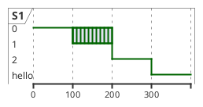

### Hiding a value: `{-}` and `{hidden}`

Assign `{-}` or `{hidden}` to blank the signal for a stretch — useful when a value is
irrelevant or unknown in that window:

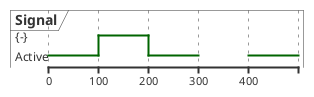

## Binary signals

`binary` renders a two-level square wave. Use `low`/`high` (or `0`/`1`) as values. Append a
`:` annotation to label a specific transition:

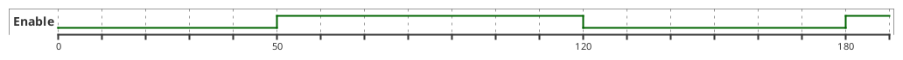

### Annotating transitions

A `: text` suffix on an assignment labels that edge — perfect for calling out `start`,
`stop`, bit values, etc.:

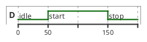

## Clock signals

A `clock` draws a self-repeating square wave — you declare its shape once and never assign
values to it. The parameters:

- `with period N` — the full cycle length (required).
- `pulse P` — the width of the high portion within each period (optional; default is half).
- `offset O` — shift the whole waveform along the axis (optional).

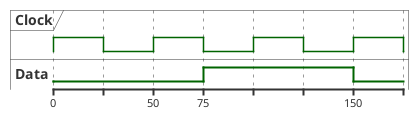

With `pulse` and `offset` you get an asymmetric, shifted clock:

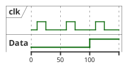

### Driving other signals off the clock: `@clk*n`

Instead of absolute times you can place markers on clock edges with `@<clockAlias>*<n>` —
"the *n*-th tick of this clock". The waveform of `EN` and `D` below is defined purely in
clock ticks, so changing the clock period reflows the whole diagram:

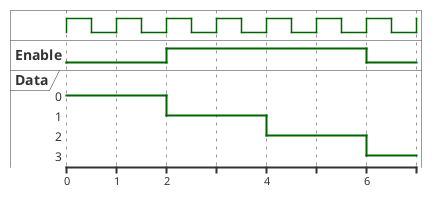

## Analog signals

`analog` plots numeric values on a Y axis and interpolates linearly between the points you
set. Values may be integers or decimals:

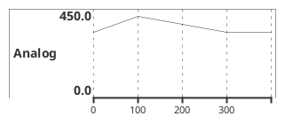

### Fixing the Y range with `between … and …`

By default the axis auto-scales to the values used. Pin it explicitly (including negative
ranges) with `between <min> and <max>` in the declaration:

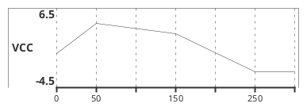

Analog signals also support tick density and pixel height controls
(`VCC ticks num on multiple 3`, `VCC is 200 pixels height`) for fine-tuning the plot.

## Messages between signals

Inside a time block you can draw an **arrow** from one signal to another with `A -> B :
text`, representing a message, event or causal link. Attach a relative-time target to the
destination (`B@+50`) to say "arrives 50 units later":

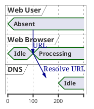

## Time constraints

A **constraint arrow** measures and annotates the distance between two instants. Use the
signal-scoped form `Signal@t1 <-> @t2 : caption` to pin the arrow to one signal's lane, or
the global form `@t1 <-> @t2 : caption`. The `{…}` braces around a caption keep spaces
intact:

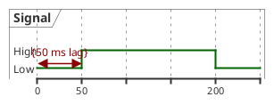

## Highlighting a time window

`highlight <from> to <to> [#color;line:color] : caption` shades a vertical band across the
whole diagram to draw attention to a phase. The color and caption are optional:

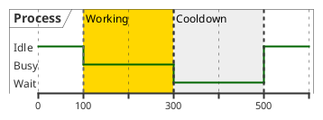

## Notes on signals

Attach a `note top of <signal>` or `note bottom of <signal>` to annotate a signal. Use `\n`
inside the text for line breaks. Notes are available for `concise` and `binary` signals:

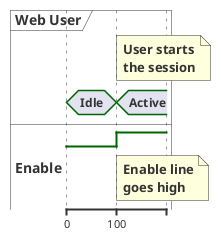

## Colors

Append `#color` (and optionally `;line:color`) to any state assignment to tint that segment.
Standard PlantUML color names and `#RRGGBB` hex values both work:

```plantuml
@startuml
robust "Signal" as S
concise "Line" as LR
@0
S is Idle
LR is Raised
@100
S is Waiting #LightCyan;line:Aqua
LR is Lowered #pink
@250
S is Idle
LR is Raised
@enduml
```

## Scale and the time axis

`scale <units> as <pixels> pixels` sets how much horizontal space a given amount of time
occupies — essential when your timeline spans a wide numeric range and would otherwise be
cramped or enormous:

```plantuml
@startuml
scale 100 as 60 pixels
robust "Signal" as S
@0
S is Low
@100
S is High
@400
S is Low
@1000
S is High
@enduml
```

### Calendar time and date formatting

Markers can be calendar dates (`@2019/07/02`) or clock times. Pair them with
`use date format "…"` (Java `SimpleDateFormat` patterns such as `yy-MM-dd`) to control how
the axis labels are printed:

```plantuml
@startuml
use date format "yy-MM-dd"
concise "Season" as S
@2019/07/02
S is Summer
@2019/10/01
S is Autumn
@2020/01/01
S is Winter
@2020/04/01
S is Spring
@enduml
```

Related axis controls include `hide time-axis` (suppress the axis entirely) and
`manual time-axis` (place tick labels yourself).

## Compact mode

`mode compact` (or the per-signal `compact` keyword) squeezes the vertical spacing so many
signals fit in a small diagram:

```plantuml
@startuml
mode compact
robust "R1" as R1
robust "R2" as R2
concise "C1" as C1
@0
R1 is A
R2 is X
C1 is On
@100
R1 is B
R2 is Y
C1 is Off
@enduml
```

## Participant-oriented (block) form

Rather than grouping assignments by *time*, you can group them by *signal*. Open a block
with `@<signalAlias>`, then list bare time/value lines inside it (`0 is idle`, `+200 is
Proc.` for relative steps). Each block describes one signal's whole life:

```plantuml
@startuml
robust "Web Browser" as WB
concise "Web User" as WU

@WB
0 is idle
+200 is Proc.
+100 is Waiting

@WU
0 is Waiting
+500 is ok
@enduml
```

## Styling with `<style>`

A `<style> … </style>` block gives fine-grained control over the timing diagram's
appearance. Target the whole `document`, the `constraintArrow`, and define reusable
`.class` stereotypes:

```plantuml
@startuml
<style>
timingDiagram {
  document { BackGroundColor SandyBrown }
  constraintArrow { LineStyle 2-1 LineThickness 3 LineColor Blue }
}
</style>
robust "Signal" as S
@0
S is Low
@100
S is High
@250
S is Low
S@0 <-> @100 : delay
@enduml
```

## Diagram-wide text

Timing diagrams accept the usual `title`, `header`, `footer`, `caption` and `legend … end
legend` document texts, exactly as other PlantUML diagrams do.

## A complete worked example

The following read-cycle diagram brings the pieces together: a reference `clock`, a `binary`
chip-select line, two `robust` buses with constrained state sets, a `title`, and a
`highlight` marking the active read window.

```plantuml
@startuml
title Read cycle timing
clock "Clock" as clk with period 50
binary "Chip Select" as cs
robust "Address Bus" as addr
addr has Hi-Z,Valid
robust "Data Bus" as data
data has Hi-Z,Read

@0
cs is high
addr is Hi-Z
data is Hi-Z
@50
cs is low
addr is Valid
@100
data is Read
@150
cs is high
addr is Hi-Z
data is Hi-Z

highlight 50 to 150 #palegreen;line:green : Read window
@enduml
```

## Quick reference

| Construct | Syntax | Notes |
|-----------|--------|-------|
| Declare | `robust\|concise\|binary\|clock\|analog "Label" as ID` | Style + label + alias |
| Clock | `clock "L" as C with period N [pulse P] [offset O]` | Auto square wave |
| Analog range | `analog "L" between MIN and MAX as ID` | Fixed Y axis |
| State set | `ID has a,b,c` | Fixes band order |
| Named state | `ID has "Text" as token` | Display label |
| Initial value | `ID is Value` *(before first `@`)* | Value at start |
| Time marker | `@N` / `@+N` / `@-N` on its own line | Absolute / relative / negative |
| Anchor | `@N as :name` then `@:name[+k]` | Named time point |
| Clock tick | `@clk*n` | n-th edge of clock `clk` |
| Assign | `ID is Value` on the next line | **Never** `@N ID is Value` inline |
| Ambiguous | `ID is {a,b}` | Overlapping bands |
| Hidden | `ID is {-}` / `ID is {hidden}` | Blank the lane |
| Annotation | `ID is Value : text` | Labels the edge |
| Message | `A -> B : text` / `A -> B@+k : text` | Inside a time block |
| Constraint | `ID@t1 <-> @t2 : {caption}` | Measure interval |
| Highlight | `highlight F to T [#c;line:c] : cap` | Shade a window |
| Note | `note top\|bottom of ID : text` | `concise`/`binary` |
| Color | `ID is Value #color;line:color` | Tint a segment |
| Scale | `scale U as P pixels` | Time-to-pixel ratio |
| Dates | `use date format "yy-MM-dd"` + `@YYYY/MM/dd` | Calendar axis |
| Compact | `mode compact` | Tight spacing |

## Render it via the API

Every `plantuml` block above is a complete diagram you can POST to the rendering endpoint.
Send the source as JSON and request `svg` (or `png`):

```bash
curl -sS -X POST https://plantuml.joor.net/api/v1/render \
  -H 'content-type: application/json' \
  -d '{
    "source": "@startuml\nrobust \"Web Browser\" as WB\nWB is Idle\n@0\nWB is Processing\n@200\nWB is Idle\n@enduml",
    "format": "svg"
  }'
```

A successful call returns HTTP `200` with the rendered image in the response body. A syntax
error returns HTTP `422` with a JSON body whose `detail` reads *"Syntax Error? (Assumed
diagram type: timing)"* — if you hit that, the most common cause on this build is putting a
state assignment on the same line as its `@` time marker (see the gotcha at the top).
