# Use Case Diagrams

A **use case diagram** is a UML behavioral diagram that describes *what* a system does from the point of view of the people (or external systems) that interact with it, rather than *how* it does it. It captures **actors** (the roles that use the system), **use cases** (the discrete pieces of functionality the system offers), the **boundary** of the system, and the **relationships** between them. Use case diagrams are ideal for the early, requirements-gathering phase of a project: they give non-technical stakeholders a readable, one-page map of "who can do what" and they help you scope a system before you write a line of code.

PlantUML lets you build these diagrams from plain text. You describe actors, use cases and their links, and the layout engine positions everything for you. This page is an exhaustive reference for the use case syntax available in the pinned build (**PlantUML v1.2026.8**), progressing from the simplest possible diagram to advanced styling, business use cases, boundaries, notes and layout control. Every example below is a complete, self-contained diagram you can copy and render as-is.

## The basics: actors, use cases and a link

The two fundamental elements are the **actor** and the **use case**. In PlantUML there are two interchangeable ways to declare each:

- An **actor** is written either between colons — `:User:` — which draws the classic *stick man*, or with the `actor` keyword — `actor User`. Both produce the same element.
- A **use case** is written either between parentheses — `(Do something)` — or with the `usecase` keyword — `usecase "Do something"`. Both produce the same oval.

You connect elements with an arrow. The simplest arrow is `-->` (an association line). The direction of the arrow only expresses the relationship; PlantUML still chooses the overall layout.

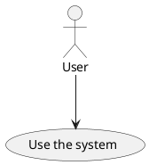

Here is exactly the same diagram written with the keyword forms instead of the shorthand punctuation. Mixing the two notations in one diagram is perfectly legal — use whichever reads best.


## Actors

### Stick man vs. keyword

The colon syntax `:Name:` and the `actor Name` keyword are equivalent. When a name contains spaces or you want a short handle to reference it later, use the `as` alias. You can embed a line break with `\n`.

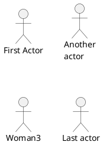

### Actor rendering styles

By default actors are drawn as a stick man. You can switch the whole diagram to alternative styles with `skinparam actorStyle`. The two most useful values are `awesome` (a more modern, filled silhouette) and `Hollow` (an outlined figure). This is a global setting: it affects every actor in the diagram.

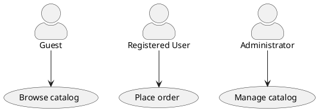

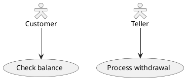

## Use cases

### Parentheses vs. keyword, and aliases

`(Text)` and `usecase "Text"` both create an oval use case. Use `as` to give it an alias you can reference elsewhere in the diagram; the alias can itself be parenthesized. This is essential once diagrams grow, because it lets you write short handles instead of repeating long labels.

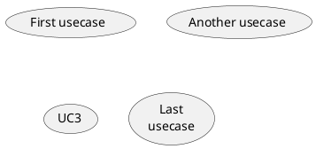

### Multi-line use cases with separators and titles

The text of a use case can span several lines. Inside a quoted label you can use separators to draw horizontal rules and section titles:

- `--` draws a plain separator line.
- `..` draws a dotted separator.
- `==` draws a heavier separator.
- `__` draws an underline-style separator.

Text placed between two `..` markers (e.g. `..Conclusion..`) becomes a small centered title.

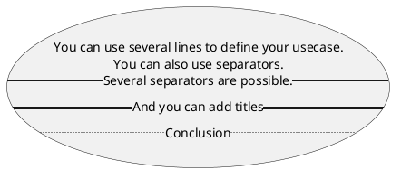

## Relationships between elements

Use case diagrams recognise several standard UML relationships. PlantUML renders them through different arrow syntaxes.

### Association

A plain **association** is a solid line, typically between an actor and a use case, meaning "this actor participates in this use case". Use `-->` (or `--` for an undirected line, or `->` for a shorter horizontal one). You can attach a free-text label after a colon.

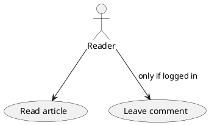

### Include and extend

The two most important use-case-specific relationships are **include** and **extend**. Both are drawn as a dashed arrow `..>` with a stereotype label. Conventionally:

- `(A) ..> (B) : include` means A always uses the behavior of B as part of its flow.
- `(A) ..> (B) : extends` means A optionally adds behavior to B.

PlantUML does not enforce the label text — you write `: include` or `: <<extend>>` yourself. Below both are shown; note the dashed arrow produced by `..>`.

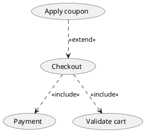

### Generalization / inheritance

**Generalization** (inheritance) is drawn with the hollow-triangle arrow `<|--`. It works both between actors (a specialized actor role) and between use cases. Read `Parent <|-- Child` as "Child is a kind of Parent".

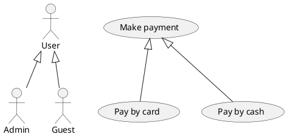

## Arrows: direction and length

### Choosing an explicit direction

Layout is automatic, but you can nudge it. Insert a direction keyword inside the arrow to force where the target is placed relative to the source: `-up->`, `-down->`, `-left->`, `-right->`. Each has a single-letter shorthand: `-u->`, `-d->`, `-l->`, `-r->`.

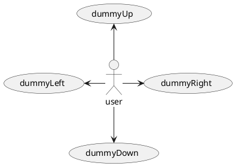

### Arrow length controls layout

The number of dashes in an arrow controls its minimum length: more dashes means a longer arrow, which the layout engine uses as a spacing hint. A single dash `-` tends to produce a horizontal link, while `--` and longer favor vertical spacing.

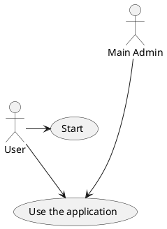

### Reversed arrows

You can also point an arrow the other way with `<--`, `<-`, or `<..`. This is often used to reverse the visual direction without changing the logical relationship.

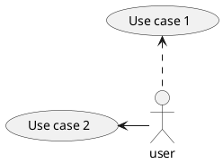

## Boundaries: packages and rectangles

To draw the boundary of the system (or to group related elements) you can wrap them in a `rectangle` or a `package`. Everything declared inside the braces is drawn within the box, and links may cross the boundary. A `rectangle` gives a plain box (the usual system-boundary look); a `package` gives a tabbed folder shape. You can force packages to render like rectangles with `skinparam packageStyle rectangle`.

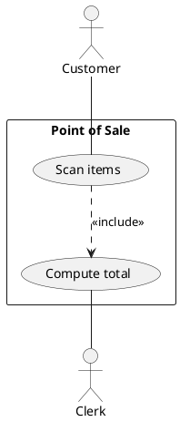

Packages are handy for separating actors from the functionality they use — for example grouping people on one side and system capabilities on the other.

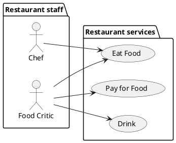

You can also nest boundaries to model subsystems.

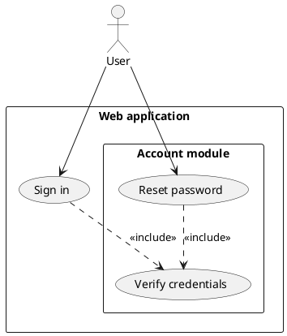

## Notes

### Notes attached to an element

Attach a note to any element with `note <position> of <element>`, where position is `left`, `right`, `top` or `bottom`. A single-line note uses a colon; a multi-line note is opened with `note ...` and closed with `end note`.

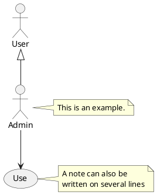

### Floating notes linked to several elements

Declare a standalone note with `note "text" as N` and then connect it to elements with dotted links `..`. This lets one note annotate several use cases at once.

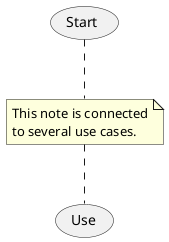

## Stereotypes

You can tag any element with a **stereotype** using guillemets/double angle brackets `<< ... >>`. Stereotypes appear above the element name and are also used as selectors for conditional styling (see below).

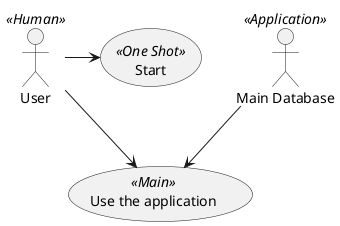

## Styling

### Global use case skinparams

The `skinparam usecase { ... }` block styles every use case at once. You can set background/border/arrow colors, actor colors and fonts, and — powerfully — you can make a setting conditional on a stereotype by appending the `<< Stereo >>` selector to the property name.

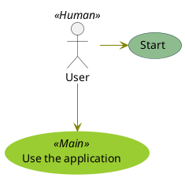

### Inline element styling

Instead of a global skinparam you can color a single element inline right after its declaration. The syntax is `#[fill];line:color;line.[bold|dashed|dotted];text:color`.

```plantuml
@startuml
actor a
actor b #pink;line:red;line.bold;text:red
usecase c #palegreen;line:green;line.dashed;text:green
usecase d #aliceblue;line:blue;line.dotted;text:blue
@enduml
```

### Inline arrow styling

Arrows can be styled inline too, placed between the target and the optional label: `#color;line.[bold|dashed|dotted];text:color`.

```plantuml
@startuml
actor foo
foo --> (bar1) #line:red;line.bold;text:red : red bold
foo --> (bar2) #green;line.dashed;text:green : green dashed
foo --> (bar3) #blue;line.dotted;text:blue : blue dotted
@enduml
```

## Business use cases

UML distinguishes ordinary use cases from **business use cases**. In PlantUML you mark an element as "business" by appending a trailing slash `/`. This works for both use cases and actors, and with either the punctuation or keyword form. Business use cases are drawn with an extra slash through the oval; business actors get a diagonal line across the stick man.

```plantuml
@startuml
(First usecase)/
(Another usecase)/ as (UC2)
usecase/ UC3
usecase/ (Last\nusecase) as UC4
@enduml
```

```plantuml
@startuml
:First Actor:/
:Another\nactor:/ as Man2
actor/ Woman3
actor/ :Last actor: as Person1
@enduml
```

## Layout control

### Left-to-right direction

By default PlantUML stacks elements top-to-bottom. The command `left to right direction` changes the flow to horizontal, which usually produces a much more natural, wide use case diagram with actors on the left and the system on the right. Place it near the top of the diagram.

```plantuml
@startuml
left to right direction
:user1: --> (Usecase 1)
:user2: --> (Usecase 2)
:user2: --> (Usecase 3)
@enduml
```

### Splitting a diagram across pages

`newpage` breaks a single source into multiple diagram pages, which is useful when a use case model becomes too large for one image.

```plantuml
@startuml
:actor1: --> (Usecase1)
newpage
:actor2: --> (Usecase2)
@enduml
```

## A complete, realistic example

Putting the pieces together — direction control, a rectangle boundary, association, include and extend — reproduces the canonical checkout example from the PlantUML documentation.

```plantuml
@startuml
left to right direction
skinparam packageStyle rectangle

actor customer
actor clerk

rectangle checkout {
  customer -- (checkout)
  (checkout) ..> (payment) : include
  (help) ..> (checkout) : extends
  (checkout) -- clerk
}
@enduml
```

A slightly larger model showing actors, generalization, boundaries, include/extend and notes all at once:

```plantuml
@startuml
left to right direction
skinparam actorStyle awesome

actor "Registered User" as User
actor "Administrator" as Admin
User <|-- Admin

rectangle "Online Store" {
  User --> (Browse products)
  User --> (Add to cart)
  (Add to cart) ..> (Browse products) : <<include>>
  User --> (Checkout)
  (Checkout) ..> (Process payment) : <<include>>
  (Checkout) ..> (Apply discount) : <<extend>>
  Admin --> (Manage inventory)
  Admin --> (View reports)
}

note bottom of (Process payment) : Handled by an\nexternal gateway
@enduml
```

## Mixing in other diagram content

With `allowmixing` you can combine a use case diagram with other element types such as JSON data blocks in a single image.

```plantuml
@startuml
allowmixing
actor Actor
usecase Usecase
json JSON {
  "fruit":"Apple",
  "size":"Large",
  "color": ["Red", "Green"]
}
@enduml
```

## Render it via the API

Every example above is a complete diagram. To render one through the server, POST its source to `/api/v1/render`. For instance, the checkout example:

```bash
curl -sS -X POST https://plantuml.joor.net/api/v1/render \
  -H 'content-type: application/json' \
  -d '{
    "source": "@startuml\nleft to right direction\nskinparam packageStyle rectangle\nactor customer\nactor clerk\nrectangle checkout {\n  customer -- (checkout)\n  (checkout) ..> (payment) : include\n  (help) ..> (checkout) : extends\n  (checkout) -- clerk\n}\n@enduml",
    "format": "svg"
  }' \
  -o checkout.svg
```

Set `"format"` to `svg`, `png` or `txt` (ASCII art) depending on the output you need. A successful render returns HTTP `200` with the image body; a malformed diagram returns HTTP `422` with a JSON error describing the syntax problem.
