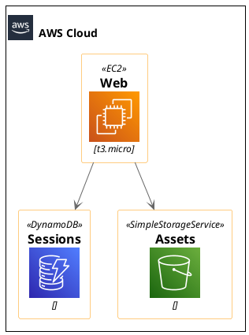
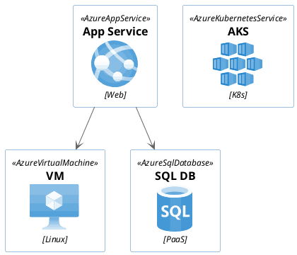
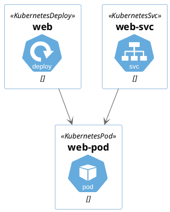
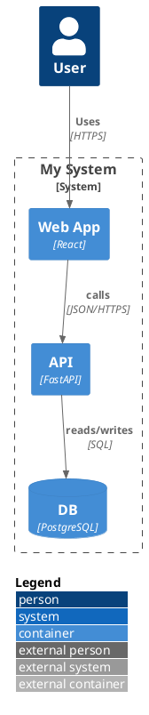
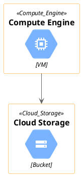
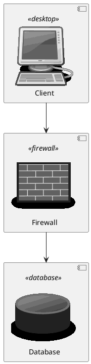
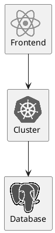
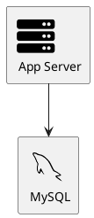
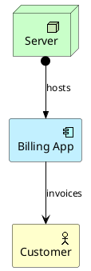

# Architecture icon libraries — verified include paths & macros

All paths below are **bundled in PlantUML stdlib** (v1.2026.x) and work under
`SECURITY_PROFILE=INTERNET` with no remote fetch. Every snippet was validated to render.
Use angle-bracket includes `!include <...>`. Common pitfalls are flagged ⚠.

## AWS (`awslib` — modern icons)

- Macro = the icon file name: `EC2(alias, "label", "tech")`. Groups: `<awslib/Groups/AWSCloud>` → `AWSCloudGroup(alias){ ... }`.
- Add `!include <awslib/AWSSimplified.puml>` for the clean/simplified look.

## Azure (`azure`)

- ⚠ `AzureAppService` lives under `azure/Compute/`, **not** `azure/Web/`.
- ⚠ The macro for `<azure/Databases/AzureSQLDatabase>` is **`AzureSqlDatabase`** (camelCase), even though the file is `AzureSQLDatabase`.

## Kubernetes (`k8s` — macros)

- ⚠ Use `<k8s/...>` (macro library), **not** `<kubernetes/...>` — that namespace is raw sprite
  sheets only (`!include <kubernetes/k8s-sprites-unlabeled-25pct>` then `<$pod>`, `<$master>`…).

## C4 model (`C4`)

- Files: `<C4/C4_Context>`, `<C4/C4_Container>`, `<C4/C4_Component>`, `<C4/C4_Deployment>`,
  `<C4/C4_Dynamic>`, `<C4/C4_Sequence>`.
- Macros: `Person`, `System`, `System_Ext`, `Container`, `ContainerDb`, `Component`,
  `System_Boundary`, `Container_Boundary`, `Rel`, `Rel_U/D/L/R`, `LAYOUT_WITH_LEGEND()`.
- ⚠ The upstream README's `!include https://.../C4_Context.puml` (remote) is **blocked** under
  INTERNET — use the bundled `<C4/...>`.

## GCP (`gcp` — bundled, snake_case)

- ⚠ Folders are CamelCase (`Compute`, `Storage`, `Networking`, `Databases`) but service files &
  macros are **snake_case** (`Compute_Engine`, `Cloud_Storage`, `Cloud_SQL`, `Kubernetes_Engine`).

## Open Security Architecture / network (`osa`)

- ⚠ OSA needs `!include <aws/common>` FIRST (it provides the `PUML_ENTITY` helper).
- Macro = UPPERCASE of the icon (`<osa/firewall/firewall>` → `FIREWALL(alias, "label")`).

## Material icons (`material2.1.19` — sprites)
```plantuml
@startuml
!include <material2.1.19/common>
!include <material2.1.19/folder>
rectangle "Documents\n<$folder>" as docs
@enduml
```
- ⚠ Use `material2.1.19` (versioned). `<material/...>` + `MA_*` macros are broken in this build.
  Reference sprites as `<$icon>`, or use `SPRITE_ENT_L(alias, stereo, "label", icon, "#color")`.

## Office icons (`office`, needs tupadr3)

```plantuml
@startuml
!include <tupadr3/common>
!include <office/Servers/database_server>
OFF_DATABASE_SERVER(db, "Primary DB")
@enduml
```

- ⚠ Requires `<tupadr3/common>` first. Macro = `OFF_<NAME>`.

## Logos (`logos` — sprites, no macros)

- Flat folder; reference `<$name>`. No macros, no common file.

## Devicons & Font Awesome (`tupadr3`)

- Prefixes: `FA5_*` (font-awesome-5), `FA_*` (font-awesome), `DEV_*` (devicons), `DEV2_*`
  (devicons2), `MD_*` (material). Always `<tupadr3/common>` first.

## ArchiMate (`archimate`)


## Discover more
`GET /api/v1/libraries` lists all of these; each example above corresponds to a curated
entry in `GET /api/v1/examples`. Full walk-throughs live at `/help/architecture-libraries`.
